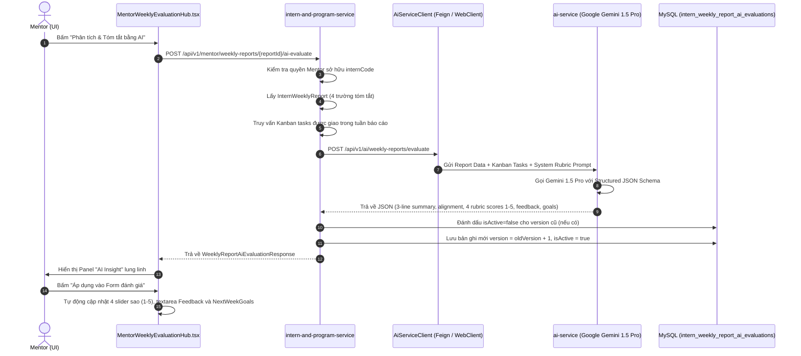

# BẢN ĐẶC TẢ THIẾT KẾ KIẾN TRÚC & ĐẶC TẢ KỸ THUẬT CHI TIẾT (FULL SPECIFICATION)
# TÍNH NĂNG AI-04: AI TÓM TẮT & ĐÁNH GIÁ BÁO CÁO TUẦN CỦA THỰC TẬP SINH

> **Tài liệu đặc tả kiến trúc chính thức:** InternHub Workspace - AI System  
> **Phiên bản:** v1.0-APPROVED-AFTER-GRILL  
> **Ngày phê duyệt:** 2026-10-17  
> **Đối tượng người dùng:** Mentor phụ trách, HR/Admin quản lý thực tập.  
> **Nguyên tắc chất lượng:** Tuân thủ 100% [CONSTRAINTS.md](file:///c:/Users/Luong%20Anh%20Huy/InternHub-Workspace/CONSTRAINTS.md), Test-Driven Development (TDD), Zero suppression, sạch sẽ FQCN.

---

## 1. MỤC TIÊU NGHIỆP VỤ & PHẠM VI (BUSINESS OBJECTIVES & SCOPE)

### 1.1. Vấn đề thực tế (Problem Statement)
- Mentor phải quản lý từ 5 đến 15 thực tập sinh cùng lúc. Vào cuối mỗi tuần, việc đọc kỹ toàn bộ báo cáo tuần (gồm 4 trụ cột văn bản dài: việc hoàn thành, việc dở dang, khó khăn, bài học kinh nghiệm) tốn từ 10 - 20 phút cho mỗi TTS.
- Mentor khó kiểm chứng xem công việc TTS tự khai trong báo cáo có thực sự khớp với tiến độ trên bảng Kanban thực tế hay không (nguy cơ khai khống hoặc bỏ quên việc quan trọng).
- Quá trình chấm điểm và viết nhận xét thủ công thường lặp lại hoặc mang tính cảm tính.

### 1.2. Giải pháp AI-04
1. **Tóm tắt 3 dòng siêu tốc (Đọc trong 15 giây):**
   - Dòng 1: *Tiến độ & Kết quả*: Khái quát công việc cốt lõi đã hoàn thành trong tuần.
   - Dòng 2: *Khó khăn & Rủi ro (Blockers)*: Các vướng mắc công nghệ, rủi ro chậm tiến độ dự án.
   - Dòng 3: *Đề xuất hành động Mentor*: Điểm mấu chốt Mentor cần can thiệp hoặc chất vấn trong buổi 1-on-1.
2. **Đối chiếu Bảng nhiệm vụ Kanban (Kanban Alignment):**
   - Tự động quét các task được phân công cho TTS (`findAssignedItemsByInternIdWithDetails`) có `updatedAt` hoặc `dueDate` nằm trong tuần báo cáo.
   - Đánh giá tỷ lệ tương quan (%) giữa lời khai báo cáo và trạng thái thẻ task Kanban (`DONE` / `IN_PROGRESS` / `TODO`).
   - Cảnh báo trạng thái tương quan: `MATCHED` (Khớp cao >80%), `PARTIAL_MISMATCH` (Khớp một phần 50-80%), `UNVERIFIED_TASKS` (Nghi vấn khai khống hoặc lệch hoàn toàn <50%).
3. **Gợi ý Đánh giá & Soạn sẵn Lời nhận xét theo Chuẩn Thang Điểm 5:**
   - Đề xuất 4 điểm thành phần (1 đến 5 sao) khớp hoàn toàn với giao diện [MentorWeeklyEvaluationHub.tsx](file:///c:/Users/Luong%20Anh%20Huy/InternHub-Workspace/InternHub-Frontend/src/pages/mentor/components/MentorWeeklyEvaluationHub.tsx):
     - `technicalScore` (1 - 5)
     - `attitudeScore` (1 - 5)
     - `teamworkScore` (1 - 5)
     - `productivityScore` (1 - 5)
     - Tự động suy ra `averageScore` = (tổng 4 điểm) / 4.
   - Soạn sẵn `suggestedFeedback` (nhận xét đánh giá chuyên môn và thái độ) và `suggestedNextWeekGoals` (mục tiêu tuần tới).
   - Có nút bấm **"Áp dụng vào đánh giá"** để điền tự động 1-click vào form chấm điểm của Mentor.
4. **Bảo mật & Phân quyền (RBAC):**
   - Chỉ riêng **Mentor** phụ trách trực tiếp và **HR / Admin** mới có quyền kích hoạt và xem AI Insight.
   - **Thực tập sinh tuyệt đối không nhìn thấy** khối phân tích AI này nhằm tránh xung đột hoặc thiên vị định kiến.

---

## 2. QUY TRÌNH LUỒNG DỮ LIỆU & KIẾN TRÚC TÍCH HỢP (SEQUENCE ARCHITECTURE)



---

## 3. THIẾT KẾ CƠ SỞ DỮ LIỆU (DATABASE SCHEMA)

### Bảng mới: `intern_weekly_report_ai_evaluations`
Nằm trong schema của `intern-and-program-service`:

```sql
CREATE TABLE intern_weekly_report_ai_evaluations (
    id BIGINT AUTO_INCREMENT PRIMARY KEY,
    report_id BIGINT NOT NULL,
    intern_code VARCHAR(50) NOT NULL,
    week_number INT NOT NULL,
    version INT NOT NULL DEFAULT 1,
    is_active BOOLEAN NOT NULL DEFAULT TRUE,
    
    -- Tóm tắt 3 dòng sắc bén
    progress_summary TEXT NOT NULL,         -- Dòng 1: Tiến độ và kết quả chính
    blockers_and_risks TEXT NOT NULL,       -- Dòng 2: Khó khăn, rủi ro, vướng mắc
    mentor_action_advice TEXT NOT NULL,     -- Dòng 3: Khuyến nghị hành động cho Mentor

    -- Đối chiếu Nhiệm vụ Kanban
    kanban_alignment_status VARCHAR(30) NOT NULL, -- MATCHED, PARTIAL_MISMATCH, UNVERIFIED_TASKS
    kanban_alignment_score INT NOT NULL,          -- Thang điểm 0 - 100 (% tương quan)
    kanban_discrepancy_details TEXT,              -- Chi tiết phân tích sai lệch giữa khai báo và task thực tế

    -- Gợi ý Đánh giá Chuẩn Thang Điểm 5 (1 - 5 sao)
    suggested_technical_score INT NOT NULL,       -- 1 đến 5
    suggested_attitude_score INT NOT NULL,        -- 1 đến 5
    suggested_teamwork_score INT NOT NULL,        -- 1 đến 5
    suggested_productivity_score INT NOT NULL,    -- 1 đến 5
    suggested_average_score DECIMAL(3,1) NOT NULL,-- Điểm trung bình (1.0 đến 5.0)
    suggested_feedback TEXT NOT NULL,             -- Nhận xét mẫu chuyên nghiệp
    suggested_next_week_goals TEXT,               -- Gợi ý mục tiêu tuần kế tiếp

    -- Metadata kỹ thuật
    model_name VARCHAR(50) NOT NULL DEFAULT 'gemini-1.5-pro',
    prompt_version VARCHAR(50) NOT NULL DEFAULT 'v1.0-weekly-eval-5stars-202610',
    execution_time_ms BIGINT,
    requested_by VARCHAR(100) NOT NULL,           -- Username hoặc ID của Mentor/HR
    created_at TIMESTAMP NOT NULL DEFAULT CURRENT_TIMESTAMP,
    updated_at TIMESTAMP NOT NULL DEFAULT CURRENT_TIMESTAMP ON UPDATE CURRENT_TIMESTAMP,

    CONSTRAINT fk_weekly_report_ai_eval FOREIGN KEY (report_id) REFERENCES intern_weekly_reports(id) ON DELETE CASCADE,
    INDEX idx_ai_eval_report_active (report_id, is_active),
    INDEX idx_ai_eval_intern_week (intern_code, week_number)
);
```

---

## 4. SYSTEM PROMPT & GEMINI STRUCTURED JSON SCHEMA

### 4.1. System Prompt Template (Độ chuẩn xác cao)
```text
BẠN LÀ MỘT TRỢ LÝ GIẢNG VIÊN VÀ CHUYÊN GIA ĐỐI SOÁT THỰC TẬP CÔNG NGHỆ THÔNG TIN CẤP CAO.
Nhiệm vụ của bạn là:
1. Đọc báo cáo tuần của Thực tập sinh (4 trụ cột văn bản).
2. Đối chiếu với danh sách các thẻ nhiệm vụ Kanban thực tế được phân công cho sinh viên trong tuần đó.
3. Xuất ra bản phân tích cô đọng 3 dòng và đề xuất điểm số (THANG ĐIỂM TỪ 1 ĐẾN 5 SAO).

QUY TẮC ĐÁNH GIÁ:
1. TÓM TẮT ĐÚNG 3 DÒNG:
   - progressSummary: Tóm tắt 1 câu ngắn gọn các đầu việc hoàn thành và sản phẩm bàn giao thực tế.
   - blockersAndRisks: Nêu rõ khó khăn kỹ thuật, điểm nghẽn (blocker), hoặc dấu hiệu chậm tiến độ nếu có.
   - mentorActionAdvice: 1 lời khuyên cụ thể Mentor cần chỉ dẫn kỹ thuật hoặc câu hỏi cần chất vấn khi gặp mặt 1-on-1.

2. ĐỐI CHIẾU KANBAN (KANBAN ALIGNMENT):
   - So khớp các việc trong 'completedTasksSummary' với các Task Kanban có trạng thái COMPLETED trong tuần.
   - Tính toán tỷ lệ tương quan kanbanAlignmentScore (0 đến 100).
   - Phân loại:
     * MATCHED (score >= 80): Việc khai báo khớp hoàn toàn với task đã hoàn thành trên bảng Kanban.
     * PARTIAL_MISMATCH (50 <= score < 80): Có làm nhưng có task chưa cập nhật hoặc khai báo chung chung.
     * UNVERIFIED_TASKS (score < 50): Khai báo nhiều việc nhưng trên Kanban không có task tương ứng, hoặc task Kanban bị bỏ dở hoàn toàn.

3. GỢI Ý ĐIỂM SỐ THEO THANG ĐIỂM 5 (SỐ NGUYÊN TỪ 1 ĐẾN 5):
   - technicalScore: Đánh giá độ khó kỹ thuật và chất lượng đầu ra (1 - 5).
   - attitudeScore: Đánh giá sự chủ động, tinh thần trách nhiệm và tính trung thực (1 - 5).
   - teamworkScore: Đánh giá khả năng cộng tác, giao tiếp và báo cáo (1 - 5).
   - productivityScore: Đánh giá năng suất và tiến độ hoàn thành so với mục tiêu (1 - 5).
   - suggestedFeedback: Viết nhận xét khách quan, mang tính xây dựng, chuyên nghiệp.
   - suggestedNextWeekGoals: Đề xuất 2-3 mục tiêu cụ thể cần hoàn thành cho tuần tới.
```

### 4.2. JSON Schema Output từ Gemini
```json
{
  "progressSummary": "string",
  "blockersAndRisks": "string",
  "mentorActionAdvice": "string",
  "kanbanAlignmentStatus": "MATCHED | PARTIAL_MISMATCH | UNVERIFIED_TASKS",
  "kanbanAlignmentScore": 85,
  "kanbanDiscrepancyDetails": "string",
  "suggestedTechnicalScore": 4,
  "suggestedAttitudeScore": 5,
  "suggestedTeamworkScore": 4,
  "suggestedProductivityScore": 4,
  "suggestedFeedback": "string",
  "suggestedNextWeekGoals": "string"
}
```

---

## 5. THIẾT KẾ GIAO DIỆN MENTOR (FRONTEND INTEGRATION)

### 5.1. Vị trí tích hợp
Trong component [MentorWeeklyEvaluationHub.tsx](file:///c:/Users/Luong%20Anh%20Huy/InternHub-Workspace/InternHub-Frontend/src/pages/mentor/components/MentorWeeklyEvaluationHub.tsx):
- Đặt ngay trên đầu cột bên phải (`rightEvaluationColumn` - phía trên khối Rubrics Form).
- Nút bấm chính: **"✨ Tóm tắt & Đánh giá bằng AI"** (Trạng thái loading spinner, hiển thị thời gian phân tích).

### 5.2. Khối AI Insight Panel khi đã có kết quả
- **Header:** Huy hiệu Version hiện tại (ví dụ: `AI Insight #1`), Model `gemini-1.5-pro`, và nút **"🔄 Tái phân tích (Regenerate)"**.
- **Card 3 Dòng Tóm Tắt Nhanh:**
  - 🟢 **Tiến độ:** Màu xanh ngọc / green badge.
  - 🟡 **Rủi ro/Blockers:** Màu vàng cam / warning badge.
  - 🔵 **Mentor Advice:** Màu xanh dương / info badge.
- **Card Đối Chiếu Kanban:**
  - Thanh tiến trình độ tương quan (ví dụ: `85% - MATCHED`).
  - Ghi chú đối soát task: Chỉ ra các task đã khớp và các task nghi vấn lệch bảng.
- **Thanh Hành Động 1-Click:**
  - Nút: **"⚡ Áp dụng Gợi ý của AI vào Form Chấm Điểm"**
  - Khi bấm:
    - Gán `setScores({ technicalScore, attitudeScore, teamworkScore, productivityScore })`.
    - Gán `setFeedback(aiData.suggestedFeedback)`.
    - Gán `setNextWeekGoals(aiData.suggestedNextWeekGoals)`.
    - Hiển thị toast: *"Đã áp dụng toàn bộ điểm và nhận xét gợi ý từ AI. Vui lòng rà soát lại trước khi công bố!"*

---

## 6. KẾ HOẠCH TRIỂN KHAI TEST-DRIVEN DEVELOPMENT (TDD PLAN)

- **Bước 1 (Backend - intern-and-program-service):**
  - Tạo entity [InternWeeklyReportAiEvaluation.java](file:///c:/Users/Luong%20Anh%20Huy/InternHub-Workspace/InternHub/intern-and-program-service/src/main/java/org/example/internservice/intern/entity/InternWeeklyReportAiEvaluation.java).
  - Tạo repository [InternWeeklyReportAiEvaluationRepository.java](file:///c:/Users/Luong%20Anh%20Huy/InternHub-Workspace/InternHub/intern-and-program-service/src/main/java/org/example/internservice/intern/repository/InternWeeklyReportAiEvaluationRepository.java).
  - Viết Unit Test `InternWeeklyReportAiEvaluationServiceTest.java` (Red) kiểm tra luồng versioning và lấy dữ liệu Kanban.
  - Triển khai Service và Controller endpoint `POST /api/v1/mentor/weekly-reports/{reportId}/ai-evaluate` và `GET /api/v1/mentor/weekly-reports/{reportId}/ai-evaluation`.

- **Bước 2 (Backend - ai-service):**
  - Tạo service `AiWeeklyReportGraderService.java` tích hợp Gemini 1.5 Pro với JSON Schema thang điểm 5.
  - Viết unit test kiểm thử parsing response schema và sanitize prompt.

- **Bước 3 (Frontend - Mentor UI):**
  - Tạo service method trong `assessmentService.ts`.
  - Nhúng AI Insight Panel vào [MentorWeeklyEvaluationHub.tsx](file:///c:/Users/Luong%20Anh%20Huy/InternHub-Workspace/InternHub-Frontend/src/pages/mentor/components/MentorWeeklyEvaluationHub.tsx) với đầy đủ hiệu ứng và nút áp dụng điểm.
  - Build kiểm thử `npm run build` không lỗi TypeScript.
