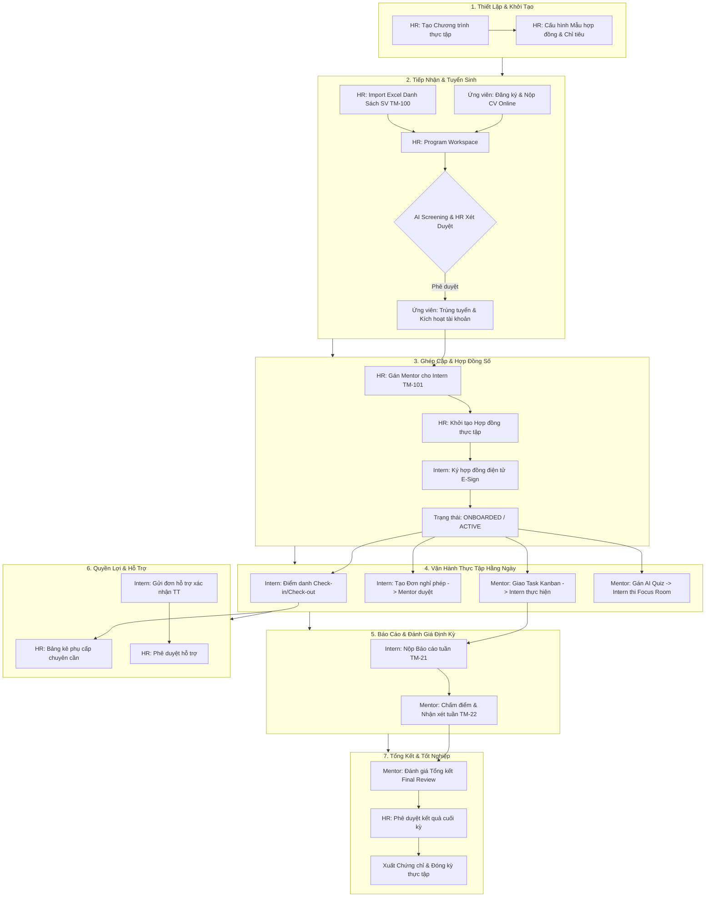

# 📋 KỊCH BẢN KIỂM THỬ E2E TOÀN DIỆN LUỒNG CHÍNH HỆ THỐNG INTERNHUB
## (End-to-End System Core Workflow Test Scenarios)

> **Mã tài liệu:** `TEST-PLAN-E2E-MAIN-FLOW-2026`  
> **Phiên bản:** `v1.0 (Full System Release)`  
> **Hệ sinh thái:** Spring Cloud Microservices + React 18 TypeScript Frontend  
> **Phạm vi:** Kiểm thử liên thông toàn bộ vòng đời thực tập sinh (End-to-End Lifecycle) qua 4 vai trò: **HR**, **Ứng viên/Thực tập sinh (Intern)**, **Người hướng dẫn (Mentor)**, và **Quản trị viên (Admin)**.

---

## 📑 MỤC LỤC
1. [Tổng Quan & Ma Trận Luồng Nghiệp Vụ Cốt Lõi](#1-tổng-quan--ma-trận-luồng-nghiệp-vụ-cốt-lõi)
2. [Môi Trường Kiểm Thử & Dữ Liệu Khởi Tạo (Test Data & Preconditions)](#2-môi-trường-kiểm-thử--dữ-liệu-khởi-tạo)
3. [Giai Đoạn 1: Thiết Lập Chương Trình Thực Tập & Biểu Mẫu (HR / Admin)](#3-giai-đoạn-1-thiết-lập-chương-trình-thực-tập--biểu-mẫu)
4. [Giai Đoạn 2: Tiếp Nhận & Xét Duyệt Ứng Viên (Candidate / HR)](#4-giai-đoạn-2-tiếp-nhận--xét-duyệt-ứng-viên)
5. [Giai Đoạn 3: Phân Bổ Mentor & Ký Kết Hợp Đồng Điện Tử (HR / Mentor / Intern)](#5-giai-đoạn-3-phân-bổ-mentor--ký-kết-hợp-đồng-điện-tử)
6. [Giai Đoạn 4: Vận Hành Thực Tập Hằng Ngày (Chấm Công, Nghỉ Phép, Giao Việc, AI Quiz)](#6-giai-đoạn-4-vận-hành-thực-tập-hằng-ngày)
7. [Giai Đoạn 5: Báo Cáo Tuần & Đánh Giá Định Kỳ (Intern & Mentor)](#7-giai-đoạn-5-báo-cáo-tuần--đánh-giá-định-kỳ)
8. [Giai Đoạn 6: Quản Lý Phụ Cấp & Xử Lý Yêu Cầu Hỗ Trợ (HR & Intern)](#8-giai-đoạn-6-quản-lý-phụ-cấp--xử-lý-yêu-cầu-hỗ-trợ)
9. [Giai Đoạn 7: Đánh Giá Tổng Kết & Hoàn Thành Khóa Thực Tập (Mentor & HR)](#9-giai-đoạn-7-đánh-giá-tổng-kết--hoàn-thành-khóa-thực-tập)
10. [Giai Đoạn 8: Giám Sát Quản Trị, Nhật Ký Kiểm Toán & Bảo Mật (Admin)](#10-giai-đoạn-8-giám-sát-quản-trị-nhật-ký-kiểm-toán--bảo-mật)
11. [Bảng Đánh Giá Kết Quả Kiểm Thử (Pass/Fail Checklist)](#11-bảng-đánh-giá-kết-quả-kiểm-thử)

---

## 1. TỔNG QUAN & MA TRẬN LUỒNG NGHIỆP VỤ CỐT LÕI

Hệ thống **InternHub** vận hành theo chuỗi giá trị khép kín từ lúc doanh nghiệp mở đợt tuyển thực tập sinh đến khi sinh viên tốt nghiệp kỳ thực tập.

---

## 2. MÔI TRƯỜNG KIỂM THỬ & DỮ LIỆU KHỞI TẠO

### 2.1. Cấu Hình Cổng & Dịch Vụ Microservices
| Dịch vụ | Địa chỉ Host / Port | Vai trò kỹ thuật | Trạng thái bắt buộc |
| :--- | :--- | :--- | :--- |
| **API Gateway** | `http://localhost:8080` | Entry point duy nhất, JWT verify, Route | Phải Healthy |
| **Discovery Server (Eureka)** | `http://localhost:8761` | Service Registry | Phải Healthy |
| **Config Server** | `http://localhost:8888` | Quản lý cấu hình tập trung | Phải Healthy |
| **Identity Service** | `http://localhost:8081` | Quản trị tài khoản, Auth, Dynamic RBAC | Đã đăng ký Eureka |
| **Intern & Program Service** | `http://localhost:8082` | Nghiệp vụ thực tập sinh, Task, Hợp đồng | Đã đăng ký Eureka |
| **Reporting & Integration** | `http://localhost:8083` | Audit Logs, Email notification, Backup | Đã đăng ký Eureka |
| **File Service & S3 Mock** | `http://localhost:8084` / `9090` | Lưu trữ file CV, tài liệu, chữ ký | Đã đăng ký Eureka |
| **Redis Broker** | `localhost:6379` | Token Blacklist, Cache, Pub/Sub | Chạy ngầm Docker |
| **Notification Service** | `http://localhost:8085` | WebSocket thông báo thời gian thực | Đã đăng ký Eureka |
| **Service AI** | `http://localhost:8086` | AI CV Screening (TM-103), AI Quiz (TM-104) | Đã đăng ký Eureka |
| **Frontend Web App** | `http://localhost:5173` | Giao diện người dùng React 18 Vite | Đang chạy `npm run dev` |

### 2.2. Danh Sách Tài Khoản Kiểm Thử Mặc Định
| Vai trò (Role) | Username / Email | Mật khẩu | Trang Dashboard mục tiêu |
| :--- | :--- | :--- | :--- |
| 🛡️ **Admin** | `admin` (hoặc `admin@internhub.com`) | `123456` | `/admin/dashboard` |
| 👔 **HR** | `hr` (hoặc `bich.tran@internhub.com`) | `123456` | `/hr/dashboard` |
| 🧑‍🏫 **Mentor** | `mentor` (hoặc `nam.le@internhub.com`) | `123456` | `/mentor/dashboard` |
| 🧑‍🏫 **Mentor Phụ**| `mentor_dev` (`quang.dev@internhub.com`) | `123456` | `/mentor/dashboard` |
| 🎓 **Intern Hiện Hữu** | `intern` (hoặc `minh.pham@gmail.com`) | `123456` | `/intern/dashboard` |
| 👤 **Ứng viên Mới** | Tạo mới trong kịch bản (Kênh nộp đơn Online) | `Password@123` | `/intern/dashboard` |

---

## 3. GIAI ĐOẠN 1: THIẾT LẬP CHƯƠNG TRÌNH THỰC TẬP & BIỂU MẪU

### TC-01: Đăng nhập vai trò Quản lý Nhân sự (HR Login)
* **Người thực hiện:** HR (`hr` / `123456`)
* **Mục tiêu:** Xác thực phiên làm việc của HR, tải dữ liệu phân quyền `ROLE_HR`.
* **Các bước thực hiện:**
  1. Truy cập `http://localhost:5173` trên trình duyệt Chrome.
  2. Nhấp nút **"Đăng nhập"** trên thanh Header.
  3. Nhập Email/Username: `hr`, Mật khẩu: `123456`.
  4. Nhấn **"Đăng nhập"**.
* **Kết quả kỳ vọng:**
  * ✅ Đăng nhập thành công, không phát sinh lỗi Console.
  * ✅ Cookie HttpOnly `internhub_refresh_token` được lưu tự động.
  * ✅ Trình duyệt điều hướng thẳng về `http://localhost:5173/hr/dashboard`.
  * ✅ Thanh điều hướng hiển thị đầy đủ các module HR: Chương trình, Mentor, Hợp đồng, Đánh giá, Phụ cấp, Hỗ trợ.

---

### TC-02: Tạo Chương Trình Thực Tập Mới (Create Internship Program)
* **Người thực hiện:** HR
* **Mục tiêu:** Khởi tạo một đợt thực tập hợp lệ trong hệ thống.
* **Các bước thực hiện:**
  1. Từ Sidebar HR, nhấp vào menu **"Quản lý chương trình"** (`/hr/programs`).
  2. Bấm nút **"+ Tạo chương trình mới"**.
  3. Nhập các thông tin kiểm thử:
     * **Tên chương trình:** `Chương trình Thực tập Full-Stack Mùa Thu 2026`
     * **Mã chương trình:** Tự sinh hoặc nhập `PRG-2026-FALL`
     * **Phòng ban:** `Phát triển Phần mềm (Software Engineering)`
     * **Ngày bắt đầu:** Ngày hiện tại (ví dụ: `2026-10-15`)
     * **Ngày kết thúc:** 3 tháng sau (ví dụ: `2027-01-15`)
     * **Chỉ tiêu tiếp nhận:** `10`
     * **Mô tả:** `Chương trình đào tạo thực tế công nghệ Java Spring Boot & React.`
  4. Bấm nút **"Lưu & Xuất bản"**.
* **Kết quả kỳ vọng:**
  * ✅ Toast thông báo: *"Tạo chương trình thực tập thành công"*.
  * ✅ Chương trình mới xuất hiện trên danh sách với huy hiệu trạng thái `ĐANG MỞ` (`OPEN`).
  * ✅ Số lượng ứng viên hiển thị ban đầu: `0/10`.

---

### TC-03: Kiểm Tra & Cấu Hình Biểu Mẫu Hợp Đồng Mẫu (Contract Template)
* **Người thực hiện:** HR
* **Mục tiêu:** Đảm bảo hệ thống đã sẵn sàng khung hợp đồng điện tử để gửi cho sinh viên.
* **Các bước thực hiện:**
  1. Vào menu **"Quản lý hợp đồng"** (`/hr/contracts`).
  2. Chuyển sang tab **"Mẫu hợp đồng (Templates)"**.
  3. Kiểm tra mẫu hợp đồng mặc định: `Hợp đồng Đào tạo Thực tập Chuẩn InternHub`.
  4. Xem trước (Preview) nội dung hợp đồng, kiểm tra các trường token động: `{{INTERN_NAME}}`, `{{START_DATE}}`, `{{END_DATE}}`, `{{ALLOWANCE_AMOUNT}}`.
* **Kết quả kỳ vọng:**
  * ✅ Văn bản mẫu hiển thị trực quan, đúng định dạng pháp lý và các điều khoản thực tập.
  * ✅ Trạng thái mẫu: `ACTIVE` (Sẵn sàng sử dụng).

---

## 4. GIAI ĐOẠN 2: TIẾP NHẬN & XÉT DUYỆT ỨNG VIÊN

### Nhánh 1: Ứng Tuyển Trực Tuyến (Online Candidate Journey)

#### TC-04: Đăng Ký Tài Khoản Ứng Viên Mới
* **Người thực hiện:** Sinh viên / Ứng viên mới
* **Mục tiêu:** Tạo tài khoản người dùng độc lập trong hệ thống.
* **Các bước thực hiện:**
  1. Mở cửa sổ ẩn danh (Incognito Window) truy cập `http://localhost:5173`.
  2. Nhấp nút **"Đăng ký"** trên Header.
  3. Nhập thông tin:
     * **Họ và tên:** `Trần Văn Thử Nghiệm`
     * **Email:** `thunghiem.tran2026@gmail.com`
     * **Số điện thoại:** `0987654321`
     * **Mật khẩu:** `Password@123`
     * **Xác nhận mật khẩu:** `Password@123`
  4. Bấm **"Đăng ký tài khoản"**.
* **Kết quả kỳ vọng:**
  * ✅ Thông báo đăng ký thành công.
  * ✅ Kích hoạt tài khoản hoặc chuyển thẳng tới giao diện kích hoạt / Đăng nhập.

#### TC-05: Nộp Hồ Sơ Ứng Tuyển & Tải Lên CV (Online Application TM-10 / TM-4)
* **Người thực hiện:** Sinh viên vừa tạo tài khoản
* **Mục tiêu:** Điền hồ sơ năng lực và nộp vào chương trình vừa tạo ở TC-02.
* **Các bước thực hiện:**
  1. Đăng nhập với tài khoản `thunghiem.tran2026@gmail.com` / `Password@123`.
  2. Hệ thống chuyển hướng tới trang Nộp đơn hoặc bấm nút **"Ứng tuyển ngay"** (`/intern/apply`).
  3. Điền thông tin học vấn:
     * **Trường Đại học:** `Đại học Bách Khoa Hà Nội`
     * **Chuyên ngành:** `Công nghệ Thông tin`
     * **Năm sinh:** `2004`
     * **Điểm GPA:** `3.45 / 4.0`
     * **Vị trí ứng tuyển:** `Java / React Intern`
     * **Chương trình chọn:** `Chương trình Thực tập Full-Stack Mùa Thu 2026`
  4. Tải lên tệp CV mẫu (`CV_TranVanThuNghiem.pdf` - tệp PDF thực tế dưới 5MB).
  5. Bấm **"Xác nhận nộp hồ sơ"**.
* **Kết quả kỳ vọng:**
  * ✅ File Service tải tệp lên S3 lưu trữ thành công, trả về Object Key/URL.
  * ✅ Đơn ứng tuyển được tạo với trạng thái `CHỜ DUYỆT` (`PENDING`).
  * ✅ Sinh viên xem được trạng thái: *"Đơn ứng tuyển của bạn đã được gửi đến ban nhân sự"*.

---

### Nhánh 2: Tiếp Nhận Hàng Loạt Qua Excel (HR Batch Import TM-100)

#### TC-06: HR Import Danh Sách Thực Tập Sinh Bằng File Excel
* **Người thực hiện:** HR
* **Mục tiêu:** Đưa sinh viên vào hệ thống nhanh chóng bằng tập tin bảng tính.
* **Các bước thực hiện:**
  1. Trở lại trình duyệt của HR, vào **"Quản lý chương trình"** $\rightarrow$ chọn chương trình vừa tạo $\rightarrow$ mở **"Không gian làm việc (Workspace)"** (`/hr/programs/workspace`).
  2. Nhấp nút **"Import Excel Thực tập sinh"**.
  3. Tải file mẫu `intern_import_template.xlsx` (nếu cần kiểm tra mẫu).
  4. Chọn tệp Excel chứa dữ liệu sinh viên hợp lệ (bao gồm Họ tên, Email, SĐT, Trường, Chuyên ngành, Điểm GPA).
  5. Bấm nút **"Bắt đầu Import"**.
* **Kết quả kỳ vọng:**
  * ✅ Modal hiển thị kết quả kiểm tra dữ liệu (Validation Preview): Số bản ghi hợp lệ, số bản ghi trùng lặp (nếu có).
  * ✅ Bấm xác nhận lưu $\rightarrow$ Hệ thống tự động tạo hồ sơ thực tập sinh vào chương trình.
  * ✅ Danh sách ứng viên trong chương trình tăng lên tương ứng.

---

### Nhánh 3: Xét Duyệt & Sàng Lọc Hồ Sơ (Screening & Approval)

#### TC-07: AI Đánh Giá Tự Động Độ Phù Hợp CV (AI Screening TM-103)
* **Người thực hiện:** HR
* **Mục tiêu:** Đảm bảo Service AI (FastAPI/Spring Boot) phân tích nội dung CV và trả về điểm số tương thích.
* **Các bước thực hiện:**
  1. Tại Program Workspace của HR, chuyển sang tab **"Ứng viên & Tuyển sinh"**.
  2. Tìm đơn của ứng viên `Trần Văn Thử Nghiệm`.
  3. Nhấp nút **"Phân tích AI (AI Screening)"**.
* **Kết quả kỳ vọng:**
  * ✅ Service AI nhận request từ Gateway $\rightarrow$ đọc nội dung PDF từ File Service.
  * ✅ Trả về điểm tương thích (ví dụ: `85/100`), danh sách kỹ năng khớp (`Java`, `Spring Boot`, `SQL`) và gợi ý của AI.
  * ✅ Điểm AI hiển thị ngay trên bảng quản lý ứng viên.

#### TC-08: HR Phê Duyệt Hồ Sơ Ứng Tuyển (Approve Application TM-11 / TM-12)
* **Người thực hiện:** HR
* **Mục tiêu:** Chuyển trạng thái ứng viên từ Ứng tuyển sang Trúng tuyển (Approved) và kích hoạt gửi thông báo.
* **Các bước thực hiện:**
  1. Bấm nút **"Duyệt đơn" (Approve)** tại hồ sơ của ứng viên.
  2. Một hộp thoại xác nhận hiện ra: Nhập lời nhắn chúc mừng và ngày hẹn nhận việc.
  3. Bấm **"Xác nhận phê duyệt"**.
* **Kết quả kỳ vọng:**
  * ✅ Trạng thái ứng viên đổi thành `APPROVED` (Đã trúng tuyển).
  * ✅ Hệ thống sinh thông báo Notification Service và kích hoạt gửi Email chúc mừng (Email mock/real).
  * ✅ Hồ sơ của sinh viên được kích hoạt vai trò thực tập sinh chính thức (`ROLE_INTERN`).

---

## 5. GIAI ĐOẠN 3: PHÂN BỔ MENTOR & KÝ KẾT HỢP ĐỒNG ĐIỆN TỬ

### TC-09: HR Gán Mentor Hướng Dẫn Vào Chương Trình (Assign Mentor TM-101 / TM-16)
* **Người thực hiện:** HR
* **Mục tiêu:** Ghép nối Mentor phụ trách thực tập sinh trong đợt đào tạo.
* **Các bước thực hiện:**
  1. Tại Program Workspace, chuyển sang tab **"Phân bổ Mentor"**.
  2. Bấm nút **"+ Thêm Mentor vào chương trình"** $\rightarrow$ Chọn Mentor: `Lê Hoàng Nam` (tài khoản `mentor`).
  3. Tại bảng danh sách thực tập sinh đã duyệt, tích chọn ứng viên `Trần Văn Thử Nghiệm`.
  4. Bấm **"Gán người hướng dẫn"** $\rightarrow$ Chọn `Lê Hoàng Nam` $\rightarrow$ Bấm **"Lưu phân công"**.
* **Kết quả kỳ vọng:**
  * ✅ Bảng phân bổ cập nhật: Thực tập sinh `Trần Văn Thử Nghiệm` có Mentor phụ trách là `Lê Hoàng Nam`.
  * ✅ Mentor `Lê Hoàng Nam` nhận được thông báo in-app: *"Bạn vừa được phân công hướng dẫn thực tập sinh mới"*.

---

### TC-10: HR Khởi Tạo & Gửi Hợp Đồng Thực Tập (Issue Contract TM-13)
* **Người thực hiện:** HR
* **Mục tiêu:** Sinh hợp đồng cá nhân hóa và chuyển sang trạng thái chờ ký số.
* **Các bước thực hiện:**
  1. Tại Program Workspace hoặc menu **"Quản lý hợp đồng"** (`/hr/contracts`).
  2. Nhấp **"Tạo hợp đồng mới"**.
  3. Chọn Thực tập sinh: `Trần Văn Thử Nghiệm`.
  4. Chọn Mẫu hợp đồng: `Hợp đồng Đào tạo Thực tập Chuẩn InternHub`.
  5. Điền mức phụ cấp thực tập: `3,000,000 VND / tháng`.
  6. Bấm nút **"Ký duyệt (HR) & Gửi cho Thực tập sinh"**.
* **Kết quả kỳ vọng:**
  * ✅ Hợp đồng được tạo với mã định danh duy nhất (VD: `HD-2026-FALL-001`).
  * ✅ Trạng thái hợp đồng: `PENDING_SIGNATURE` (Chờ ký).
  * ✅ Intern nhận được thông báo: *"Bạn có 01 hợp đồng thực tập cần xác nhận và ký số"*.

---

### TC-11: Thực Tập Sinh Ký Hợp Đồng Điện Tử (Intern E-Signature TM-14)
* **Người thực hiện:** Thực tập sinh (`thunghiem.tran2026@gmail.com` hoặc `intern`)
* **Mục tiêu:** Ký chữ ký điện tử trực tiếp trên web browser và xác thực hợp đồng.
* **Các bước thực hiện:**
  1. Đăng nhập tài khoản Thực tập sinh trên giao diện.
  2. Bấm vào biểu tượng thông báo chuông hoặc truy cập menu **"Hợp đồng thực tập"** (`/intern/contract-signing`).
  3. Đọc kỹ văn bản hợp đồng với các thông tin đã được điền tự động (Họ tên, ngày bắt đầu, phụ cấp).
  4. Cuộn xuống mục **"Chữ ký của Thực tập sinh"**.
  5. Dùng chuột/touchpad vẽ chữ ký vào ô Canvas chữ ký (hoặc chọn tải ảnh chữ ký).
  6. Tích chọn ô cam kết: *"Tôi đã đọc, hiểu rõ và đồng ý với mọi điều khoản thực tập"*.
  7. Bấm **"Ký kết hợp đồng"**.
* **Kết quả kỳ vọng:**
  * ✅ Chữ ký được chuyển thành ảnh vector/PNG và gắn chặt vào bản hợp đồng.
  * ✅ Trạng thái hợp đồng chuyển thành `SIGNED` (Đã ký hoàn tất).
  * ✅ Trạng thái thực tập của sinh viên chuyển sang `ACTIVE` / `ONBOARDED`.
  * ✅ Sinh viên được mở khóa đầy đủ quyền truy cập các tính năng: Nhiệm vụ, Chấm công, Báo cáo tuần.

---

## 6. GIAI ĐOẠN 4: VẬN HÀNH THỰC TẬP HẰNG NGÀY

### 6.1. Chấm Công & Điểm Danh (Daily Attendance TM-25)

#### TC-12: Thực Tập Sinh Check-in Điểm Danh Đầu Ca
* **Người thực hiện:** Thực tập sinh (`intern`)
* **Mục tiêu:** Ghi nhận giờ bắt đầu làm việc trong ngày.
* **Các bước thực hiện:**
  1. Vào menu **"Chấm công & Điểm danh"** (`/intern/attendance`).
  2. Kiểm tra ngày giờ hệ thống hiện tại.
  3. Chọn ca làm việc (Ca sáng: 08:30 - 12:00 hoặc Ca cả ngày: 08:30 - 17:30).
  4. Bấm nút lớn **"Check-in Bắt đầu ca làm việc"**.
  5. (Hoặc truy cập trang Quét QR độc lập `/intern/attendance/confirm` để giả lập quét mã QR tại văn phòng).
* **Kết quả kỳ vọng:**
  * ✅ Hệ thống ghi nhận mốc thời gian Check-in chính xác.
  * ✅ Trạng thái ca làm chuyển sang `ĐANG LÀM VIỆC` (In-Progress).
  * ✅ Nút Check-in tự động chuyển trạng thái vô hiệu hóa, bật sáng nút Check-out.

#### TC-13: Thực Tập Sinh Check-out Kết Thúc Ca
* **Người thực hiện:** Thực tập sinh
* **Mục tiêu:** Ghi nhận giờ kết thúc ca và tính công.
* **Các bước thực hiện:**
  1. Tại trang **"Chấm công"**, bấm nút **"Check-out Kết thúc ca làm việc"**.
  2. Nhập ghi chú công việc trong ngày (tùy chọn): *"Hoàn thành module phân quyền"*.
  3. Bấm xác nhận Check-out.
* **Kết quả kỳ vọng:**
  * ✅ Ghi nhận mốc thời gian Check-out.
  * ✅ Hệ thống tính tổng số giờ làm việc thực tế trong ngày.
  * ✅ Lịch sử chấm công trong tháng cập nhật bản ghi mới với trạng thái `HỢP LỆ` (`VALID`).

---

### 6.2. Quản Lý Đơn Xin Nghỉ Phép (Leave Request TM-28)

#### TC-14: Thực Tập Sinh Nộp Đơn Xin Nghỉ Phép
* **Người thực hiện:** Thực tập sinh
* **Mục tiêu:** Gửi đơn xin nghỉ phép có lý do tới Mentor phụ trách.
* **Các bước thực hiện:**
  1. Vào menu **"Nghỉ phép"** (`/intern/leave`).
  2. Bấm nút **"+ Tạo đơn xin nghỉ phép"**.
  3. Chọn ngày nghỉ: Ngày mai.
  4. Chọn loại nghỉ: `Nghỉ phép cá nhân (Lý do việc học ở trường)`.
  5. Chọn thời gian: `Buổi chiều (13:30 - 17:30)`.
  6. Nhập lý do: *"Em có lịch thi kết thúc môn tại trường Đại học."*
  7. Bấm **"Gửi đơn duyệt"**.
* **Kết quả kỳ vọng:**
  * ✅ Đơn xin nghỉ được tạo với trạng thái `CHỜ DUYỆT` (`PENDING`).
  * ✅ Hiển thị trong bảng lịch sử đơn nghỉ của Intern.
  * ✅ Notification gửi tới Mentor phụ trách.

#### TC-15: Mentor Phê Duyệt Đơn Xin Nghỉ Phép
* **Người thực hiện:** Mentor (`mentor` / `123456`)
* **Mục tiêu:** Tiếp nhận và xử lý đơn nghỉ phép của sinh viên trong nhóm.
* **Các bước thực hiện:**
  1. Đăng nhập tài khoản Mentor.
  2. Vào menu **"Duyệt nghỉ phép"** (`/mentor/leave`).
  3. Quan sát đơn nghỉ mới nhất của thực tập sinh `Trần Văn Thử Nghiệm`.
  4. Bấm nút **"Phê duyệt" (Approve)**.
  5. Nhập ghi chú phản hồi: *"Đã đồng ý, em nhớ hoàn thành task bù vào hôm sau nhé."*
  6. Bấm **"Xác nhận duyệt"**.
* **Kết quả kỳ vọng:**
  * ✅ Trạng thái đơn đổi thành `ĐÃ DUYỆT` (`APPROVED`).
  * ✅ Intern nhận được thông báo kết quả duyệt đơn.
  * ✅ Hệ thống không đánh dấu vắng mặt không phép đối với buổi nghỉ này.

---

### 6.3. Giao Việc & Quản Trị Nhiệm Vụ (Mission Kanban TM-102 / TM-19 / TM-20)

#### TC-16: Mentor Giao Nhiệm Vụ Mới Trên Bảng Kanban
* **Người thực hiện:** Mentor
* **Mục tiêu:** Tạo task kỹ thuật cụ thể cho sinh viên thực hiện.
* **Các bước thực hiện:**
  1. Vào menu **"Nhiệm vụ & Workspace"** (`/mentor/missions`).
  2. Chọn chương trình và chọn Thực tập sinh: `Trần Văn Thử Nghiệm`.
  3. Tại cột **"Cần làm (TODO)"**, bấm nút **"+ Thêm nhiệm vụ"**.
  4. Điền thông tin nhiệm vụ:
     * **Tiêu đề:** `Tích hợp Redis Caching cho Module Tra Cứu Chương Trình`
     * **Mô tả:** `Cài đặt Spring Data Redis CacheManager, cấu hình TTL 30 phút cho API GET /api/programs.`
     * **Mức độ ưu tiên:** `Cao (HIGH)`
     * **Hạn hoàn thành (Deadline):** 3 ngày tới
     * **Tiêu chí nghiệm thu (Acceptance Criteria):** `Có Unit test và cache hit/miss log.`
  5. Bấm **"Giao nhiệm vụ"**.
* **Kết quả kỳ vọng:**
  * ✅ Thẻ Task mới xuất hiện trên cột `TODO` của bảng Kanban Mentor.
  * ✅ Intern nhận được thông báo in-app có nhiệm vụ mới được giao.

#### TC-17: Thực Tập Sinh Tiếp Nhận & Cập Nhật Tiến Độ Task
* **Người thực hiện:** Thực tập sinh
* **Mục tiêu:** Kéo thả trạng thái task và nộp sản phẩm hoàn thành.
* **Các bước thực hiện:**
  1. Đăng nhập Intern, truy cập menu **"Nhiệm vụ của tôi"** (`/intern/missions`).
  2. Thấy thẻ task `Tích hợp Redis Caching...` đang ở cột **"TODO"**.
  3. Kéo thẻ sang cột **"ĐANG LÀM (IN PROGRESS)"**.
  4. Sau khi hoàn thành code, nhấp vào thẻ task để mở Drawer chi tiết:
     * Cập nhật tiến độ: `100%`.
     * Nhập ghi chú bàn giao: *"Đã cấu hình RedisCacheConfiguration và thêm test passed 100%."*
     * Đính kèm Link Pull Request: `https://github.com/codegym/internhub/pull/105`.
  5. Kéo thẻ sang cột **"CHỜ DUYỆT (IN REVIEW)"**.
* **Kết quả kỳ vọng:**
  * ✅ Thẻ nằm tại cột `IN REVIEW`.
  * ✅ Mentor nhận được thông báo sinh viên đã nộp kết quả công việc.

#### TC-18: Mentor Nghiệm Thu & Đóng Nhiệm Vụ (Task Completion)
* **Người thực hiện:** Mentor
* **Mục tiêu:** Đánh giá sản phẩm và chốt hoàn thành task.
* **Các bước thực hiện:**
  1. Mentor vào `/mentor/missions`, mở thẻ task tại cột **"IN REVIEW"**.
  2. Xem liên kết Pull Request và ghi chú bàn giao của sinh viên.
  3. Bấm nút **"Nghiệm thu Đạt (Approve & Complete)"**.
  4. Nhập lời nhận xét: *"Code sạch, test case bao phủ tốt. Đạt yêu cầu."*
* **Kết quả kỳ vọng:**
  * ✅ Thẻ task tự động chuyển sang cột **"HOÀN THÀNH (DONE / COMPLETED)"**.
  * ✅ Điểm tích lũy / tiến độ hoàn thành nhiệm vụ của Intern tăng lên.

---

### 6.4. Đánh Giá Năng Lực Bằng AI Quiz (TM-104)

#### TC-19: Mentor Tạo & Gán Bài Kiểm Tra AI Quiz
* **Người thực hiện:** Mentor
* **Mục tiêu:** Sinh bộ câu hỏi trắc nghiệm tự động qua AI và giao cho sinh viên.
* **Các bước thực hiện:**
  1. Trong giao diện Mentor Workspace, vào tab **"Bài kiểm tra (Quiz Hub)"**.
  2. Bấm nút **"+ Tạo bài kiểm tra AI"**.
  3. Nhập yêu cầu cho AI:
     * **Chủ đề:** `Spring Boot Security & JWT Tokens`
     * **Số lượng câu hỏi:** `5 câu`
     * **Độ khó:** `Trung bình (Medium)`
     * **Thời gian làm bài:** `10 phút`
  4. Bấm **"Sinh đề thi bằng AI"** $\rightarrow$ Service AI tự động tạo danh sách 5 câu hỏi trắc nghiệm gồm 4 đáp án và đáp án đúng.
  5. Xem lại các câu hỏi, bấm **"Gán bài thi cho Thực tập sinh"** $\rightarrow$ Chọn `Trần Văn Thử Nghiệm`.
* **Kết quả kỳ vọng:**
  * ✅ Bài thi được khởi tạo và lưu vào hệ thống.
  * ✅ Intern nhận được thông báo có bài kiểm tra năng lực cần làm.

#### TC-20: Thực Tập Sinh Làm Bài Thi Trong Phòng Thi Focus Exam Room
* **Người thực hiện:** Thực tập sinh
* **Mục tiêu:** Làm bài thi trong môi trường độc lập, chống gian lận và xem điểm tự động.
* **Các bước thực hiện:**
  1. Vào menu **"Bài kiểm tra"** (`/intern/quizzes`).
  2. Nhấp nút **"Bắt đầu làm bài"** tại bài thi `Spring Boot Security & JWT Tokens`.
  3. Hệ thống mở giao diện toàn màn hình Focus Exam Room (`/intern/quizzes/:assignmentId/take`).
  4. Đồng hồ đếm ngược 10:00 bắt đầu chạy.
  5. Lần lượt chọn đáp án cho cả 5 câu hỏi.
  6. Bấm **"Nộp bài thi"** và xác nhận nộp.
* **Kết quả kỳ vọng:**
  * ✅ Hệ thống thu bài và tự động chấm điểm ngay lập tức.
  * ✅ Trình duyệt chuyển sang trang Kết quả thi (`/intern/quizzes/submissions/:submissionId`).
  * ✅ Hiển thị điểm số (ví dụ: `80% - 4/5 câu đúng`), chi tiết đáp án đúng và lời giải thích kỹ thuật.
  * ✅ Kết quả điểm số được đồng bộ về Dashboard quản lý của Mentor.

---

## 7. GIAI ĐOẠN 5: BÁO CÁO TUẦN & ĐÁNH GIÁ ĐỊNH KỲ

### TC-21: Thực Tập Sinh Nộp Báo Cáo Tuần (Weekly Report Submission TM-21)
* **Người thực hiện:** Thực tập sinh
* **Mục tiêu:** Báo cáo công việc định kỳ mỗi cuối tuần.
* **Các bước thực hiện:**
  1. Vào menu **"Báo cáo tuần"** (`/intern/weekly-reports`).
  2. Bấm nút **"+ Tạo báo cáo tuần"**.
  3. Chọn Tuần báo cáo: `Tuần 1`.
  4. Điền nội dung báo cáo:
     * **Công việc đã làm:** `Hoàn thành tích hợp Redis Caching, đạt điểm bài thi Spring Security 80%.`
     * **Khó khăn vướng mắc:** `Cần hỗ trợ cấu hình Redis Sentinel ở môi trường Production.`
     * **Kế hoạch tuần tới:** `Bắt đầu xây dựng API Audit Log và đồng bộ dữ liệu ElasticSearch.`
     * **Tự đánh giá:** `Tốt (Good)`.
  5. Bấm **"Nộp báo cáo tuần"**.
* **Kết quả kỳ vọng:**
  * ✅ Báo cáo được gửi thành công, trạng thái: `ĐÃ NỘP` (`SUBMITTED`).
  * ✅ Hệ thống khóa chỉnh sửa nội dung sau khi nộp (trừ khi Mentor yêu cầu làm lại).
  * ✅ Mentor phụ trách nhận được thông báo cần review báo cáo.

---

### TC-22: Mentor Đánh Giá & Chấm Điểm Báo Cáo Tuần (Weekly Assessment TM-22)
* **Người thực hiện:** Mentor
* **Mục tiêu:** Chấm điểm chuyên cần, thái độ và kỹ thuật của sinh viên trong tuần.
* **Các bước thực hiện:**
  1. Đăng nhập Mentor, vào mục **"Đánh giá tuần"** hoặc mở từ thông báo.
  2. Mở báo cáo `Tuần 1` của thực tập sinh `Trần Văn Thử Nghiệm`.
  3. Đọc nội dung báo cáo và nhập thang điểm đánh giá (Thang 10 hoặc A/B/C/D):
     * **Điểm Chuyên cần & Kỷ luật:** `9.5 / 10`
     * **Điểm Tiến độ & Khối lượng công việc:** `9.0 / 10`
     * **Điểm Kỹ thuật & Chất lượng code:** `9.0 / 10`
     * **Điểm Tổng kết tuần:** `9.2 / 10` (Hệ thống tự tính trung bình)
     * **Nhận xét của Mentor:** *"Em nắm bắt công việc nhanh, chủ động giải quyết bài toán. Tiếp tục phát huy trong tuần tới."*
  4. Bấm **"Lưu & Phê duyệt đánh giá"**.
* **Kết quả kỳ vọng:**
  * ✅ Báo cáo chuyển trạng thái sang `ĐÃ ĐÁNH GIÁ` (`REVIEWED`).
  * ✅ Intern nhận được thông báo điểm số và lời nhận xét của Mentor.
  * ✅ Điểm tuần được ghi nhận vào biểu đồ tiến độ năng lực của Intern.

---

## 8. GIAI ĐOẠN 6: QUẢN LÝ PHỤ CẤP & XỬ LÝ YÊU CẦU HỖ TRỢ

### TC-23: HR Thiết Lập & Duyệt Chi Trả Phụ Cấp (Allowance Approval C4)
* **Người thực hiện:** HR
* **Mục tiêu:** Tổng hợp công điểm danh để tính tiền hỗ trợ hàng tháng cho thực tập sinh.
* **Các bước thực hiện:**
  1. Đăng nhập HR, vào menu **"Quản lý phụ cấp"** (`/hr/allowances`).
  2. Chọn Đợt chi trả: `Tháng 10/2026`.
  3. Hệ thống hiển thị bảng tính phụ cấp dựa trên hợp đồng (`3,000,000 VND`) và tỷ lệ ngày công thực tế (Attendance data).
  4. Kiểm tra dòng của thực tập sinh `Trần Văn Thử Nghiệm`.
  5. Bấm nút **"Phê duyệt bảng thanh toán phụ cấp"**.
* **Kết quả kỳ vọng:**
  * ✅ Trạng thái đợt chi trả chuyển thành `ĐÃ DUYỆT` (`APPROVED / PAID`).
  * ✅ Thực tập sinh truy cập `/intern/allowances` thấy ngay lịch sử phiếu phụ cấp tháng với trạng thái chi trả thành công.

---

### TC-24: Xử Lý Yêu Cầu Hỗ Trợ Sinh Viên (Support Requests C4)
* **Người thực hiện:** Intern $\rightarrow$ HR
* **Mục tiêu:** Giải quyết các thủ tục hành chính (Giấy xác nhận thực tập gửi nhà trường).
* **Các bước thực hiện:**
  1. **Intern:** Vào `/intern/support-requests` $\rightarrow$ Bấm **"Gửi yêu cầu hỗ trợ"** $\rightarrow$ Loại: `Cấp Giấy xác nhận đang thực tập tại doanh nghiệp` $\rightarrow$ Ghi chú: *"Em cần nộp về khoa CNTT trường Bách Khoa trước ngày 20"* $\rightarrow$ Bấm Gửi.
  2. **HR:** Nhận được thông báo $\rightarrow$ Vào `/hr/support-requests` $\rightarrow$ Xem chi tiết yêu cầu $\rightarrow$ Bấm **"Chấp thuận & Đính kèm văn bản"** (Tải file PDF giấy xác nhận có mộc dấu) $\rightarrow$ Bấm Hoàn tất.
* **Kết quả kỳ vọng:**
  * ✅ Trạng thái yêu cầu: `HOÀN THÀNH` (`RESOLVED`).
  * ✅ Intern tải được file giấy xác nhận trực tiếp từ hệ thống.

---

## 9. GIAI ĐOẠN 7: ĐÁNH GIÁ TỔNG KẾT & HOÀN THÀNH KHÓA THỰC TẬP

### TC-25: Mentor Đánh Giá Tổng Kết Cuối Khóa (Final Evaluation Summary)
* **Người thực hiện:** Mentor
* **Mục tiêu:** Tổng hợp năng lực toàn khóa và đề xuất hướng phát triển nhân sự.
* **Các bước thực hiện:**
  1. Đăng nhập Mentor, vào Workspace chương trình, chọn tab **"Đánh giá cuối kỳ"**.
  2. Chọn thực tập sinh `Trần Văn Thử Nghiệm`.
  3. Hệ thống tổng hợp điểm trung bình các tuần, số task hoàn thành, tỷ lệ điểm danh.
  4. Mentor điền các tiêu chí cuối kỳ:
     * **Kỹ năng chuyên môn:** `Xuất sắc (Excellent)`
     * **Kỹ năng làm việc nhóm & Giao tiếp:** `Tốt (Good)`
     * **Thái độ học hỏi:** `Xuất sắc (Excellent)`
     * **Đề xuất của Mentor (Recommendation):** `Đề xuất tuyển dụng chính thức (Offer Full-time Junior Developer)`
     * **Nhận xét tổng quát:** *"Sinh viên có tố chất kỹ thuật xuất sắc, có thể tham gia dự án thực tế ngay lập tức."*
  5. Bấm **"Nộp đánh giá tổng kết lên HR"**.
* **Kết quả kỳ vọng:**
  * ✅ Đánh giá của Mentor được ghi nhận với trạng thái `SUBMITTED_TO_HR`.
  * ✅ HR nhận thông báo có hồ sơ hoàn thành khóa cần nghiệm thu.

---

### TC-26: HR Nghiệm Thu Cuối Kỳ & Đóng Khóa Thực Tập (Program Graduation)
* **Người thực hiện:** HR
* **Mục tiêu:** Phê duyệt kết quả cuối cùng, cấp chứng chỉ và cập nhật trạng thái tốt nghiệp.
* **Các bước thực hiện:**
  1. Đăng nhập HR, vào menu **"Đánh giá & Xếp loại"** (`/hr/evaluations`).
  2. Mở hồ sơ của thực tập sinh `Trần Văn Thử Nghiệm`.
  3. Xem toàn bộ điểm số, đánh giá của Mentor và đề xuất tuyển dụng.
  4. Chọn xếp loại tốt nghiệp: `Xuất sắc (Rank A)`.
  5. Bấm nút **"Phê duyệt Hoàn thành thực tập"**.
  6. Bấm nút **"Xuất chứng nhận thực tập (Export Certificate PDF)"**.
* **Kết quả kỳ vọng:**
  * ✅ Trạng thái của thực tập sinh chuyển thành `COMPLETED` / `GRADUATED`.
  * ✅ Tệp PDF Chứng chỉ thực tập được xuất thành công, có đầy đủ logo InternHub, họ tên, xếp loại và chữ ký đại diện doanh nghiệp.
  * ✅ Sinh viên xem được huy hiệu tốt nghiệp trên Dashboard cá nhân.

---

## 10. GIAI ĐOẠN 8: GIÁM SÁT QUẢN TRỊ, NHẬT KÝ KIỂM TOÁN & BẢO MẬT

### TC-27: Admin Kiểm Tra Nhật Ký Kiểm Toán Toàn Hệ Thống (Audit Logs TM-9)
* **Người thực hiện:** Admin (`admin` / `123456`)
* **Mục tiêu:** Xác minh mọi hành động nghiệp vụ cốt lõi từ TC-01 đến TC-26 đều được ghi nhận minh bạch vào Audit Logs.
* **Các bước thực hiện:**
  1. Đăng nhập Admin (`/login` $\rightarrow$ `/admin/dashboard`).
  2. Vào menu **"Nhật ký hoạt động (Audit Logs)"** (`/admin/system`).
  3. Lọc logs theo các sự kiện vừa diễn ra:
     * `CREATE_PROGRAM` (HR tạo chương trình)
     * `APPLY_PROGRAM` (Ứng viên nộp đơn)
     * `APPROVE_APPLICATION` (HR duyệt đơn)
     * `SIGN_CONTRACT` (Intern ký hợp đồng)
     * `ATTENDANCE_CHECKIN` (Intern điểm danh)
     * `SUBMIT_REPORT` & `EVALUATE_REPORT` (Báo cáo tuần)
     * `FINAL_EVALUATION` (Đánh giá tốt nghiệp)
* **Kết quả kỳ vọng:**
  * ✅ Tất cả các sự kiện hiển thị chuẩn xác với đầy đủ: `Timestamp`, `Actor Email`, `Action`, `Resource ID`, `Client IP`, `Response Status (200 OK)`.
  * ✅ Dữ liệu audit được bảo vệ tính toàn vẹn (Append-only).

---

### TC-28: Kiểm Tra Cơ Chế Sao Lưu Dữ Liệu Tự Động & Thủ Công (Data Backup TM-8)
* **Người thực hiện:** Admin
* **Mục tiêu:** Đảm bảo hệ thống có khả năng sao lưu CSDL MySQL an toàn.
* **Các bước thực hiện:**
  1. Tại Admin Dashboard, chuyển sang tab **"Sao lưu & Phục hồi (System Backup)"**.
  2. Bấm nút **"Tạo bản sao lưu ngay (Backup Now)"**.
  3. Hệ thống gọi sang `reporting-and-integration-service` (cổng 8083) để chạy tác vụ dump database `internhub_db`.
* **Kết quả kỳ vọng:**
  * ✅ File backup `.sql` hoặc `.sql.gz` được sinh thành công trong thư mục `/backups`.
  * ✅ Bảng lịch sử backup hiển thị bản ghi mới: Thời gian, Kích thước file, Trạng thái `SUCCESS`.

---

### TC-29: Kiểm Tra Kiểm Soát Truy Cập Phân Quyền (RBAC Security Isolation)
* **Người thực hiện:** Admin / Intern / Mentor
* **Mục tiêu:** Đảm bảo ranh giới bảo mật giữa các vai trò (Role Isolation).
* **Các bước thực hiện:**
  1. Dùng tài khoản **Intern**, thử truy cập trực tiếp URL của HR: `http://localhost:5173/hr/programs` hoặc Admin: `http://localhost:5173/admin/users`.
  2. Dùng tài khoản **Mentor**, thử gọi API duyệt ứng viên hoặc đổi quyền của HR.
  3. Dùng Postman gửi request không có JWT Header tới các endpoint nội bộ.
* **Kết quả kỳ vọng:**
  * ✅ Trình duyệt tự động chặn hoặc chuyển hướng về Dashboard vai trò hợp lệ.
  * ✅ API Gateway chặn request vi phạm với mã lỗi `403 Forbidden` hoặc `401 Unauthorized`.
  * ✅ Không xảy ra hiện tượng rò rỉ dữ liệu chéo vai trò.

---

## 11. BẢNG ĐÁNH GIÁ KẾT QUẢ KIỂM THỬ (PASS/FAIL CHECKLIST)

| STT | Mã Test Case | Tên Kịch Bản Kiểm Thử | Vai Trò | Kết Quả (P/F) | Ghi Chú |
| :---: | :--- | :--- | :---: | :---: | :--- |
| **1** | `TC-01` | Đăng nhập tài khoản Quản lý Nhân sự (HR Login) | HR | [ ] Pass / [ ] Fail | |
| **2** | `TC-02` | Tạo Chương trình Thực tập mới (Create Program) | HR | [ ] Pass / [ ] Fail | |
| **3** | `TC-03` | Cấu hình & Xem trước Mẫu hợp đồng chuẩn | HR | [ ] Pass / [ ] Fail | |
| **4** | `TC-04` | Đăng ký tài khoản Ứng viên mới trực tuyến | Candidate | [ ] Pass / [ ] Fail | |
| **5** | `TC-05` | Nộp hồ sơ ứng tuyển & Tải lên file CV PDF | Candidate | [ ] Pass / [ ] Fail | |
| **6** | `TC-06` | HR Import danh sách sinh viên qua Excel TM-100 | HR | [ ] Pass / [ ] Fail | |
| **7** | `TC-07` | AI Screening chấm điểm mức độ phù hợp của CV | HR / AI | [ ] Pass / [ ] Fail | |
| **8** | `TC-08` | HR Phê duyệt hồ sơ & Kích hoạt quyền Intern | HR | [ ] Pass / [ ] Fail | |
| **9** | `TC-09` | HR Gán Mentor hướng dẫn cho Thực tập sinh | HR | [ ] Pass / [ ] Fail | |
| **10**| `TC-10` | HR Khởi tạo & Gửi hợp đồng thực tập điện tử | HR | [ ] Pass / [ ] Fail | |
| **11**| `TC-11` | Thực tập sinh ký hợp đồng số (E-Signature) | Intern | [ ] Pass / [ ] Fail | |
| **12**| `TC-12` | Thực tập sinh Check-in điểm danh ca làm việc | Intern | [ ] Pass / [ ] Fail | |
| **13**| `TC-13` | Thực tập sinh Check-out kết thúc ca làm việc | Intern | [ ] Pass / [ ] Fail | |
| **14**| `TC-14` | Thực tập sinh tạo Đơn xin nghỉ phép | Intern | [ ] Pass / [ ] Fail | |
| **15**| `TC-15` | Mentor Phê duyệt Đơn xin nghỉ phép | Mentor | [ ] Pass / [ ] Fail | |
| **16**| `TC-16` | Mentor Giao nhiệm vụ kỹ thuật trên bảng Kanban | Mentor | [ ] Pass / [ ] Fail | |
| **17**| `TC-17` | Thực tập sinh cập nhật tiến độ & Nộp kết quả | Intern | [ ] Pass / [ ] Fail | |
| **18**| `TC-18` | Mentor Nghiệm thu & Đóng nhiệm vụ (Complete) | Mentor | [ ] Pass / [ ] Fail | |
| **19**| `TC-19` | Mentor Tạo đề thi trắc nghiệm bằng AI Quiz | Mentor / AI | [ ] Pass / [ ] Fail | |
| **20**| `TC-20` | Thực tập sinh thi trong Focus Exam Room & Chấm điểm | Intern | [ ] Pass / [ ] Fail | |
| **21**| `TC-21` | Thực tập sinh Gửi Báo cáo tuần (Weekly Report) | Intern | [ ] Pass / [ ] Fail | |
| **22**| `TC-22` | Mentor Đánh giá & Cho điểm báo cáo tuần | Mentor | [ ] Pass / [ ] Fail | |
| **23**| `TC-23` | HR Tính toán & Phê duyệt chi trả phụ cấp | HR | [ ] Pass / [ ] Fail | |
| **24**| `TC-24` | Xử lý Yêu cầu hỗ trợ cấp giấy xác nhận TT | Intern / HR | [ ] Pass / [ ] Fail | |
| **25**| `TC-25` | Mentor Đánh giá Tổng kết Cuối kỳ (Final Review) | Mentor | [ ] Pass / [ ] Fail | |
| **26**| `TC-26` | HR Nghiệm thu, Cấp chứng chỉ & Hoàn thành khóa | HR | [ ] Pass / [ ] Fail | |
| **27**| `TC-27` | Admin Kiểm tra Nhật ký kiểm toán (Audit Logs) | Admin | [ ] Pass / [ ] Fail | |
| **28**| `TC-28` | Admin Kiểm tra Sao lưu Dữ liệu hệ thống | Admin | [ ] Pass / [ ] Fail | |
| **29**| `TC-29` | Kiểm tra Bảo mật Cô lập Phân quyền RBAC | Security | [ ] Pass / [ ] Fail | |

---

## 12. HƯỚNG DẪN XỬ LÝ KHI GẶP LỖI (TROUBLESHOOTING GUIDE)

1. **Lỗi `401 Unauthorized` hoặc Mất phiên làm việc:**
   * Kiểm tra cookie `internhub_refresh_token` trong tab Application DevTools.
   * Nếu cookie đã hết hạn, đăng nhập lại để làm mới token.
2. **Lỗi Upload CV hoặc File không hiển thị:**
   * Kiểm tra container `file-service` (cổng 8084) và `s3-storage` (cổng 9090).
   * Đảm bảo Bucket `internhub-documents` đã được khởi tạo trong S3 Mock.
3. **Lỗi AI Screening / Quiz không phản hồi:**
   * Kiểm tra container `service-ai` (cổng 8086).
   * Nếu chạy ở chế độ MOCK (`GEMINI_MOCK_MODE=true`), AI sẽ tự động sinh dữ liệu mẫu chuẩn hóa mà không cần kết nối mạng bên ngoài.
4. **Lỗi Thông báo Thời gian thực (WebSocket / Notification):**
   * Kiểm tra kết nối container `notification-service` (cổng 8085) và `redis-broker` (cổng 6379).
