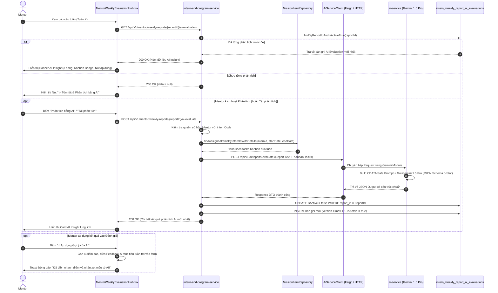

# ĐẶC TẢ KỸ THUẬT (TECHNICAL SPECIFICATION)
# MODULE AI-04: AI TÓM TẮT & ĐỐI SOÁT ĐÁNH GIÁ BÁO CÁO TUẦN THỰC TẬP SINH

> **Mã đặc tả:** SPEC-AI-04-WEEKLY-REPORT-ASSISTANT  
> **Phiên bản:** 2.0 (HARDENED - PRODUCTION READY - SPEC-DRIVEN)  
> **Trạng thái:** DRAFT FOR REVIEW (PHASE 1 - DEFINE)  
> **Tác giả:** Đội ngũ Kỹ thuật & AI Architecture InternHub  
> **Ngày cập nhật:** 2026-10-17  
> **Tuân thủ quy chuẩn:** [CONSTRAINTS.md](file:///c:/Users/Luong%20Anh%20Huy/InternHub-Workspace/CONSTRAINTS.md) | Test-Driven Development (TDD) | Zero suppression | 0 FQCN  
> **Dựa trên quyết định Brainstorming & Đối soát Mã nguồn thực tế:**  
> 1. **On-Demand Mentor Trigger:** Kích hoạt theo ý chí của Mentor, tiết kiệm quota LLM và tránh phân tích khi báo cáo chưa hoàn thiện.
> 2. **Alignment 100% Thang Điểm 5 Sao:** Đồng bộ trực tiếp với [MentorWeeklyEvaluationHub.tsx](file:///c:/Users/Luong%20Anh%20Huy/InternHub-Workspace/InternHub-Frontend/src/pages/mentor/components/MentorWeeklyEvaluationHub.tsx) và [InternWeeklyAssessment.java](file:///c:/Users/Luong%20Anh%20Huy/InternHub-Workspace/InternHub/intern-and-program-service/src/main/java/org/example/internservice/intern/entity/InternWeeklyAssessment.java) (4 cột điểm 1-5 sao, 1-click apply).
> 3. **Kanban Task Cross-Checking:** Quét tự động danh sách tasks được giao cho TTS (`findAssignedItemsByInternIdWithDetails`) trong tuần đối chiếu với nội dung tự khai.
> 4. **Audit Trail & Immutable Versioning:** Bảng `intern_weekly_report_ai_evaluations` lưu vết toàn bộ các lần bấm phân tích/tái phân tích, quản lý trạng thái `version` và `isActive`.
> 5. **Strict RBAC & Privacy Defense:** Bảo mật 100%, che giấu hoàn toàn dữ liệu phân tích AI đối với Thực tập sinh, chỉ phục vụ Mentor và HR/Admin.

---

## 1. MỤC TIÊU & PHẠM VI (GOALS & SCOPE)

### 1.1 Mục tiêu (Goals)
1. **Dành cho Mentor:**
   - **Tóm tắt siêu tốc 15 giây:** Đọc nhanh bản tóm tắt 3 dòng sắc nét (Tiến độ thực tế, Khó khăn/Blocker công nghệ, Đề xuất hành động cần hỏi trong buổi 1-on-1).
   - **Đối soát Kanban tự động:** Phát hiện ngay các công việc tự khai khống hoặc các task Kanban tồn đọng bị lờ đi không báo cáo.
   - **Trợ lý gợi ý chấm điểm 1-Click:** Đề xuất sẵn 4 điểm thành phần chuẩn thang 5 sao (`technicalScore`, `attitudeScore`, `teamworkScore`, `productivityScore`), kèm nhận xét mẫu (`feedback`) và mục tiêu tuần tới (`nextWeekGoals`), cho phép Mentor điền tự động vào Form chấm điểm chỉ bằng một cú nhấp chuột.
2. **Dành cho Quản trị & HR:**
   - Lưu trữ toàn bộ lịch sử các lần phân tích AI để làm dữ liệu kiểm toán khi có khiếu nại hoặc đối soát chất lượng hướng dẫn của Mentor.
3. **Hiệu năng & An ninh (Performance & Security):**
   - Chống nghẽn luồng: Xử lý qua FeignClient/RestTemplate có cấu hình timeout rõ ràng và Circuit Breaker.
   - Bảo mật Prompt: Áp dụng cơ chế bọc thẻ và khử mã độc (Anti-prompt-injection) cho toàn bộ nội dung báo cáo tuần do sinh viên gửi lên.

### 1.2 Ngoài phạm vi của Spec này (Non-Goals)
- Không tự động công bố điểm hay tự động gửi nhận xét cho thực tập sinh (Mentor bắt buộc phải là người bấm phê duyệt và công bố `PUBLISHED`).
- Không chấm điểm mã nguồn qua GitHub/GitLab repository trong phiên bản này (thuộc module nâng cao `AI-06: Codebase Telemetry`).

---

## 2. BỐN TRỤ CỘT BẢO MẬT & KIẾN TRÚC LÕI (CORE ARCHITECTURAL PILLARS)

### 🛡️ Trụ cột 1: Kiểm soát Kích hoạt & Tối ưu Chi phí (On-Demand Trigger & Anti-Spam Rate Limit)
- **Kích hoạt có chủ đích (On-Demand Execution):** Thay vì tự động chạy ngầm mỗi khi sinh viên nộp bài gây lãng phí token LLM (đặc biệt khi sinh viên nộp nháp hoặc sửa đổi nhiều lần), tính năng chỉ kích hoạt khi Mentor hoặc HR chủ động bấm nút **"✨ Phân tích & Tóm tắt bằng AI"** trên giao diện duyệt báo cáo.
- **Rate Limit & Idempotency Key:**
  - Áp dụng Rate Limit tối đa 3 lần phân tích / phút / báo cáo để chống việc Mentor spam nút bấm.
  - Sử dụng khóa chống trùng lặp `reportId + weekNumber` trong Redis với TTL 10 giây trong khi tiến trình gọi LLM đang diễn ra.

---

### ⚖️ Trụ cột 2: Đồng Bộ 100% Thang Đo 5 Sao & Gợi Ý Đánh Giá Nhất Quán (5-Star Native Alignment)
- **Loại bỏ sai lệch thang đo:** Mã nguồn hiện tại của hệ sinh thái (`MentorWeeklyEvaluationHub.tsx` dòng 220-240) sử dụng `renderStarSelector` với thang điểm từ 1 đến 5 sao:
  - `technicalScore` $\in [1, 5]$
  - `attitudeScore` $\in [1, 5]$
  - `teamworkScore` $\in [1, 5]$
  - `productivityScore` $\in [1, 5]$
  - $\text{averageScore} = \frac{\text{technical} + \text{attitude} + \text{teamwork} + \text{productivity}}{4}$ (làm tròn 1 chữ số thập phân).
- **Cơ chế 1-Click Apply:** Khi Mentor xem kết quả phân tích AI và bấm nút **"⚡ Áp dụng Gợi ý của AI"**, Frontend tự động điền giá trị 4 tiêu chí sao vào state form và chèn chuỗi nhận xét vào `textarea`, giúp Mentor chỉ mất 3 giây để hoàn tất bước chấm điểm mà vẫn giữ quyền kiểm soát tối cao trước khi bấm `Lưu` hoặc `Công bố`.

---

### 🔍 Trụ cột 3: Thuật Toán Đối Soát Nhiệm Vụ Kanban (Kanban Cross-Checking Engine)
- **Truy vấn Dữ liệu Đầu vào (Data Fetching):**
  - Quét danh sách công việc tự khai trong 4 trụ cột của báo cáo: `completedTasksSummary`, `unfinishedTasksSummary`, `difficultiesAndChallenges`, `learningsAndKnowledge`.
  - Quét bảng Kanban: Gọi `missionItemRepository.findAssignedItemsByInternIdWithDetails(internId)` để lấy tất cả tasks được giao cho TTS có `updatedAt` hoặc `dueDate` nằm trong khoảng thời gian từ `startDate` đến `endDate` của tuần báo cáo.
- **Tiêu chuẩn Đối soát (Alignment Taxonomy):**
  - $\text{Score} \ge 80\% \rightarrow$ `MATCHED`: Báo cáo phản ánh trung thực, các công việc hoàn thành đều có thẻ task `COMPLETED` tương ứng trên Kanban.
  - $50\% \le \text{Score} < 80\% \rightarrow$ `PARTIAL_MISMATCH`: Khớp một phần, có việc đã làm nhưng task Kanban chưa kéo sang Done, hoặc khai báo sơ sài so với khối lượng giao.
  - $\text{Score} < 50\% \rightarrow$ `UNVERIFIED_TASKS`: Nguy cơ khai khống cao (báo cáo hoàn thành nhiều việc nhưng bảng Kanban không có task hoặc task bị bỏ dở, quá hạn nghiêm trọng).

---

### 🔒 Trụ cột 4: Bảo Vệ Dữ Liệu Nhạy Cảm & Phân Quyền Tuyệt Đối (RBAC & Masking)
- **Zero-Access đối với Thực tập sinh:** Bảng phân tích AI là công cụ hỗ trợ nội bộ dành riêng cho Mentor và Phòng Đào tạo / HR.
- **Data Masking tại tầng API:**
  - API `GET /api/v1/mentor/weekly-reports/{reportId}/ai-evaluation` bắt buộc kiểm tra `@PreAuthorize("hasAnyRole('MENTOR', 'HR', 'ADMIN')")`.
  - Nếu `intern` cố tình gọi API này hoặc gọi API xem chi tiết báo cáo tuần của mình, trường `aiEvaluation` hoàn toàn bị loại bỏ hoặc trả về `null`.
- **Anti-Prompt-Injection:** Toàn bộ văn bản do sinh viên nhập được đóng gói an toàn trong khối CDATA và sanitize chuỗi thoát thẻ trước khi gửi vào prompt của Google Gemini.

---

## 3. MÁY TRẠNG THÁI & QUẢN LÝ PHIÊN BẢN (FINITE STATE MACHINE & VERSIONING)

### 3.1 Sơ đồ Quản lý Phiên bản (Version Control State Flow)

```
        ┌─────────────────── [ Mentor mở báo cáo tuần ] ───────────────────┐
        │                                                                  │
        ▼                                                                  │
 [ CHƯA PHÂN TÍCH ] ──(Mentor bấm "Phân tích bằng AI")──► [ ĐANG GỌI LLM ] │
                                                                │          │
        ┌───────────────────────────────────────────────────────┴──────────┤
        ▼ (Thất bại / Timeout)                                             ▼ (Thành công)
   [ FAILED ]                                                     [ EVALUATION_V1 ]
        │                                                           (isActive = true)
        ├──(Bấm thử lại)──────────┐                                        │
        │                         │                                        ├──(Mentor bấm "Tái phân tích")
        ▼                         ▼                                        ▼
   [ ĐANG GỌI LLM ] ◄─────────────┴─────────────────────────────── [ EVALUATION_V2 ]
                                                             (V1: isActive = false)
                                                             (V2: isActive = true)
```

### 3.2 Ma trận Hành vi Nghiệp vụ Versioning

| Trạng thái hiện tại | Sự kiện kích hoạt | Trạng thái mới | Hành vi hệ thống |
| :--- | :--- | :--- | :--- |
| Không có bản ghi | Bấm "Phân tích bằng AI" | `VERSION = 1` | Gọi Gemini, lưu bản ghi mới với `version = 1`, `is_active = true`. |
| Đã có Version N | Bấm "Tái phân tích" | `VERSION = N + 1` | Cập nhật bản ghi N thành `is_active = false`. Tạo bản ghi mới `version = N + 1`, `is_active = true`. |
| Đang gọi LLM | Bấm click liên tục | *BỊ CHẶN* | Nút bấm chuyển sang `disabled` kèm spinner xoay; Redis lock chặn request trùng lặp. |
| Báo cáo bị thu hồi sửa | Bấm phân tích | *BỊ CHẶN* | Chỉ cho phép phân tích khi báo cáo ở trạng thái `SUBMITTED` hoặc `REVIEWED`. |

---

## 4. THIẾT KẾ DÒNG DỮ LIỆU ĐÃ NÂNG CẤP (HARDENED SEQUENCE DIAGRAM)



---

## 5. THIẾT KẾ CƠ SỞ DỮ LIỆU ĐÃ NÂNG CẤP (HARDENED SCHEMA)

### Bảng `intern_weekly_report_ai_evaluations`
Đặt tại cơ sở dữ liệu `intern-and-program-service`:

| Tên cột | Kiểu dữ liệu | Ràng buộc | Mô tả |
| :--- | :--- | :--- | :--- |
| `id` | BIGINT | PK, AUTO_INCREMENT | Khóa chính tự tăng |
| `report_id` | BIGINT | NOT NULL, FK | Liên kết `intern_weekly_reports.id` (ON DELETE CASCADE) |
| `intern_code` | VARCHAR(50) | NOT NULL | Mã định danh thực tập sinh |
| `week_number` | INT | NOT NULL | Số thứ tự tuần thực tập |
| `version` | INT | NOT NULL (Default: 1) | Số thứ tự phiên bản phân tích (Tăng dần khi bấm tái phân tích) |
| `is_active` | BOOLEAN | NOT NULL (Default: true) | `true` nếu là phiên bản phân tích hiện hành có hiệu lực |
| `progress_summary` | TEXT | NOT NULL | **Dòng 1:** Tóm tắt tiến độ và các đầu việc hoàn thành thực tế |
| `blockers_and_risks` | TEXT | NOT NULL | **Dòng 2:** Các khó khăn kỹ thuật, điểm nghẽn hoặc nguy cơ trễ hạn |
| `mentor_action_advice`| TEXT | NOT NULL | **Dòng 3:** Đề xuất hành động Mentor cần can thiệp trong buổi 1-on-1 |
| `kanban_alignment_status` | VARCHAR(30) | NOT NULL | `MATCHED`, `PARTIAL_MISMATCH`, `UNVERIFIED_TASKS` |
| `kanban_alignment_score` | INT | NOT NULL | Tỷ lệ tương quan công việc giữa báo cáo và Kanban (0 - 100%) |
| `kanban_discrepancy_details` | TEXT | NULL | Ghi chú đối soát sai lệch (các task bị lệch trạng thái hoặc khai khống) |
| `suggested_technical_score` | INT | NOT NULL | Điểm kỹ thuật & chuyên môn đề xuất (**Thang 1 - 5**) |
| `suggested_attitude_score` | INT | NOT NULL | Điểm thái độ & tác phong đề xuất (**Thang 1 - 5**) |
| `suggested_teamwork_score` | INT | NOT NULL | Điểm giao tiếp & đồng đội đề xuất (**Thang 1 - 5**) |
| `suggested_productivity_score`| INT | NOT NULL | Điểm tiến độ & năng suất đề xuất (**Thang 1 - 5**) |
| `suggested_average_score` | DECIMAL(3,1) | NOT NULL | Điểm trung bình đề xuất (**Thang 1.0 - 5.0**) |
| `suggested_feedback` | TEXT | NOT NULL | Lời nhận xét mẫu khách quan, mang tính xây dựng cho Mentor |
| `suggested_next_week_goals` | TEXT | NULL | Gợi ý 2-3 mục tiêu cụ thể cho tuần kế tiếp |
| `model_name` | VARCHAR(50) | NOT NULL (Default: 'gemini-1.5-pro') | Tên mô hình AI xử lý |
| `prompt_version` | VARCHAR(50) | NOT NULL (Default: 'v1.0-weekly-eval-5stars-202610') | Mã phiên bản System Prompt để kiểm toán |
| `execution_time_ms` | BIGINT | NULL | Thời gian máy chủ AI phản hồi (milliseconds) |
| `requested_by` | VARCHAR(100) | NOT NULL | ID hoặc Username của Mentor/HR kích hoạt |
| `created_at` | DATETIME | NOT NULL | Thời điểm tạo bản ghi |
| `updated_at` | DATETIME | NULL | Thời điểm cập nhật |

---

## 6. THIẾT KẾ RESTful API CONTRACTS ĐÃ NÂNG CẤP

### 6.1 Lấy kết quả phân tích AI hiện hành của Báo cáo Tuần
- **Endpoint:** `GET /api/v1/mentor/weekly-reports/{reportId}/ai-evaluation`
- **Quyền truy cập:** `@PreAuthorize("hasAnyRole('MENTOR', 'HR', 'ADMIN')")`
- **Response Body (200 OK):**
  ```json
  {
    "code": 200,
    "message": "Lấy kết quả phân tích AI thành công",
    "data": {
      "id": 12,
      "reportId": 105,
      "internCode": "INT-202603-0001",
      "weekNumber": 3,
      "version": 1,
      "isActive": true,
      "progressSummary": "Hoàn thành tích hợp tính năng thanh toán VNPAY và viết unit test đạt 85% coverage.",
      "blockersAndRisks": "Gặp khó khăn khi tích hợp webhook sandbox do chữ ký checksum HMAC-SHA512 trả về không khớp.",
      "mentorActionAdvice": "Hướng dẫn thực tập sinh cách đối chiếu secret key và quy tắc sắp xếp param theo bảng chữ cái trước khi băm checksum.",
      "kanbanAlignment": {
        "status": "MATCHED",
        "score": 90,
        "details": "Khớp hoàn toàn với task KANBAN-102 (Đã Done) và KANBAN-104 (Đang In Progress)."
      },
      "suggestedAssessment": {
        "technicalScore": 4,
        "attitudeScore": 5,
        "teamworkScore": 4,
        "productivityScore": 4,
        "averageScore": 4.3,
        "feedback": "Thực tập sinh thể hiện khả năng nắm bắt nghiệp vụ tốt, chủ động tìm tòi tài liệu. Cần chú ý kiểm tra kỹ định dạng dữ liệu đầu vào khi làm việc với cổng thanh toán bên thứ ba.",
        "nextWeekGoals": "Khắc phục triệt để lỗi checksum sandbox VNPAY và hoàn thiện tài liệu tích hợp API."
      },
      "metadata": {
        "modelName": "gemini-1.5-pro",
        "promptVersion": "v1.0-weekly-eval-5stars-202610",
        "executionTimeMs": 1845,
        "requestedBy": "mentor_hoangnam",
        "createdAt": "2026-10-17T15:30:00Z"
      }
    }
  }
  ```

---

### 6.2 Kích hoạt Phân tích / Tái phân tích Báo cáo Tuần bằng AI
- **Endpoint:** `POST /api/v1/mentor/weekly-reports/{reportId}/ai-evaluate`
- **Quyền truy cập:** `@PreAuthorize("hasAnyRole('MENTOR', 'HR', 'ADMIN')")`
- **Request Headers:**
  - `Authorization: Bearer <mentor_jwt>`
- **Response Body (200 OK):** Trả về cấu trúc tương tự mục 6.1 với `version` tăng thêm 1.
- **Xử lý Mã lỗi Chi tiết:**
  - `400 BAD_REQUEST`: Báo cáo tuần chưa được nộp (`DRAFT`).
  - `403 FORBIDDEN`: Mentor không được phân công phụ trách thực tập sinh của báo cáo này.
  - `404 NOT_FOUND`: Không tìm thấy báo cáo tuần với `reportId` tương ứng.
  - `429 TOO_MANY_REQUESTS`: Bấm phân tích quá nhiều lần trong thời gian ngắn (vượt quá 3 lần/phút).
  - `503 SERVICE_UNAVAILABLE`: Cụm máy chủ AI (Google Gemini) cạn quota hoặc mất kết nối mạng.

---

### 6.3 Hợp đồng Giao tiếp Nội bộ (Internal Core ➡️ AI Service Contract)
- **Endpoint tại `ai-service`:** `POST /api/v1/ai/reports/evaluate-weekly`
- **Request Body:**
  ```json
  {
    "internCode": "INT-202603-0001",
    "internName": "Lê Văn Hùng",
    "weekNumber": 3,
    "completedTasksSummary": "Đã tích hợp xong cổng VNPAY...",
    "unfinishedTasksSummary": "Chưa xong webhook do lỗi checksum...",
    "difficultiesAndChallenges": "Tài liệu VNPAY mẫu Java cũ...",
    "learningsAndKnowledge": "Hiểu rõ cơ chế hash HMAC SHA512...",
    "kanbanTasks": [
      {
        "id": 102,
        "title": "Tích hợp VNPAY",
        "status": "COMPLETED",
        "priority": "HIGH",
        "dueDate": "2026-10-16"
      },
      {
        "id": 104,
        "title": "Viết Unit Test thanh toán",
        "status": "IN_PROGRESS",
        "priority": "MEDIUM",
        "dueDate": "2026-10-18"
      }
    ]
  }
  ```
- **Gemini System Instruction & Schema:**
  - Buộc trả về đúng JSON Schema chứa các thuộc tính: `progressSummary`, `blockersAndRisks`, `mentorActionAdvice`, `kanbanAlignmentStatus`, `kanbanAlignmentScore`, `kanbanDiscrepancyDetails`, `suggestedTechnicalScore`, `suggestedAttitudeScore`, `suggestedTeamworkScore`, `suggestedProductivityScore`, `suggestedFeedback`, `suggestedNextWeekGoals`.

---

## 7. MA TRẬN PHÒNG VỆ & XỬ LÝ SỰ CỐ (RESILIENCE & EDGE CASES)

| Tình huống sự cố | Rủi ro tiềm ẩn | Cơ chế giải quyết trong Bản Spec 2.0 |
| :--- | :--- | :--- |
| **Google Gemini trả về mã 429 Quota Exceeded** | Báo cáo bị treo, Mentor chờ vô hạn | Cấu hình FeignClient timeout 15s. Nếu 429 hoặc 5xx, ném ngoại lệ có kiểm soát `503 SERVICE_UNAVAILABLE` với thông báo thân thiện: *"Hệ thống AI đang quá tải, vui lòng thử lại sau giây lát hoặc chấm điểm thủ công."* |
| **Sinh viên chèn Prompt Injection vào báo cáo** | AI bị thao túng cho điểm 5 sao tuyệt đối | Bọc toàn bộ nội dung của sinh viên trong khối `<student_report><![CDATA[ ... ]]></student_report>` và thêm quy tắc bắt buộc trong System Prompt cấm làm theo bất kỳ câu lệnh điều khiển nào trong bài làm. |
| **Thực tập sinh không có bất kỳ Task Kanban nào trong tuần** | AI báo lỗi hoặc trừ oan điểm sinh viên | Hệ thống tự động phát hiện `kanbanTasks.isEmpty()`, chuyển trạng thái sang `NO_TASKS_ASSIGNED`, nhắc nhở Mentor cần giao task trên Kanban thay vì trừ điểm TTS. |
| **Mentor bấm nút phân tích 2 lần liên tiếp (Double-click)** | Tốn 2 lần gọi Gemini và tạo 2 version trùng | Khóa nút tại Frontend ngay sau click đầu tiên (`isEvaluating = true`); Backend kích hoạt Redis Lock với key `ai_eval:report:{id}` thời hạn 10s. |

---

## 8. THIẾT KẾ GIAO DIỆN MENTOR (FRONTEND INTEGRATION SPEC)

### 8.1 Vị trí Tích hợp trong [MentorWeeklyEvaluationHub.tsx](file:///c:/Users/Luong%20Anh%20Huy/InternHub-Workspace/InternHub-Frontend/src/pages/mentor/components/MentorWeeklyEvaluationHub.tsx)
- Đặt ngay phía trên khối `rubricsBox` của cột bên phải (`rightEvaluationColumn`).

### 8.2 Các Thành phần Giao diện (UI Components)
1. **Trạng thái chưa phân tích:**
   - Một khối Card màu tím nhạt/gradient tinh tế với thông điệp: *"Sử dụng Trí tuệ Nhân tạo để tóm tắt nhanh 3 dòng, đối soát tiến độ với bảng Kanban và nhận gợi ý điểm số."*
   - Nút bấm: **"✨ Tóm tắt & Đánh giá bằng AI"** (Icon Sparkles, màu Gradient Indigo-Purple).
2. **Trạng thái đang xử lý (Loading State):**
   - Skeleton animation kèm thanh tiến trình mượt mà với thông điệp: *"AI đang đọc báo cáo và đối chiếu bảng nhiệm vụ Kanban (khoảng 3 - 5 giây)..."*
3. **Trạng thái đã có kết quả (AI Insight Banner):**
   - **Header:** Hiển thị Badge `Phiên bản #X`, nhãn `Gemini 1.5 Pro`, và nút **"🔄 Tái phân tích"** (nhỏ gọn ở góc phải).
   - **3 Thẻ Tóm Tắt Màu Sắc Trực Quan:**
     - 🟢 **Tiến độ cốt lõi:** Viền xanh ngọc, icon CheckCircle.
     - 🟡 **Khó khăn & Rủi ro:** Viền vàng cam, icon AlertTriangle.
     - 🔵 **Lời khuyên cho Mentor:** Viền xanh dương, icon HelpCircle.
   - **Thanh Tương Quan Kanban:**
     - Hiển thị thanh tiến trình % (ví dụ: `90% MATCHED - Khớp tiến độ thực tế`).
     - Đoạn văn ngắn giải thích các task đã khớp.
   - **Thanh Thao Tác Chấm Nhanh 1-Click:**
     - Nút bấm nổi bật: **"⚡ Áp dụng Gợi ý của AI vào Form"**.
     - Khi bấm:
       1. Cập nhật 4 sao: `setScores({ technicalScore, attitudeScore, teamworkScore, productivityScore })`.
       2. Điền nhận xét: `setFeedback(suggestedFeedback)`.
       3. Điền mục tiêu tuần tới: `setNextWeekGoals(suggestedNextWeekGoals)`.
       4. Hiển thị Toast thông báo: *"Đã áp dụng toàn bộ gợi ý từ AI vào Form đánh giá. Bạn có thể chỉnh sửa lại trước khi công bố!"*

---

## 9. KẾ HOẠCH BẺ NHỎ CÔNG VIỆC INCREMENTAL (TDD TASK BREAKDOWN)

- **Task 1 (Backend Core - intern-and-program-service):**
  - Tạo Entity [InternWeeklyReportAiEvaluation.java](file:///c:/Users/Luong%20Anh%20Huy/InternHub-Workspace/InternHub/intern-and-program-service/src/main/java/org/example/internservice/intern/entity/InternWeeklyReportAiEvaluation.java) với đầy đủ các trường và index.
  - Tạo Repository `InternWeeklyReportAiEvaluationRepository.java` với các hàm `findByReportIdAndIsActiveTrue`, `deactivateOldVersionsByReportId`.
  - Viết Unit Test `InternWeeklyReportAiEvaluationServiceTest.java` (Red) kiểm thử logic tạo version mới và truy vấn tasks Kanban.
  - Triển khai Service & Controller endpoints `/api/v1/mentor/weekly-reports/{reportId}/ai-evaluate` và `/ai-evaluation`.

- **Task 2 (Backend AI Module - ai-service):**
  - Tạo `AiWeeklyReportGraderService.java` xử lý xây dựng Prompt CDATA an toàn và cấu hình Gemini 1.5 Pro Structured JSON Schema (thang 1 - 5).
  - Viết unit test kiểm thử parsing Json output từ Gemini và xử lý fallback an toàn khi gặp lỗi.

- **Task 3 (Frontend Mentor UI Integration):**
  - Bổ sung hàm API `getWeeklyReportAiEvaluation` và `triggerWeeklyReportAiEvaluation` trong `assessmentService.ts`.
  - Tạo component chuyên biệt `MentorWeeklyReportAiInsightCard.tsx`.
  - Tích hợp component vào [MentorWeeklyEvaluationHub.tsx](file:///c:/Users/Luong%20Anh%20Huy/InternHub-Workspace/InternHub-Frontend/src/pages/mentor/components/MentorWeeklyEvaluationHub.tsx) với cơ chế 1-click apply.

- **Task 4 (E2E Verification & Audit Logging):**
  - Chạy test Gradle build trên toàn bộ các service liên quan.
  - Chạy `npm run build` trên Frontend xác nhận 0 TypeScript error.
  - Nghiệm thu thực tế trên trình duyệt và đối soát với [CONSTRAINTS.md](file:///c:/Users/Luong%20Anh%20Huy/InternHub-Workspace/CONSTRAINTS.md).
