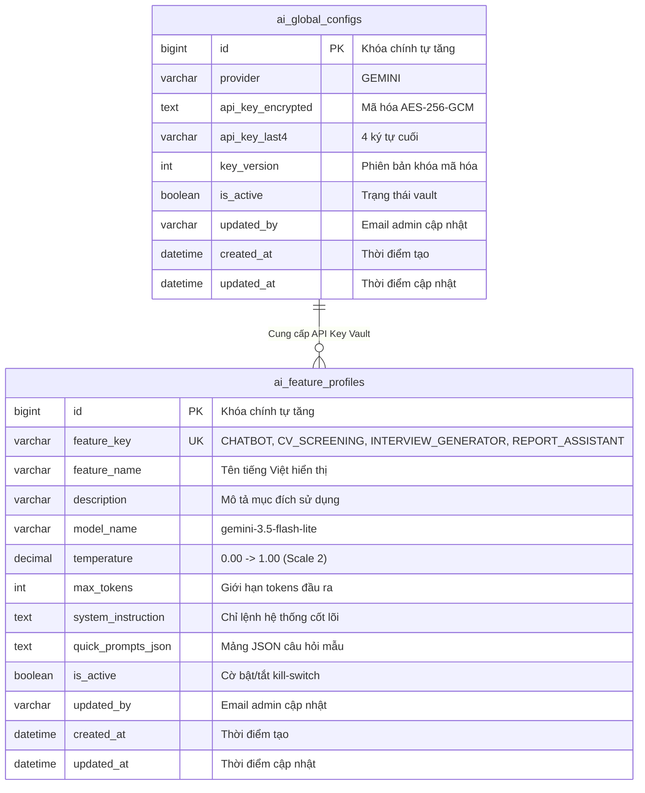
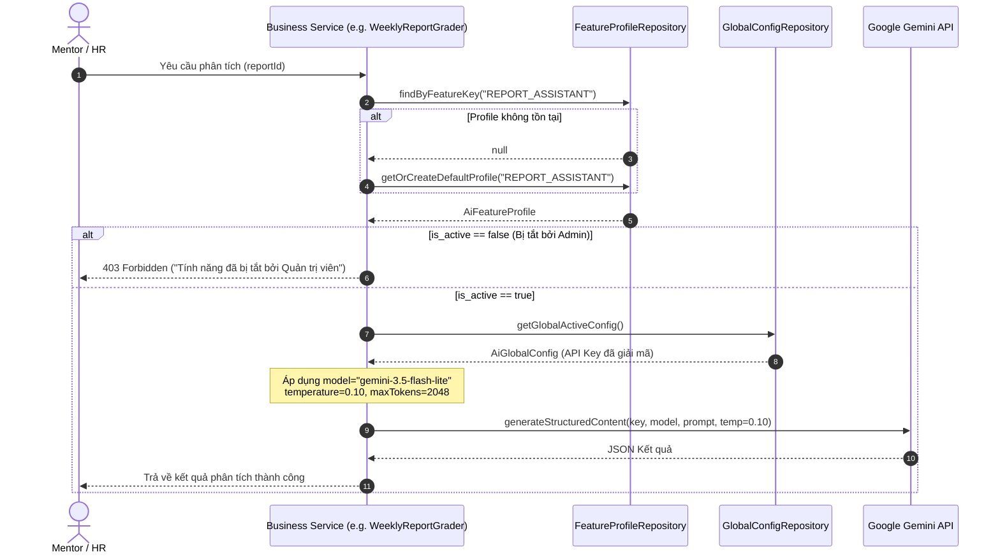

# ĐẶC TẢ KỸ THUẬT (TECHNICAL SPECIFICATION)
# MODULE AI-09: PHÂN TÁCH CẤU HÌNH AI THEO MODULE NGHIỆP VỤ (MULTI-PROFILE AI CONFIG)

> **Mã đặc tả:** `SPEC-AI-09-MULTI-PROFILE-CONFIG`  
> **Phiên bản:** 2.0 (HARDENED - PRODUCTION READY - SPEC-DRIVEN)  
> **Trạng thái:** APPROVED / READY FOR IMPLEMENTATION  
> **Tác giả:** Đội ngũ Kỹ thuật & AI Architecture InternHub  
> **Ngày cập nhật:** 2026-10-18  
> **Mức độ ưu tiên:** 🔥 **P0 - CRITICAL**  
> **Lưu trữ tại:** `InternHub/docs/specs/SPEC_AI_09_MULTI_PROFILE_CONFIG.md`  
> **Tuân thủ quy chuẩn:** [CONSTRAINTS.md](file:///c:/Users/Luong%20Anh%20Huy/InternHub-Workspace/CONSTRAINTS.md) | Test-Driven Development (TDD) | Zero suppression | 0 FQCN  

---

## 0. NHẬT KÝ THAY ĐỔI & GIẢI TRÌNH KỸ THUẬT (REVISION HISTORY & CHANGE RATIONALE)

> [!IMPORTANT]
> **BẮT BUỘC ĐIỀN ĐẦY ĐỦ**: Bất kể khi nào Lập trình viên hay AI Agent thay đổi mã nguồn ảnh hưởng đến logic, API, validation hay database (từ cấp độ L2 trở lên), **bắt buộc** phải ghi thêm một dòng vào bảng này để giải trình lý do trước khi coi nhiệm vụ là hoàn tất.

| Phiên bản | Ngày | Người thực hiện | Task / Jira | Loại thay đổi | Lý do & Giải trình kỹ thuật (Rationale) |
| :---: | :---: | :---: | :---: | :---: | :--- |
| **v1.0** | 2026-10-18 | Antigravity AI | `AI-09` | Khởi tạo Spec | Thiết kế ban đầu cấu trúc Multi-Profile Config sau phỏng vấn. |
| **v2.0** | 2026-10-18 | Antigravity AI | `AI-09` | Nâng cấp toàn diện | Nâng cấp bản đặc tả lên chuẩn sâu (Deep Spec): bổ sung kiến trúc DTO chi tiết, state machine, sequence diagrams, quy tắc Hard Block (403 khi module bị tắt), Sandbox Test trên từng Tab và tối thiểu 10 Edge Cases cốt lõi. |

---

## 1. MỤC TIÊU & PHẠM VI (GOALS & SCOPE)

### 1.1 Mục tiêu Nghiệp Vụ (Business Goals)
1. **Giải quyết triệt để xung đột thông số AI giữa các Module:**
   - **CV Screening (`CV_SCREENING`)**: Đòi hỏi tính nhất quán tuyệt đối, bám sát rubric định lượng, xuất JSON chuẩn xác 100% $\rightarrow$ Bắt buộc `temperature = 0.00`, `model = gemini-3.5-flash-lite`.
   - **Sinh Bộ Câu Hỏi Phỏng Vấn (`INTERVIEW_GENERATOR`)**: Đòi hỏi tính sáng tạo, đề bài tình huống đa dạng, tránh trùng lặp giữa các ứng viên $\rightarrow$ Bắt buộc `temperature = 0.65`, `model = gemini-3.5-flash-lite`.
   - **Chatbot FAQ & Onboarding (`CHATBOT`)**: Phản hồi nhanh chóng, thân thiện, đàm thoại tự nhiên $\rightarrow$ Bắt buộc `temperature = 0.30`, `model = gemini-3.5-flash-lite`.
   - **Trợ Lý Đánh Giá Báo Cáo Tuần (`REPORT_ASSISTANT`)**: Đối soát Kanban, phân tích logic khách quan, đề xuất điểm 5 sao $\rightarrow$ Bắt buộc `temperature = 0.10`, `model = gemini-3.5-flash-lite`.
2. **Quản trị Khóa Tập Trung & Độc Lập Tham Số (Decoupled Architecture):**
   - Tách biệt hoàn toàn giữa **Global API Key Vault** (khóa duy nhất toàn hệ thống, mã hóa AES-256-GCM) và **Module Profile Parameters** (Model, Temperature, MaxTokens, System Instruction, IsActive).
3. **Quyền Kiểm Soát Chủ Động (Hard Blocking & Kill-Switch):**
   - Admin có quyền bật/tắt độc lập từng module. Khi một module bị tắt (`is_active = false`), hệ thống lập tức thực thi **Hard Block** (trả về HTTP 403 Forbidden với mã lỗi rõ ràng), ngăn chặn mọi hành vi gọi LLM tiêu tốn ngân sách.

### 1.2 Ngoài phạm vi (Non-Goals)
- Không lưu trữ nhiều API Key riêng lẻ cho từng module trong phiên bản này (tất cả đều kế thừa Global API Key Vault).
- Không hỗ trợ chuyển đổi sang nhà cung cấp bên ngoài ngoài Google Gemini trong phase này (chuẩn hóa toàn bộ hệ thống sang `gemini-3.5-flash-lite`).

---

## 2. BỐN TRỤ CỘT KIẾN TRÚC LÕI (CORE ARCHITECTURAL PILLARS)

### 🛡️ Trụ cột 1: Tách Biệt Kho Khóa Toàn Cục & Cấu Hình Tham Số Từng Module
- **Global Key Vault (`ai_global_configs`):**
  - Chịu trách nhiệm bảo mật khóa API của Google Gemini.
  - Toàn bộ dữ liệu nhạy cảm được mã hóa đối xứng AES-256-GCM với cơ chế quản lý phiên bản khóa (`key_version`).
  - Phía giao diện client tuyệt đối không bao giờ nhận plain-text API Key; chỉ trả về chuỗi mặt nạ `apiKeyLast4` (ví dụ: `••••••••A1b2`).
- **Feature Profiles (`ai_feature_profiles`):**
  - Lưu trữ hồ sơ tham số riêng cho từng module nghiệp vụ dựa trên khóa tự nhiên `feature_key`.
  - Hỗ trợ lưu trữ System Instruction đặc thù và danh sách câu hỏi gợi ý nhanh (Quick Prompts JSON).

### ⚖️ Trụ cột 2: Cơ Chế Kiểm Soát Bật/Tắt Tuyệt Đối (Hard Block & Kill-Switch Enforcement)
- Mỗi module sở hữu cờ `is_active` độc lập:
  - Khi `is_active = true`: Module hoạt động bình thường theo các tham số đã cấu hình.
  - Khi `is_active = false`: Hệ thống ném ngay lập tức `ResponseStatusException(HttpStatus.FORBIDDEN, "Tính năng [Tên module] tạm thời bị vô hiệu hóa bởi Quản trị viên.")`.
- **Bảo vệ tầng sâu:** Việc kiểm tra `is_active` được thực hiện ngay tại entrypoint của Service nghiệp vụ trước khi tiến hành parse dữ liệu hay gọi Feign/Gemini Client, chặn 100% chi phí API phát sinh ngoài ý muốn.

### 🔍 Trụ cột 3: Sandbox Test Trực Tiếp Trên Từng Tab Profile (Per-Profile Latency & Cost Metering)
- Trên mỗi Tab Profile của giao diện Admin (`AiSettingsPage.tsx`), cung cấp khung **Sandbox Test trực tiếp**:
  - Cho phép Admin nhập một prompt thử nghiệm riêng cho module đó (ví dụ: đối với CV Screening thì nhập đoạn văn bản kinh nghiệm mẫu; đối với Interview Generator thì nhập vị trí tuyển dụng).
  - Backend cung cấp endpoint `POST /api/v1/ai/admin/profiles/{featureKey}/test` để thực thi cuộc gọi thử nghiệm với chính các tham số (`temperature`, `modelName`, `systemInstruction`) của Tab đó.
  - Đo đạc và trả về số đo định lượng: Thời gian phản hồi (`latencyMs`), kết quả đầu ra thực tế (`previewOutput`), và trạng thái xác thực.

### 🎨 Trụ cột 4: Trải Nghiệm Giao Diện Người Dùng Tiên Tiến (Clean UI & Status Indicator Dots)
- Giao diện Admin loại bỏ hoàn toàn các thuật ngữ dev gây khó hiểu:
  - Sử dụng thanh **Tab Bar 4 Modules**: `Chatbot TTS`, `Sàng Lọc CV`, `Sinh Bộ Đề Phỏng Vấn`, `Trợ Lý Báo Cáo Tuần`.
  - Mỗi Tab có một **Chấm chỉ báo trạng thái (Status Indicator Dot)**:
    - 🟢 Chấm Xanh lá: Module đang BẬT (`is_active = true`).
    - ⚪ Chấm Xám nhạt: Module đang TẮT (`is_active = false`).
  - Admin chỉ cần nhìn lướt qua toàn bộ thanh Tab là nắm trọn vẹn trạng thái hoạt động của cả 4 module mà không cần nhấp chuột vào từng Tab.

---

## 3. THIẾT KẾ CƠ SỞ DỮ LIỆU & DATA MIGRATION (DATABASE SCHEMA)

### 3.1 Sơ Đồ Thực Thể Quan Hệ (Entity Relationship Diagram)



### 3.2 SQL DDL & Migration Script
```sql
-- 1. Bảng lưu trữ Khóa API toàn hệ thống
CREATE TABLE IF NOT EXISTS ai_global_configs (
    id BIGINT AUTO_INCREMENT PRIMARY KEY,
    provider VARCHAR(50) NOT NULL DEFAULT 'GEMINI',
    api_key_encrypted TEXT,
    api_key_last4 VARCHAR(4),
    key_version INT NOT NULL DEFAULT 1,
    is_active BOOLEAN NOT NULL DEFAULT TRUE,
    updated_by VARCHAR(64),
    created_at DATETIME NOT NULL DEFAULT CURRENT_TIMESTAMP,
    updated_at DATETIME NOT NULL DEFAULT CURRENT_TIMESTAMP ON UPDATE CURRENT_TIMESTAMP
) ENGINE=InnoDB DEFAULT CHARSET=utf8mb4 COLLATE=utf8mb4_unicode_ci;

-- 2. Bảng lưu trữ cấu hình riêng biệt từng module
CREATE TABLE IF NOT EXISTS ai_feature_profiles (
    id BIGINT AUTO_INCREMENT PRIMARY KEY,
    feature_key VARCHAR(50) NOT NULL UNIQUE,
    feature_name VARCHAR(100) NOT NULL,
    description VARCHAR(255),
    model_name VARCHAR(100) NOT NULL DEFAULT 'gemini-3.5-flash-lite',
    temperature DECIMAL(3, 2) NOT NULL DEFAULT 0.20,
    max_tokens INT NOT NULL DEFAULT 1024,
    system_instruction TEXT,
    quick_prompts_json TEXT,
    is_active BOOLEAN NOT NULL DEFAULT TRUE,
    updated_by VARCHAR(64),
    created_at DATETIME NOT NULL DEFAULT CURRENT_TIMESTAMP,
    updated_at DATETIME NOT NULL DEFAULT CURRENT_TIMESTAMP ON UPDATE CURRENT_TIMESTAMP
) ENGINE=InnoDB DEFAULT CHARSET=utf8mb4 COLLATE=utf8mb4_unicode_ci;

-- 3. Migration dữ liệu từ bảng cũ ai_system_configs sang bảng mới (nếu có)
INSERT INTO ai_global_configs (id, provider, api_key_encrypted, api_key_last4, key_version, is_active, updated_by)
SELECT 1, provider, api_key_encrypted, api_key_last4, key_version, is_active, updated_by
FROM ai_system_configs WHERE id = 1
ON DUPLICATE KEY UPDATE updated_at = CURRENT_TIMESTAMP;

-- 4. Nạp sẵn 4 Profiles chuẩn mặc định
INSERT INTO ai_feature_profiles (feature_key, feature_name, description, model_name, temperature, max_tokens, system_instruction, quick_prompts_json, is_active)
VALUES
('CHATBOT', 'Trợ Lý FAQ Thực Tập', 'Hỗ trợ giải đáp nội quy, tài liệu onboarding cho thực tập sinh.', 'gemini-3.5-flash-lite', 0.30, 1024, 'Bạn là trợ lý ảo hỗ trợ thực tập sinh tại InternHub. Trả lời thân thiện, súc tích và chính xác dựa trên quy định công ty.', '["Quy định điểm danh là gì?", "Cách thức nộp báo cáo tuần?", "Chế độ nghỉ phép của thực tập sinh?"]', TRUE),
('CV_SCREENING', 'Sàng Lọc Hồ Sơ & CV', 'Trích xuất kỹ năng, so khớp thang đo rubric tuyển dụng, xuất JSON 100% chuẩn xác.', 'gemini-3.5-flash-lite', 0.00, 2048, 'Bạn là chuyên gia thẩm định hồ sơ tuyển dụng. Phân tích bám sát tiêu chí rubric, không thêm thắt suy diễn.', '[]', TRUE),
('INTERVIEW_GENERATOR', 'Sinh Bộ Câu Hỏi Phỏng Vấn', 'Tạo bộ câu hỏi phỏng vấn kỹ thuật và tình huống đa dạng, sáng tạo, chống lặp lại.', 'gemini-3.5-flash-lite', 0.65, 3072, 'Bạn là chuyên gia phỏng vấn kỹ thuật công nghệ cao. Tạo câu hỏi phân loại sâu sắc, tình huống thực tế.', '[]', TRUE),
('REPORT_ASSISTANT', 'Trợ Lý Đánh Giá Báo Cáo Tuần', 'Đối soát báo cáo với tiến độ Kanban, phân tích 3 dòng và gợi ý điểm 5 sao khách quan.', 'gemini-3.5-flash-lite', 0.10, 2048, 'Bạn là trợ lý đối soát đào tạo thực tập sinh. Đối chiếu nhiệm vụ Kanban với báo cáo tuần, lập luận chặt chẽ.', '[]', TRUE)
ON DUPLICATE KEY UPDATE updated_at = CURRENT_TIMESTAMP;
```

---

## 4. CHI TIẾT API CONTRACTS & DTO DESIGN

### 4.1 REST API Endpoints Specification

| Phương thức | URI Endpoint | Phân quyền (RBAC) | Mô tả chức năng |
| :---: | :--- | :---: | :--- |
| `GET` | `/api/v1/ai/admin/multi-config` | `ROLE_ADMIN` | Lấy toàn bộ cấu hình: Global API Key Vault + Danh sách 4 Profiles. |
| `PUT` | `/api/v1/ai/admin/global-key` | `ROLE_ADMIN` | Cập nhật API Key toàn hệ thống (mã hóa lưu trữ). |
| `GET` | `/api/v1/ai/admin/profiles/{featureKey}` | `ROLE_ADMIN` | Lấy chi tiết cấu hình của 1 Profile cụ thể. |
| `PUT` | `/api/v1/ai/admin/profiles/{featureKey}` | `ROLE_ADMIN` | Cập nhật tham số kỹ thuật riêng cho 1 Profile. |
| `POST` | `/api/v1/ai/admin/profiles/{featureKey}/test` | `ROLE_ADMIN` | Chạy thử nghiệm Sandbox prompt riêng cho Profile đó. |

### 4.2 DTO Contracts (Request & Response)

#### DTO: `AiMultiConfigResponse`
```json
{
  "globalConfig": {
    "provider": "GEMINI",
    "apiKeyLast4": "4A9b",
    "hasKey": true,
    "isActive": true,
    "updatedAt": "2026-10-18T10:30:00"
  },
  "profiles": [
    {
      "featureKey": "CHATBOT",
      "featureName": "Trợ Lý FAQ Thực Tập",
      "description": "Hỗ trợ giải đáp nội quy, tài liệu onboarding cho thực tập sinh.",
      "modelName": "gemini-3.5-flash-lite",
      "temperature": 0.30,
      "maxTokens": 1024,
      "systemInstruction": "Bạn là trợ lý ảo hỗ trợ thực tập sinh...",
      "quickPrompts": ["Quy định điểm danh?", "Cách nộp báo cáo tuần?"],
      "isActive": true,
      "updatedAt": "2026-10-18T10:30:00"
    },
    {
      "featureKey": "CV_SCREENING",
      "featureName": "Sàng Lọc Hồ Sơ & CV",
      "description": "Trích xuất kỹ năng, so khớp rubric, xuất JSON 100%.",
      "modelName": "gemini-3.5-flash-lite",
      "temperature": 0.00,
      "maxTokens": 2048,
      "systemInstruction": "Bạn là chuyên gia thẩm định hồ sơ...",
      "quickPrompts": [],
      "isActive": true,
      "updatedAt": "2026-10-18T10:30:00"
    },
    {
      "featureKey": "INTERVIEW_GENERATOR",
      "featureName": "Sinh Bộ Câu Hỏi Phỏng Vấn",
      "description": "Tạo câu hỏi kỹ thuật & tình huống sáng tạo.",
      "modelName": "gemini-3.5-flash-lite",
      "temperature": 0.65,
      "maxTokens": 3072,
      "systemInstruction": "Bạn là chuyên gia phỏng vấn kỹ thuật...",
      "quickPrompts": [],
      "isActive": true,
      "updatedAt": "2026-10-18T10:30:00"
    },
    {
      "featureKey": "REPORT_ASSISTANT",
      "featureName": "Trợ Lý Đánh Giá Báo Cáo Tuần",
      "description": "Đối soát Kanban, phân tích 3 dòng và gợi ý điểm 5 sao.",
      "modelName": "gemini-3.5-flash-lite",
      "temperature": 0.10,
      "maxTokens": 2048,
      "systemInstruction": "Bạn là trợ lý đối soát đào tạo...",
      "quickPrompts": [],
      "isActive": true,
      "updatedAt": "2026-10-18T10:30:00"
    }
  ]
}
```

#### DTO: `UpdateFeatureProfileRequest`
```json
{
  "modelName": "gemini-3.5-flash-lite",
  "temperature": 0.15,
  "maxTokens": 2048,
  "systemInstruction": "Chỉ lệnh tùy chỉnh mới...",
  "quickPrompts": ["Câu hỏi 1", "Câu hỏi 2"],
  "isActive": true
}
```

#### DTO: `TestProfileRequest` & `TestProfileResponse`
```json
// Request
{
  "testPrompt": "Hãy phân tích báo cáo: Tôi đã hoàn thành task #101 và viết Swagger."
}

// Response
{
  "success": true,
  "featureKey": "REPORT_ASSISTANT",
  "modelName": "gemini-3.5-flash-lite",
  "temperature": 0.10,
  "latencyMs": 842,
  "output": "1. Tiến độ: Hoàn thành task #101 và tài liệu API Swagger...",
  "errorMessage": null
}
```

---

## 5. QUY TRÌNH THỰC THI & SEQUENCE DIAGRAM

### 5.1 Luồng Gọi Tác Vụ Nghiệp Vụ Có Kiểm Tra Hard Block



---

## 6. DANH SÁCH 10 EDGE CASES CỐT LÕI & GIẢI PHÁP PHÒNG VỆ (EDGE CASES & MITIGATIONS)

### 6.1 Case 1: Kill-Switch Kích Hoạt (Admin TẮT Profile `is_active = false`)
- **Nguy cơ:** Người dùng bên ngoài vẫn liên tục gửi request làm hệ thống lãng phí tài nguyên tính toán.
- **Giải pháp:** Service ném ngay `ResponseStatusException(HttpStatus.FORBIDDEN)` tại dòng đầu tiên của hàm xử lý. Không giải mã API Key, không kết nối internet.

### 6.2 Case 2: Cơ sở dữ liệu bị trống bảng `ai_feature_profiles` (Zero-Config Crash)
- **Nguy cơ:** Do thao tác database bằng tay hoặc lỗi migrate, bảng profile rỗng dẫn đến ném `NullPointerException`.
- **Giải pháp:** Phương thức `getProfileOrDefault(String featureKey)` bọc trong khối synchronized; nếu không tìm thấy trong DB, tự động khởi tạo bản ghi default preset và lưu vào DB ngay lập tức trước khi trả về.

### 6.3 Case 3: Trùng lặp Khóa `feature_key`
- **Nguy cơ:** Gửi request tạo profile với feature_key đã có sẵn.
- **Giải pháp:** Đặt ràng buộc `UNIQUE` trên cột `feature_key` ở cấp độ Database. Xử lý bắt ngoại lệ `DataIntegrityViolationException` và ném về mã lỗi `409 Conflict`.

### 6.4 Case 4: Nhập Giá Trị Temperature Ngoài Biên Cho Phép
- **Nguy cơ:** Người dùng nhập `temperature = 2.5` hoặc `-0.5` làm sập thư viện của Google Gemini.
- **Giải pháp:** Bean validation `@DecimalMin("0.0")` và `@DecimalMax("1.0")` trên DTO; Frontend đặt slider `min="0.0"` `max="1.0"` `step="0.05"`.

### 6.5 Case 5: Mã Hóa API Key Tránh Lộ Dữ Liệu Nhạy Cảm
- **Nguy cơ:** API Key lưu dạng plain-text bị lộ qua log hoặc REST API response.
- **Giải pháp:** Mã hóa đối xứng AES-256-GCM với Key Versioning; DTO Response tuyệt đối chỉ chứa trường `apiKeyLast4` và boolean `hasKey`.

### 6.6 Case 6: Rate Limiting Trên Endpoint Test Sandbox
- **Nguy cơ:** Admin hoặc kẻ gian spam liên tục nút "Test Phản Hồi Profile" gây cạn kiệt quota API Key.
- **Giải pháp:** Áp dụng Rate Limiting tối đa 5 request test / phút / admin bằng Redis Token Bucket.

### 6.7 Case 7: Độ Dài Prompt Vượt Giới Hạn Tokens
- **Nguy cơ:** Admin nhập System Instruction quá dài vượt context window của model.
- **Giải pháp:** Ràng buộc `@Size(max = 8000)` trên trường `systemInstruction` và validate tổng tokens trước khi gửi sang Gemini.

### 6.8 Case 8: Đồng Thời Cập Nhật Profile (Concurrent Update Conflict)
- **Nguy cơ:** Hai quản trị viên cùng mở một Tab Profile và lưu đè tham số của nhau.
- **Giải pháp:** Áp dụng trường `@Version private Long optLockVersion` hoặc lưu vết thời gian `updatedAt` để kiểm tra xung đột dữ liệu phiên bản.

### 6.9 Case 9: Google Gemini Đổi Endpoint / Báo Lỗi 404 Model
- **Nguy cơ:** Tên model nhập vào Tab Profile không tồn tại trên Google AI Studio.
- **Giải pháp:** Validate tên model trong danh sách whitelist an toàn (`gemini-3.5-flash-lite`, `gemini-1.5-flash`, `gemini-1.5-pro`); nếu thất bại, tự động kích hoạt heuristic fallback đối soát Kanban nội bộ.

### 6.10 Case 10: Xung Đột Dữ Liệu Khi Bật Lại Module (Re-activation State Consistency)
- **Nguy cơ:** Module vừa được bật lại sau thời gian tắt, các cache cũ của Redis chứa trạng thái cấm gây lỗi người dùng.
- **Giải pháp:** Khi Admin lưu cập nhật profile, Service tự động phát sinh sự kiện xóa cache tương ứng trên Redis (`ai:profile:{featureKey}`).

---

## 7. TIÊU CHÍ NGHIỆM THU ĐỊNH LƯỢNG (QUANTITATIVE ACCEPTANCE CRITERIA)

- [ ] **AC-1 (Schema Integrity):** Bảng `ai_global_configs` và `ai_feature_profiles` được tạo tự động với đầy đủ indexes, nạp thành công 4 preset profiles mặc định (`CHATBOT`, `CV_SCREENING`, `INTERVIEW_GENERATOR`, `REPORT_ASSISTANT`).
- [ ] **AC-2 (Parametric Accuracy):** Khi gọi hàm đánh giá báo cáo tuần, `temperature` truyền vào Google Gemini được ghi nhận đúng `0.10`; khi gọi sinh câu hỏi phỏng vấn, `temperature` được ghi nhận đúng `0.65`.
- [ ] **AC-3 (Hard Kill-Switch):** Khi Admin tắt `REPORT_ASSISTANT` (`isActive = false`), request gọi phân tích báo cáo tuần trả về HTTP `403 Forbidden` và thời gian phản hồi `< 50ms` (do ngắt ngay tại tầng Service, không gọi ra ngoài internet).
- [ ] **AC-4 (Admin Tab Bar & Indicator Dots):** Giao diện `AiSettingsPage.tsx` có đầy đủ 4 Tabs. Mỗi Tab hiển thị chính xác chấm xanh (khi profile active) hoặc chấm xám (khi profile inactive).
- [ ] **AC-5 (Sandbox Testing):** Admin có thể nhập prompt test trên từng Tab Profile và nhận về kết quả đo đạc thời gian (`latencyMs`) cùng nội dung phản hồi mẫu trong vòng `< 5000ms`.
- [ ] **AC-6 (Quality Constraints):** 0 compile error, 0 suppression (`@SuppressWarnings`), 100% test cases Unit & E2E vượt qua theo tiêu chuẩn sàn chất lượng trong [CONSTRAINTS.md](file:///c:/Users/Luong%20Anh%20Huy/InternHub-Workspace/CONSTRAINTS.md).
