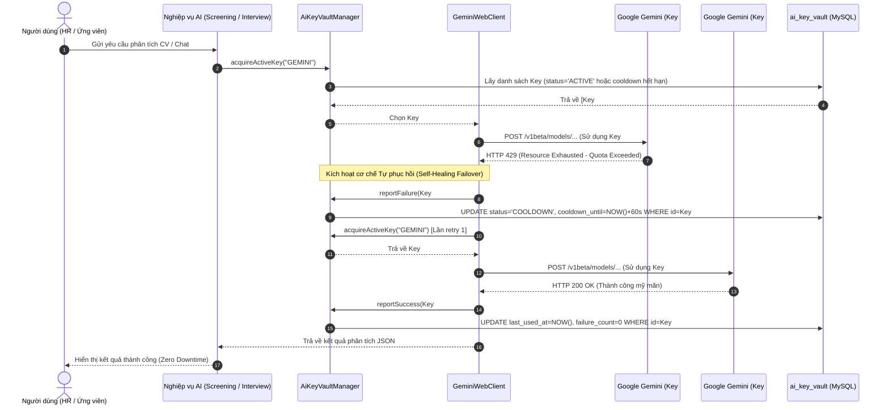

# ĐẶC TẢ KỸ THUẬT (TECHNICAL SPECIFICATION)
# MODULE AI-10: KHO KHÓA API ĐA NGUỒN, ĐIỀU PHỐI XOAY TUA ROUND-ROBIN & TỰ PHỤC HỒI COOLDOWN (MULTI-KEY & PROVIDER VAULT)

> **Mã đặc tả:** `SPEC-AI-10-MULTI-KEY-VAULT`  
> **Phiên bản:** 2.0 (HARDENED - PRODUCTION READY - SPEC-DRIVEN)  
> **Trạng thái:** DRAFT FOR REVIEW (PHASE 1 - DEFINE)  
> **Phân hệ phụ trách:** `ai-service` & `InternHub-Frontend`  
> **Mức độ ưu tiên:** P0 (Cấp thiết - Đảm bảo Zero-Downtime khi chạm hạn ngạch Quota)  
> **Tác giả:** Đội ngũ Kỹ thuật & AI Architecture InternHub  
> **Ngày phê duyệt:** 2026-10-19  
> **Tuân thủ quy chuẩn:** [CONSTRAINTS.md](file:///c:/Users/Luong%20Anh%20Huy/InternHub-Workspace/CONSTRAINTS.md) | Test-Driven Development (TDD) | Zero suppression | 0 FQCN  
> **Được định hình qua quy trình:** `/interview-me` & `/grill-me` ngày 2026-10-19:  
> 1. **Cơ chế tải kết hợp (Hybrid Balancing):** Phân tải Round-Robin theo trọng số ưu tiên (`priority`) + Tự động ngắt chuyển Key dự phòng (Fallback) ngay lập tức khi vấp lỗi HTTP 429.
> 2. **Cơ chế Cooldown 60s & Tự phục hồi (Self-Healing):** Key bị lỗi 429 tạm thời đưa vào danh sách nghỉ 60 giây để nạp lại hạn ngạch RPM/TPM của Google Gemini, sau 60s tự động tái kích hoạt.
> 3. **Kho Khóa Dùng Chung Duy Nhất (Global Vault Scope):** Toàn bộ các module AI (Chatbot FAQ, Sàng lọc CV, Sinh câu hỏi phỏng vấn, Đánh giá báo cáo tuần) dùng chung kho khóa để phân tải tối đa.
> 4. **Bảo mật Đa tầng (Multi-layer Defense):** Mã hóa đối xứng AES-256 trong CSDL, che giấu mã khóa trên UI (`AIzaSy...****`), tuyệt đối không phơi bày key thô qua log hoặc API response.
> 5. **Giao diện Quản trị Thân thiện (No Dev Jargon):** Tích hợp trực tiếp vào [AiSettingsPage.tsx](file:///c:/Users/Luong%20Anh%20Huy/InternHub-Workspace/InternHub-Frontend/src/pages/admin/AiSettingsPage.tsx) dưới dạng Tab "Kho Khóa API", hiển thị bảng trạng thái realtime và nút kiểm tra kết nối từng khóa.

---

## 1. MỤC TIÊU & PHẠM VI (GOALS & SCOPE)

### 1.1 Mục tiêu Nghiệp vụ (Business Goals)
1. **Triệt tiêu lỗi gián đoạn 429 (Zero Downtime for Users):**
   - Khi HR tải lên hàng loạt 20-50 CV cùng lúc để phân tích, hoặc nhiều sinh viên tương tác phỏng vấn đồng thời, hạn ngạch (RPM/TPM) của 1 API Key đơn lẻ rất dễ bị chạm trần. AI-10 đảm bảo hệ thống tự động tráo sang Key khác trong suốt (transparent failover), người dùng không cảm nhận thấy sự cố.
2. **Tối ưu hóa tài nguyên miễn phí & doanh nghiệp:**
   - Cho phép doanh nghiệp tận dụng nhiều API Key (Key chính trả phí + các Key phụ dự phòng) với cơ chế phân tải Round-Robin đều đặn, giảm thiểu chi phí phát sinh tức thời trên một tài khoản.
3. **Minh bạch trạng thái hoạt động:**
   - Cung cấp cho Admin bảng điều khiển trực quan: Biết rõ Key nào đang hoạt động tốt, Key nào đang tạm nghỉ hồi sức (Cooldown đếm ngược), Key nào bị hỏng vĩnh viễn (401/403) để kịp thời cập nhật.

### 1.2 Ngoài phạm vi của Spec này (Non-Goals)
- Không can thiệp vào logic nghiệp vụ của từng Module AI (Module nào dùng model gì, temperature bao nhiêu đã do [SPEC_AI_09_MULTI_PROFILE_CONFIG.md](file:///c:/Users/Luong%20Anh%20Huy/InternHub-Workspace/InternHub/docs/specs/SPEC_AI_09_MULTI_PROFILE_CONFIG.md) quản lý).
- Chưa tích hợp thanh toán tự động hay mua thêm Key trực tiếp từ Google Cloud / OpenAI trong phiên bản này (quản lý Key do Admin nhập thủ công).

---

## 2. BỐN TRỤ CỘT BẢO MẬT & KIẾN TRÚC LÕI (CORE ARCHITECTURAL PILLARS)

### 🛡️ Trụ cột 1: Phân Phối Tải Đều Đặn (Weighted Round-Robin Dispatcher)
- Thay vì chỉ để các Key phụ "nằm im chờ chết" khi Key chính sập, bộ điều phối `AiKeyVaultManager` thực hiện chia tải quay vòng ngay từ đầu:
  - Các Key có cùng mức `priority` cao nhất (ví dụ: `priority = 1`) sẽ được gọi luân phiên theo mốc thời gian `last_used_at` cũ nhất.
  - Các Key có `priority = 2` chỉ được huy động khi toàn bộ Key `priority = 1` đều đang bận hoặc đang trong trạng thái Cooldown.

---

### ⚖️ Trụ cột 2: Cơ Chế Tự Phục Hồi & Cooldown 60 Giây (Fault-Tolerance & Self-Healing)
- **Chuẩn đoán mã lỗi thông minh:**
  - **Lỗi 429 (Too Many Requests / Quota Exceeded):** Đánh dấu trạng thái `status = 'COOLDOWN'`, gán `cooldown_until = NOW() + 60s`. Trong 60 giây này, bộ điều phối sẽ bỏ qua Key này để nạp lại token bucket phía Google. Sau 60s, Key tự động chuyển về `status = 'ACTIVE'`.
  - **Lỗi 401 / 403 (Unauthorized / Forbidden - Key không hợp lệ hoặc bị xóa):** Chuyển vĩnh viễn sang `status = 'DISABLED'`, tăng cờ cảnh báo lỗi và không tự động thử lại.
  - **Lỗi 5xx hoặc Timeout:** Thử lại tối đa 2 lần trước khi chuyển sang Key kế tiếp.

---

### 🔍 Trụ cột 3: Chuyển Đổi Khóa Trong Suốt Tầng WebClient (Transparent Failover Interceptor)
- WebClient gọi Google Gemini API được bọc trong một bộ lặp phục hồi (Retry-with-Fallback Loop):
  - Khi một request nghiệp vụ (Screening, Chatbot, Phỏng vấn) đang thực thi và vấp phải Exception HTTP 429:
    1. Bắt ngoại lệ tại tầng Client Interceptor.
    2. Đánh dấu Key vừa dùng vào danh sách Cooldown.
    3. Lấy ngay Key kế tiếp có sẵn từ Vault.
    4. Gửi lại request với Key mới (tối đa 3 lần retry qua các Key khác nhau).
    5. Trả về kết quả hoàn hảo cho nghiệp vụ, người dùng chỉ cảm thấy request chậm hơn 1-2 giây chứ không hề nhận thông báo lỗi.

---

### 🔒 Trụ cột 4: Mã Hóa Đối Xứng AES-256 & Bảo Mật Khóa Tuyệt Đối (Security & Masking)
- **Mã hóa Database:** Mọi API Key thô do Admin nhập vào bắt buộc phải đi qua `AesEncryptionService` (sử dụng Secret Key 256-bit quản lý qua biến môi trường `AI_ENCRYPTION_SECRET`) trước khi lưu vào cột `api_key_encrypted`.
- **Masking UI:** Chỉ lưu trữ 4 ký tự cuối trong cột `api_key_last4`. Mọi API trả về Frontend chỉ cung cấp chuỗi masked: `AIzaSy...****ABCD`. Tuyệt đối không bao giờ trả Key giải mã về trình duyệt.

---

## 3. MÁY TRẠNG THÁI KHÓA (KEY LIFECYCLE & STATE MACHINE)

### 3.1 Sơ đồ Vòng đời Trạng thái Khóa (Key State Transition Diagram)

```
        ┌────────────────── [ Admin Thêm Khóa Mới ] ──────────────────┐
        │                                                              │
        ▼ (Kiểm tra kết nối thành công)                                │
  [ ACTIVE ] ◄─────────────────────────────────────────────┐           │
    (Sẵn sàng)                                             │           │
        │                                                  │           │
        ├──(Gặp lỗi HTTP 429 Quota Exceeded)               │           │
        │                                                  │           │
        ▼                                                  │           │
  [ COOLDOWN ] ──(Đồng hồ đếm ngược hết 60s)───────────────┤           │
    (Tạm nghỉ)                                             │           │
        │                                                  │           │
        ├──(Gặp lỗi HTTP 401/403 Sai Key / Thu hồi)        │           │
        │                                                  │           │
        ▼                                                  ▼           │
  [ DISABLED ] ◄───────────────────────────────────────────┴───────────┘
   (Vô hiệu hóa)
        │
        ├──(Admin bấm "Kích hoạt lại" hoặc "Cập nhật Key mới")
        ▼
   [ ACTIVE ]
```

### 3.2 Ma trận Hành vi Trạng thái (Key State Behavioral Matrix)

| Trạng thái hiện tại | Sự kiện kích hoạt | Trạng thái mới | Hành vi hệ thống |
| :--- | :--- | :--- | :--- |
| **Bản nháp / Mới** | Admin nhập Key & bấm Thử nghiệm | `ACTIVE` | Gọi endpoint Gemini ping thử. Nếu 200 OK $\rightarrow$ Mã hóa AES-256, lưu DB với `ACTIVE`. |
| **ACTIVE** | Request gọi thành công (200 OK) | `ACTIVE` | Cập nhật `last_used_at = NOW()`, reset `failure_count = 0`. |
| **ACTIVE** | Gặp lỗi HTTP 429 Quota Exceeded | `COOLDOWN` | Set `cooldown_until = NOW() + 60s`. Lấy ngay Key khác chạy tiếp request cho user. |
| **COOLDOWN** | Hết 60 giây (`NOW() >= cooldown_until`) | `ACTIVE` | Tự động đưa Key trở lại vòng xoay Round-Robin khi có lượt request tiếp theo. |
| **ACTIVE / COOLDOWN** | Gặp lỗi 401/403 (Key sai/bị hủy) | `DISABLED` | Set `status = 'DISABLED'`, gửi thông báo lỗi lên hệ thống quản trị. Không xoay vòng Key này nữa. |
| **DISABLED** | Admin vào sửa lại Key hoặc bấm Test | `ACTIVE` | Test thành công thì mở lại trạng thái `ACTIVE`. |

---

## 4. THIẾT KẾ DÒNG DỮ LIỆU ĐÃ NÂNG CẤP (FAILOVER SEQUENCE DIAGRAM)



---

## 5. THIẾT KẾ CƠ SỞ DỮ LIỆU (DATABASE SCHEMA)

### Bảng `ai_key_vault`
Đặt tại cơ sở dữ liệu `ai-service`:

| Tên cột | Kiểu dữ liệu | Ràng buộc | Mô tả |
| :--- | :--- | :--- | :--- |
| `id` | BIGINT | PK, AUTO_INCREMENT | Khóa chính tự tăng |
| `key_name` | VARCHAR(100) | NOT NULL | Tên gợi nhớ (ví dụ: *Gemini Doanh nghiệp Chính*, *Gemini Dự phòng 1*) |
| `provider` | VARCHAR(50) | NOT NULL (Default: 'GEMINI') | Nhà cung cấp AI (`GEMINI`, `OPENAI`, etc.) |
| `api_key_encrypted` | TEXT | NOT NULL | Chuỗi API Key đã mã hóa AES-256 an toàn |
| `api_key_last4` | VARCHAR(4) | NOT NULL | 4 ký tự cuối nhận diện trên UI (ví dụ: `6d8F`) |
| `priority` | INT | NOT NULL (Default: 1) | Mức độ ưu tiên phân phối (`1`: Cao nhất, `2`: Dự phòng cấp 2, ...) |
| `status` | VARCHAR(20) | NOT NULL (Default: 'ACTIVE') | Trạng thái: `ACTIVE`, `COOLDOWN`, `DISABLED` |
| `cooldown_until` | DATETIME | NULL | Mốc thời gian hết hạn Cooldown (khi bị 429) |
| `failure_count` | INT | NOT NULL (Default: 0) | Số lần lỗi liên tiếp gần nhất |
| `last_used_at` | DATETIME | NULL | Thời điểm gần nhất được điều phối gọi thành công |
| `created_by` | VARCHAR(64) | NULL | Username của Quản trị viên khởi tạo |
| `updated_by` | VARCHAR(64) | NULL | Username của Quản trị viên cập nhật gần nhất |
| `is_deleted` | BOOLEAN | NOT NULL (Default: false) | Xóa mềm |
| `created_at` | DATETIME | NOT NULL | Thời điểm tạo |
| `updated_at` | DATETIME | NOT NULL | Thời điểm cập nhật tự động |

**Chỉ mục hiệu năng (Indexes):**
- `idx_vault_dispatcher`: `(provider, is_deleted, status, priority, last_used_at)` tối ưu hóa truy vấn chọn Key khả dụng trong $< 2\text{ms}$.

---

## 6. THIẾT KẾ RESTful API CONTRACTS

### 6.1 Lấy danh sách Khóa trong Kho (Admin Key Vault Listing)
- **Endpoint:** `GET /api/v1/ai/admin/vault`
- **Quyền truy cập:** `@PreAuthorize("hasRole('ADMIN')")`
- **Response Body (200 OK):**
  ```json
  {
    "code": 200,
    "message": "Lấy danh sách khóa API thành công",
    "data": [
      {
        "id": 1,
        "keyName": "Gemini Doanh nghiệp Chính",
        "provider": "GEMINI",
        "maskedKey": "AIzaSy...****8a2B",
        "priority": 1,
        "status": "ACTIVE",
        "cooldownSecondsRemaining": 0,
        "failureCount": 0,
        "lastUsedAt": "2026-10-19T01:30:00Z"
      },
      {
        "id": 2,
        "keyName": "Gemini Dự phòng Tải cao",
        "provider": "GEMINI",
        "maskedKey": "AIzaSy...****4f9C",
        "priority": 1,
        "status": "COOLDOWN",
        "cooldownSecondsRemaining": 42,
        "failureCount": 1,
        "lastUsedAt": "2026-10-19T01:34:18Z"
      }
    ]
  }
  ```

---

### 6.2 Thêm Khóa Mới vào Kho (Add Key to Vault)
- **Endpoint:** `POST /api/v1/ai/admin/vault`
- **Quyền truy cập:** `@PreAuthorize("hasRole('ADMIN')")`
- **Request Body:**
  ```json
  {
    "keyName": "Gemini Khóa Phụ 2",
    "provider": "GEMINI",
    "apiKey": "AIzaSyD-sample-raw-key-here",
    "priority": 2
  }
  ```
- **Xử lý phía Backend:**
  1. Kiểm tra định dạng Key không được rỗng.
  2. Ping thử nghiệm tới Google API với Key vừa nhập:
     - Nếu lỗi 400/401/403: Trả về ngay HTTP 400 kèm thông điệp: *"Khóa API không hợp lệ hoặc bị Google từ chối. Vui lòng kiểm tra lại."*
     - Nếu thành công: Mã hóa AES-256 và lưu xuống bảng `ai_key_vault`.

---

### 6.3 Kiểm tra Kết nối Trực tiếp một Khóa (Test Connection)
- **Endpoint:** `POST /api/v1/ai/admin/vault/{id}/test`
- **Response Body (200 OK):**
  ```json
  {
    "code": 200,
    "message": "Kết nối thành công tới máy chủ Google Gemini",
    "data": {
      "id": 1,
      "provider": "GEMINI",
      "status": "ACTIVE",
      "latencyMs": 342,
      "testedAt": "2026-10-19T01:38:00Z"
    }
  }
  ```

---

### 6.4 Xóa Khóa khỏi Kho (Delete Key)
- **Endpoint:** `DELETE /api/v1/ai/admin/vault/{id}`
- **Quy tắc an toàn:** Không cho phép xóa nếu trong kho chỉ còn duy nhất 1 Khóa đang hoạt động (phải luôn giữ tối thiểu 1 Key để hệ thống không bị ngừng trệ).

---

## 7. MA TRẬN PHÒNG VỆ & XỬ LÝ SỰ CỐ (RESILIENCE & EDGE CASES)

| Tình huống sự cố | Rủi ro tiềm ẩn | Cơ chế giải quyết trong Bản Spec 2.0 |
| :--- | :--- | :--- |
| **Toàn bộ Key trong Vault đều bị dính 429** | Hệ thống cạn kiệt Key khả dụng | Hệ thống chọn Key có `cooldown_until` gần nhất, áp dụng cơ chế Exponential Backoff chờ tối đa 3s. Nếu vẫn 429, trả về mã lỗi 503 thân thiện: *"Hệ thống đang chịu tải rất cao, vui lòng thử lại sau 1 phút."* |
| **Key bị Google thu hồi giữa chừng (401/403)** | Các request tiếp theo tiếp tục bị fail nếu tiếp tục chọn Key này | Đánh dấu ngay `status = 'DISABLED'`, ghi log cảnh báo mức `ERROR` và tự động loại Key này khỏi vòng quay Round-Robin vĩnh viễn. |
| **Admin nhập nhầm Key trùng lặp** | Lãng phí slot và không chia tải thực tế | Hash SHA-256 Key thô để kiểm tra tính duy nhất (`api_key_hash`). Nếu đã tồn tại Key này trong Vault, từ chối thêm mới và báo lỗi trùng lặp. |
| **Kho Key Vault bị rỗng khi hệ thống đã có Key mặc định cũ** | Giao diện báo rỗng gây hiểu lầm, phân tải không khởi tạo được | Cơ chế **Auto-seed tự động**: Khi `ai_key_vault` rỗng, hệ thống tự động bốc Key từ `ai_global_configs` tạo bản ghi Khóa Chính (Priority 1) và hiển thị `vaultSystemActiveCard` trên UI. |

---

### 7.5 Vấn Đề Gốc Rễ & Cơ Chế Tự Động Di Trú (Root Cause & Auto-Seed Migration)

#### ⚠️ Các vấn đề kỹ thuật đã được nhận diện & giải quyết (Identified Issues):
1. **Lệch cấu trúc bảng dữ liệu (Data Model Split Problem):**
   - Hệ thống ban đầu lưu 1 API key đơn lẻ trong `ai_global_configs` (hoặc `ai_system_configs`).
   - Khi phát triển AI-10, bảng mới `ai_key_vault` được tạo ra nhưng chưa có trigger tự động di chuyển key đang hoạt động sang bảng mới trong runtime $\rightarrow$ Kho khóa bị rỗng `0 keys`.
2. **Khủng hoảng nhận thức người dùng (UX Cognitive Breakdown):**
   - Giao diện Admin hiển thị *"Chưa có khóa nào trong Kho. Vui lòng thêm khóa mới"* trong khi Chatbot và CV Screening ngầm bên trong vẫn hoạt động bằng key mặc định cũ.
   - Điều này vi phạm nguyên tắc thiết kế giao diện vì **hệ thống báo một đằng, hành vi ngầm một nẻo**, gây bức xúc và mất lòng tin của người quản trị.
3. **Nguy cơ lỗi mã hóa ký tự (Mojibake Character Encoding):**
   - Script SQL nạp dữ liệu nếu chạy qua pipe CLI thông thường dễ bị vỡ font tiếng Việt thành các ký tự rác (ví dụ: `Kh??a Ch??nh`).

#### 💡 Cơ Chế Giải Quyết Triệt Để Trong Runtime:
- **Tầng Backend (`AiKeyVaultAdminService`):**
  - Trước khi trả về danh sách `getAllKeys()`, hàm `autoSeedDefaultKeyIfVaultEmpty()` sẽ kiểm tra `vaultRepository.count()`.
  - Nếu bằng 0, nó tự động đọc `ai_global_configs`, lấy khóa đã mã hóa AES-256 cùng 4 ký tự cuối, tạo một thực thể `AiKeyVaultEntry` với:
    - `keyName = "Google Gemini Khóa Chính (System Default)"`
    - `provider = "GEMINI"`
    - `priority = 1`
    - `status = "ACTIVE"`
    - `apiKeyHash = "SYSTEM_DEFAULT_SEED"`
- **Tầng Frontend (`AiSettingsPage.tsx` & `.module.css`):**
  - Trang bị **`vaultSystemActiveCard`** (màu nền xanh dịu `#f0fdf4`, viền `#bbf7d0`, icon chìa khóa và status pill xanh lá `#10b981`).
  - Dù kho khóa chưa được thêm khóa phụ, UI vẫn khẳng định rõ ràng: *"Khóa Chính Hệ Thống Đang Kích Hoạt (System Active Key) - Toàn bộ các tác vụ AI đang được vận hành thông suốt qua khóa Google Gemini mặc định."*
  - Hướng dẫn rõ ràng lý do cần thêm khóa: *"Bấm '+ Thêm Khóa Mới' để bật tính năng phân tải Round-Robin và dự phòng tự động khi vấp lỗi 429."*

---

## 8. THIẾT KẾ GIAO DIỆN QUẢN TRỊ ADMIN (FRONTEND INTEGRATION SPEC)

### 8.1 Vị trí Tích hợp trong [AiSettingsPage.tsx](file:///c:/Users/Luong%20Anh%20Huy/InternHub-Workspace/InternHub-Frontend/src/pages/admin/AiSettingsPage.tsx)
- Bổ sung một Sub-Tab hoặc một Khung chuyên biệt nằm độc lập phía dưới hoặc song song với các Profile nghiệp vụ: **"Kho Khóa API Dự Phòng (Key Vault)"**.

### 8.2 Các Thành phần Giao diện (UI Components)
1. **Thanh Trạng thái Tổng quan Kho Khóa (Vault Health Bar):**
   - Số lượng khóa hoạt động: `2 Đang hoạt động / 1 Đang tạm nghỉ / 0 Vô hiệu hóa`.
   - Nút hành động chính: **"+ Thêm Khóa Mới"** (Màu Gradient Indigo sang trọng).
2. **Bảng Danh sách Khóa (Key Vault Table):**
   - **Tên khóa:** Hiển thị đậm nét, dễ phân biệt (*Gemini Khóa Chính*, *Gemini Dự phòng*).
   - **Nhà cung cấp:** Badge thương hiệu (*Google Gemini*).
   - **Mã khóa:** Che mờ an toàn `AIzaSy...****8a2B` kèm nút Copy mã (chỉ copy phần masked hoặc gọi endpoint sao chép nếu có quyền).
   - **Mức ưu tiên:** Tag nấc `Ưu tiên 1`, `Ưu tiên 2`.
   - **Trạng thái Realtime:**
     - 🟢 **Đang hoạt động:** Xanh lục dịu mắt.
     - 🟡 **Tạm nghỉ Cooldown:** Màu vàng cam kèm nhãn đếm ngược động: `Nghỉ (còn 45s)`.
     - 🔴 **Vô hiệu hóa:** Màu đỏ/xám khi Key bị lỗi xác thực.
   - **Cột Thao tác:**
     - Nút **"Thử nghiệm"** (Icon Plug/Wifi): Ping kiểm tra kết nối realtime của từng Key.
     - Nút **"Xóa"** (Icon Trash): Xóa mềm khóa (với modal xác nhận an toàn).
3. **Modal Thêm Khóa Mới (Add Key Modal):**
   - Ô nhập: Tên gợi nhớ.
   - Ô nhập: Mã khóa API (Input password có toggle bật/tắt mắt xem).
   - Chọn mức ưu tiên (Mặc định: 1).
   - Nút **"Xác thực & Lưu trữ"**: Khi bấm, hệ thống gọi API test trước với Google; chỉ khi kết nối thành công mới cho phép đóng modal và ghi nhận vào bảng.

---

## 9. KẾ HOẠCH BẺ NHỎ CÔNG VIỆC INCREMENTAL (TDD TASK BREAKDOWN)

- **Lát cắt 1: Database Migration & Security Entity Layer:**
  - Viết script migration tạo bảng `ai_key_vault` với charset `utf8mb4` và index chuẩn.
  - Tạo Entity `AiKeyVaultEntry.java`, Repository `AiKeyVaultRepository.java`.
  - Nâng cấp `AesEncryptionService.java` hỗ trợ mã hóa/giải mã và băm SHA-256 kiểm tra trùng lặp.
  
- **Lát cắt 2: Bộ điều phối `AiKeyVaultManager` & Kiểm thử TDD (Red-Green-Refactor):**
  - Viết Unit Test `AiKeyVaultManagerTest.java`:
    - Test 1: Luân phiên Key theo Round-Robin khi có nhiều Key cùng priority.
    - Test 2: Tự động bỏ qua Key đang trong Cooldown 60s.
    - Test 3: Tự động kích hoạt lại Key khi thời gian Cooldown đã hết.
    - Test 4: Chuyển sang Key priority thấp hơn khi toàn bộ Key priority cao bị lỗi.
  - Hiện thực logic trong `AiKeyVaultManager.java`.

- **Lát cắt 3: Tích hợp WebClient Failover Interceptor:**
  - Nâng cấp `GeminiWebClient` (hoặc Client gọi Gemini trong `ai-service`):
    - Bọc lời gọi trong cơ chế tự động chuyển Key khi bắt gặp HTTP 429.
    - Báo cáo kết quả thành công/thất bại về `AiKeyVaultManager`.

- **Lát cắt 4: RESTful API Controller & Admin DTO:**
  - Xây dựng `AiKeyVaultAdminController.java` với 4 endpoints: List, Add (kèm pre-test), Test Key, Delete.
  - Viết Integration Test kiểm thử bảo mật `@PreAuthorize("hasRole('ADMIN')")`.

- **Lát cắt 5: Giao diện Quản trị Frontend React UI:**
  - Bổ sung các hàm API Vault trong `aiService.ts`.
  - Thiết kế component `AiKeyVaultManagerCard.tsx` và Modal thêm mới trên [AiSettingsPage.tsx](file:///c:/Users/Luong%20Anh%20Huy/InternHub-Workspace/InternHub-Frontend/src/pages/admin/AiSettingsPage.tsx).
  - Kiểm thử `npm run build` đạt 0 lỗi TypeScript, nghiệm thu thực tế trên trình duyệt.
