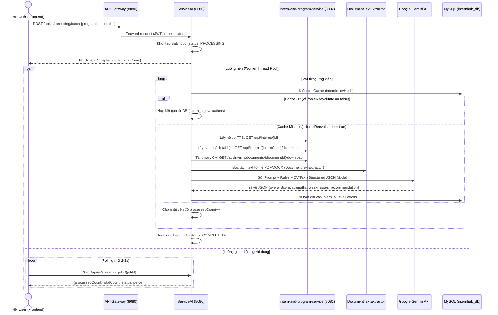

# Specification: Dịch Vụ Xét Duyệt Hồ Sơ Bằng AI (AI-Powered Application Screening Service)

---

## Bảng Nhật Ký Thay Đổi & Giải Trình Kỹ Thuật (Revision History)

| Phiên bản | Ngày | Người/Agent thực hiện | Mã task Jira | Nội dung thay đổi | Lý do kỹ thuật / Nghiệp vụ |
| :---: | :---: | :---: | :---: | :--- | :--- |
| **v1.0.0** | 2026-10-12 | AI Senior Pair-Programmer & User | `TM-103` | Tạo mới tài liệu đặc tả | Khởi tạo đặc tả kỹ thuật 13 phần cho microservice `ai-service` phục vụ xét duyệt hồ sơ thực tập sinh bằng Google Gemini API, bóc tách text PDF/Word, xử lý đa luồng chạy nền không nghẽn server và caching kết quả CSDL. |
| **v1.1.0** | 2026-10-19 | AI Senior Pair-Programmer & User | `TM-103` | Bắt buộc có CV & Vô hiệu hóa đánh giá khi thiếu CV | Bổ sung cờ `hasCv` trên `InternResponse`, chặn gọi Gemini API nếu thiếu CV (tiết kiệm token & chống ảo giác AI), vô hiệu hóa (disabled) nút bấm Thẩm định AI trên giao diện HR Workspace cho TTS chưa nộp CV kèm tooltip cảnh báo. |
| **v1.2.0** | 2026-10-19 | AI Senior Pair-Programmer & User | `TM-103` | Đồng bộ API Inter-Service & Cơ chế Thẩm định lại | Bổ sung endpoint `GET /api/interns/{id:[0-9]+}` trong `intern-and-program-service`, chuẩn hóa Feign URL `${ai.intern-service.url}` trỏ chính xác trong Docker network, hỗ trợ cờ `forceReevaluate` và nút "Thẩm Định Lại" trên UI, chuẩn hóa CSDL `ai_service_db` và module `ai-service`. |

---

## 1. Feature Overview (Tổng Quan Tính Năng)
- **Feature Name:** Dịch vụ xét duyệt hồ sơ ứng viên bằng AI (AI Application Screening Service)
- **Jira Ticket:** [TM-103](https://robluccibn9935.atlassian.net/browse/TM-103)
- **Target Subsystems:** `ai-service` (Microservice Port 8086), `api-gateway` (Định tuyến & JWT verification), `intern-and-program-service` (Core Service), `InternHub-Frontend` (HR Management Portal)
- **Target Users:** HR (Nhân sự), Quản trị viên (Admin)
- **Phân loại thay đổi (Change Level):** **L2** (Bổ sung điều kiện tiên quyết kiểm tra tài liệu CV, trả về trường `hasCv` trong hồ sơ TTS, vô hiệu hóa nút AI trên UI và validation chặn sớm ở backend).

---

## 2. Business Goal & Core Objectives (Mục Tiêu Nghiệp Vụ)
Tiếp nối chuỗi quy trình tiếp nhận và phê duyệt hồ sơ từ [TM-1](file:///d:/codegym_final_project/InternHub/docs/specs/TM-11-approve-reject-application-spec.md) và [TM-11](file:///d:/codegym_final_project/InternHub/docs/specs/TM-11-approve-reject-application-spec.md), tính năng **TM-103** giải quyết bài toán quá tải khi HR phải đọc thủ công hàng trăm CV:
1. **Tự động hóa đọc hiểu và sàng lọc:** Bóc tách dữ liệu từ file CV (PDF/Word), phân tích kinh nghiệm, kỹ năng, học vấn so với tiêu chuẩn của chương trình thực tập.
2. **Khách quan và chuẩn hóa thang điểm:** Đánh giá dựa trên file quy tắc chuẩn (`screening_rules.json`) kết hợp với thông tin cụ thể của Kỳ thực tập, đưa ra điểm số (0 - 100) và xếp loại rõ ràng.
3. **Trợ lý đề xuất quyết định (AI Copilot):** Gợi ý khuyến nghị (`RECOMMENDED_APPROVE`, `CONSIDER`, `RECOMMENDED_REJECT`), tự động soạn thảo lý do từ chối chuyên nghiệp giúp HR tiết kiệm 80% thời gian.
4. **Không làm nghẽn hệ thống:** Toàn bộ quá trình phân tích hàng loạt chạy trên luồng nền riêng biệt (`ThreadPoolTaskExecutor`), cho phép HR tự do thao tác trên các màn hình khác trong khi AI đang xử lý.
5. **Đảm bảo tính tin cậy & Tiết kiệm chi phí (v1.1.0):** Chỉ cho phép đánh giá AI khi ứng viên **đã tải lên CV** hợp lệ. Ngăn chặn triệt để hành vi gọi AI với dữ liệu rỗng gây tốn kém token và kết quả thẩm định sai lệch.

---

## 3. Scope of Work (Phạm Vi Tính Năng)

### 3.1. Trong phạm vi (In Scope)
1. **Microservice độc lập `ai-service`:** Dịch vụ tại port `8086`, đăng ký Eureka, định tuyến qua API Gateway `/api/ai/**`.
2. **Điều kiện tiên quyết tài liệu CV (Pre-requisite Check - v1.1.0):**
   - Ứng viên phải có ít nhất 1 tài liệu thuộc loại `CV` trong hệ thống (`intern_documents.document_type = 'CV'`).
   - Cung cấp cờ `hasCv: boolean` trong `InternResponse` để Frontend phát hiện ngay trạng thái nộp CV.
   - Nếu TTS chưa có CV: Backend từ chối thẩm định với mã lỗi/thông điệp: *"Ứng viên chưa tải lên CV. Không thể thực hiện thẩm định AI."*, không gọi Gemini API.
3. **Trích xuất văn bản từ CV (Text Extraction):** Hỗ trợ bóc tách plain text từ PDF (`.pdf`) bằng `Apache PDFBox` và file Word (`.docx`) bằng `Apache POI`.
4. **Tích hợp Google Gemini API:** Gọi Gemini 1.5/2.0 Flash với chế độ **Structured JSON Output**, ép kiểu dữ liệu trả về theo đúng JSON Schema.
5. **Quy tắc đánh giá chuẩn hóa:** Cấu hình file `screening_rules.json` quy định trọng số (Kỹ năng 40%, Học vấn 25%, Dự án 25%, Cam kết 10%) và ngưỡng điểm sàn.
6. **Xử lý bất đồng bộ hàng loạt (Batch Asynchronous Processing):**
   - Tiếp nhận danh sách `internIds`, trả về ngay lập tức HTTP `202 Accepted` kèm `batchJobId`.
   - Phân tích song song trên Thread Pool độc lập.
   - Endpoint tra cứu tiến độ `GET /api/ai/screening/jobs/{jobId}`.
7. **Lưu trữ & Caching kết quả (Cache-Hit):** Lưu bảng `intern_ai_evaluations`. Khi mở lại hồ sơ chưa thay đổi CV, trả về kết quả ngay trong 0.01s.
8. **Kiểm soát giao diện HR Workspace (v1.1.0):**
   - **Thẩm định TTS đã hoàn thành CV:** Đảm bảo toàn bộ tính năng thẩm định đơn lẻ và hàng loạt tiếp tục hoạt động trơn tru cho nhóm ứng viên đã có CV.
   - **Ẩn ô tích chọn dòng (Checkbox Column):** Ẩn hoàn toàn ô checkbox ở các dòng ứng viên chưa có CV (`!intern.hasCv`), giữ layout cột thẳng hàng bằng placeholder trung tính.
   - **Nút "Chọn tất cả" (Select All) thông minh:** Khi click ô chọn tất cả ở Header, hệ thống **chỉ tích chọn những ứng viên đã hoàn thành CV** (`intern.hasCv === true`). Ứng viên chưa nộp CV tuyệt đối không bị chọn. Nếu toàn bộ danh sách không ai có CV, ô Chọn tất cả bị disable.
   - **Badge trạng thái CV:** Hiển thị nhãn trực quan `Đã có CV` / `Chưa có CV` tại cột thông tin hồ sơ.
   - **Nút Thẩm định AI đơn lẻ:** Bị `disabled` kèm tooltip cảnh báo đối với TTS chưa có CV; hoạt động bình thường với TTS đã có CV.
9. **Cơ chế Thẩm định lại (Re-evaluate / Force-Reevaluate - v1.2.0):**
   - Cho phép HR yêu cầu đánh giá lại ứng viên bất cứ lúc nào với cờ `forceReevaluate = true` trong request batch (hoặc qua nút "Thẩm Định Lại" trên UI Modal).
   - Bỏ qua bản ghi cache `intern_ai_evaluations` hiện có, nạp lại CV mới nhất từ `intern-and-program-service`, bóc tách text và gửi prompt tới Gemini để sinh điểm số và nhận xét cập nhật.

### 3.2. Ngoài phạm vi (Out of Scope)
- **Tự động bấm Duyệt trong CSDL:** AI chỉ đóng vai trò trợ lý cố vấn, quyết định phê duyệt cuối cùng (`APPROVED`/`REJECTED`) do HR thực hiện theo TM-11.
- **Upload file JD riêng:** Ở giai đoạn này, tiêu chí chương trình lấy từ `InternshipProgram` (name, description, department). Tính năng upload file JD riêng sẽ được nâng cấp ở giai đoạn sau.

---

## 4. State Machine & Luồng Xử Lý (Workflow)



---

## 5. Potential Logic Loopholes & Mitigations (Các Lỗ Hổng & Giải Pháp)

| Rủi Ro / Lỗ Hổng | Hậu Quả | Giải Pháp Khắc Phục |
| :--- | :--- | :--- |
| **CV là ảnh chụp scan không có text layer** | Apache PDFBox bóc ra chuỗi rỗng hoặc ít hơn 50 ký tự | Kiểm tra độ dài văn bản sau bóc tách. Nếu `< 50 ký tự`, gắn cờ cảnh báo *"Tài liệu dạng ảnh scan, cần đọc thủ công"* hoặc gọi fallback trực tiếp |
| **Gọi Gemini vượt hạn mức Rate Limit (429 Too Many Requests)** | Batch job bị lỗi giữa chừng | Cấu hình Semaphore / Rate Limiter trong Thread Pool, kiểm soát tối đa 5 requests song song, tự động thử lại (Retry with Exponential Backoff) |
| **Ứng viên nộp CV mới sau khi đã được AI đánh giá** | Cache trả về kết quả của CV cũ | Tính mã băm `cv_file_hash` (SHA-256) của file. Nếu hash thay đổi, tự động coi là Cache-Miss và phân tích lại |
| **TTS chưa nộp CV (import qua Excel hoặc chưa upload)** | AI không có dữ liệu chuyên môn, đánh giá ảo, lãng phí token | Kiểm tra cờ `hasCv`. Frontend vô hiệu hóa nút đánh giá đơn lẻ kèm tooltip, loại khỏi danh sách thẩm định batch. Backend chặn sớm với lỗi *"Chưa nộp CV"*, không gọi Gemini API. |
| **Mất kết nối mạng tới Google Gemini** | Luồng worker bị treo | Cấu hình HTTP Timeout (15s cho mỗi request). Nếu timeout, đánh dấu hồ sơ đó là `FAILED` và tiếp tục xử lý các hồ sơ khác |

---

## 6. Data Model & Database Schema

### Bảng: `intern_ai_evaluations`
Kế thừa `BaseEntity` (`id`, `created_at`, `updated_at`):

```sql
CREATE TABLE intern_ai_evaluations (
    id BIGINT AUTO_INCREMENT PRIMARY KEY,
    intern_id BIGINT NOT NULL,
    program_id BIGINT NOT NULL,
    document_id BIGINT NULL,
    cv_file_hash VARCHAR(64) NULL,
    overall_score INT NOT NULL,
    recommendation VARCHAR(30) NOT NULL,
    match_summary TEXT,
    strengths_json TEXT,
    weaknesses_json TEXT,
    skills_matched_json TEXT,
    draft_rejection_reason TEXT,
    suggested_interview_questions_json TEXT,
    status VARCHAR(20) NOT NULL DEFAULT 'SUCCESS',
    error_message TEXT NULL,
    created_at DATETIME NOT NULL DEFAULT CURRENT_TIMESTAMP,
    updated_at DATETIME NOT NULL DEFAULT CURRENT_TIMESTAMP ON UPDATE CURRENT_TIMESTAMP,
    INDEX idx_ai_eval_intern (intern_id),
    INDEX idx_ai_eval_program (program_id),
    INDEX idx_ai_eval_hash (cv_file_hash)
) ENGINE=InnoDB DEFAULT CHARSET=utf8mb4 COLLATE=utf8mb4_unicode_ci;
```

---

## 7. API Contracts (REST Endpoints)

### 7.1. Đánh giá hàng loạt (Batch AI Screening)
- **Endpoint:** `POST /api/ai/screening/batch`
- **Quyền:** `ROLE_HR`, `ROLE_ADMIN`
- **Request Body:**
```json
{
  "programId": 1,
  "internIds": [101, 102, 103],
  "forceReevaluate": false
}
```
- **Response:** `202 Accepted`
```json
{
  "success": true,
  "statusCode": 202,
  "message": "Đã tiếp nhận yêu cầu phân tích hàng loạt bằng AI",
  "data": {
    "jobId": "job-8f2c3a-20261012",
    "totalCount": 3,
    "status": "PROCESSING",
    "submittedAt": "2026-10-12T09:30:00"
  }
}
```

### 7.2. Tra cứu tiến độ Job (Job Status Polling)
- **Endpoint:** `GET /api/ai/screening/jobs/{jobId}`
- **Quyền:** `ROLE_HR`, `ROLE_ADMIN`
- **Response:** `200 OK`
```json
{
  "success": true,
  "statusCode": 200,
  "message": "Trạng thái công việc phân tích AI",
  "data": {
    "jobId": "job-8f2c3a-20261012",
    "status": "PROCESSING",
    "totalCount": 3,
    "processedCount": 2,
    "percent": 66,
    "results": [
      {
        "internId": 101,
        "overallScore": 88,
        "recommendation": "RECOMMENDED_APPROVE",
        "status": "COMPLETED"
      }
    ]
  }
}
```

### 7.3. Lấy chi tiết đánh giá của 1 ứng viên
- **Endpoint:** `GET /api/ai/screening/interns/{internId}`
- **Quyền:** `ROLE_HR`, `ROLE_ADMIN`
- **Response:** `200 OK`
```json
{
  "success": true,
  "statusCode": 200,
  "message": "Chi tiết đánh giá AI",
  "data": {
    "internId": 101,
    "programId": 1,
    "overallScore": 88,
    "recommendation": "RECOMMENDED_APPROVE",
    "matchSummary": "Ứng viên có nền tảng Java & Spring Boot vững vàng, từng làm dự án e-commerce phù hợp với yêu cầu kỳ thực tập.",
    "strengths": ["Thành thạo Java 17, Spring Boot, JPA", "GPA 3.4/4.0 Đại học Bách Khoa", "Có kinh nghiệm viết REST API"],
    "weaknesses": ["Chưa có kinh nghiệm Docker thực tế", "Kỹ năng tiếng Anh ở mức cơ bản"],
    "skillsMatched": ["Java", "Spring Boot", "MySQL", "Git"],
    "draftRejectionReason": null,
    "suggestedInterviewQuestions": [
      "Hãy giải thích cách bạn xử lý LazyInitializationException trong Hibernate?",
      "Dự án thương mại điện tử của bạn sử dụng kiến trúc gì?"
    ],
    "evaluatedAt": "2026-10-12T09:31:00"
  }
}
```

---

## 8. Security & Role-Based Access Control (RBAC)
- 100% Endpoints được bảo vệ bởi **Spring Security Resource Server** với JWT xác thực.
- Chỉ người dùng có vai trò `ROLE_HR` hoặc `ROLE_ADMIN` mới được kích hoạt và xem kết quả xét duyệt AI.
- Quản lý API Key an toàn: Nạp qua biến môi trường `GEMINI_API_KEY`, cam kết **Zero-Access to `.env`** theo Rule 12.

---

## 9. Asynchronous Execution & Concurrency Design
- Cấu hình Bean `ThreadPoolTaskExecutor` với tiền tố tên luồng `ai-screener-`.
- Sử dụng `CompletableFuture` để phân tán xử lý từng ứng viên trong danh sách.
- Khi luồng nền hoàn thành phân tích, kết quả được ghi vào database độc lập trong giao dịch riêng `@Transactional(propagation = Propagation.REQUIRES_NEW)`.

---

## 10. Evaluation Rubric & Prompt Engineering (JSON Schema)
File cấu hình `screening_rules.json` xác định prompt template và schema ràng buộc:
```json
{
  "type": "OBJECT",
  "properties": {
    "overallScore": {"type": "INTEGER", "description": "Điểm tổng thể từ 0 đến 100"},
    "recommendation": {"type": "STRING", "enum": ["RECOMMENDED_APPROVE", "CONSIDER", "RECOMMENDED_REJECT"]},
    "matchSummary": {"type": "STRING", "description": "Tóm tắt đánh giá 2-3 câu"},
    "strengths": {"type": "ARRAY", "items": {"type": "STRING"}},
    "weaknesses": {"type": "ARRAY", "items": {"type": "STRING"}},
    "skillsMatched": {"type": "ARRAY", "items": {"type": "STRING"}},
    "draftRejectionReason": {"type": "STRING", "description": "Lý do từ chối lịch sự nếu điểm < 75"},
    "suggestedInterviewQuestions": {"type": "ARRAY", "items": {"type": "STRING"}}
  },
  "required": ["overallScore", "recommendation", "matchSummary", "strengths", "weaknesses", "skillsMatched"]
}
```

---

## 11. Integration Points
- **Eureka Discovery Server:** `ai-service` đăng ký tên `AI-SERVICE` trên cổng `8761`.
- **API Gateway:** Cấu hình route:
  ```yaml
  - id: ai-service-route
    uri: lb://ai-service
    predicates:
      - Path=/api/ai/**
    filters:
      - StripPrefix=0
  ```
- **intern-and-program-service:** Gọi Feign Client (`InternServiceClient`) thông qua URL cấu hình:
  `${ai.intern-service.url:${services.intern-service.url:http://intern-and-program-service:8082}}`
  với các endpoint:
  1. `GET /api/interns/{id}`: Lấy thông tin cơ bản và mã thực tập sinh (`internCode`).
  2. `GET /api/interns/{internCode}/documents`: Lấy danh sách tài liệu, tìm tài liệu loại `CV`.
  3. `GET /api/interns/documents/{documentId}/download`: Tải nội dung nhị phân (byte array) của file CV để trích xuất text.
  4. `GET /api/programs/{id}`: Lấy thông tin tiêu chuẩn và mô tả kỳ thực tập để làm chuẩn so sánh.

---

## 12. Failure Handling & Fallback
- Nếu Google Gemini trả về lỗi (mất mạng / quota hết hạn): Service bắt ngoại lệ, ghi log cảnh báo và trả về trạng thái `FAILED` với thông báo lỗi rõ ràng cho riêng ứng viên đó.
- Cung cấp cơ chế Mock Fallback trong `GeminiAiProvider`: Khi chưa cấu hình key thật hoặc hệ thống AI tạm dừng, tự động sinh kết quả thẩm định có cấu trúc chuẩn dựa trên nội dung CV bóc tách được để đảm bảo luồng nghiệp vụ không bị gián đoạn.

---

## 13. Test Matrix & Acceptance Criteria (Tiêu Chí Nghiệm Thu)

| Mã Test | Kịch Bản Kiểm Thử | Kết Quả Kỳ Vọng |
| :---: | :--- | :--- |
| **TC-01** | Bóc tách text file CV PDF hợp lệ | Trích xuất thành công chuỗi text đầy đủ thông tin kỹ năng |
| **TC-02** | Gọi Gemini với mock key / real key | Nhận kết quả JSON chuẩn 100% khớp schema |
| **TC-03** | Gửi batch 5 ứng viên | Trả về 202 Accepted trong < 100ms; luồng nền xử lý tuần tự không lỗi |
| **TC-04** | Kiểm tra Cache-Hit | Ứng viên đã đánh giá được trả về ngay trong 0.01s mà không gọi lại Gemini khi `forceReevaluate == false` |
| **TC-05** | Thẩm định lại (`forceReevaluate == true`) | Bỏ qua cache DB, nạp lại CV mới nhất và tính toán điểm số mới |
| **TC-06** | Biên dịch Java | `.\gradlew :ai-service:compileJava` và `.\gradlew :ai-service:bootJar -x test` thành công 100% |

---

## 14. Operational Runbook & How to Run Backend (Hướng Dẫn Vận Hành & Khởi Động Backend)

Tài liệu hướng dẫn từng bước để lập trình viên và quản trị viên khởi động và vận hành `ai-service`:

### 14.1. Bước 1: Cấu hình Khóa API Gemini & Môi Trường
1. **Lấy API Key:** Truy cập [Google AI Studio](https://aistudio.google.com/) bằng tài khoản Google -> Nhấn **"Get API key"** -> Tạo khóa mới (miễn phí).
2. **Cấu hình trên hệ thống:**
   - Khóa API được mã hóa AES-256-GCM và lưu trong bảng `ai_system_configs` của CSDL `ai_service_db`, hoặc cấu hình qua bảng điều khiển quản trị AI.
   - Nếu chưa có key thật, hệ thống tự động kích hoạt cơ chế Smart Fallback phân tích nội dung văn bản CV để chấm điểm mẫu chuẩn xác.

### 14.2. Bước 2: Kiểm tra Cơ sở dữ liệu & Bảng CSDL
- `ai-service` sử dụng cơ sở dữ liệu riêng `ai_service_db` trên MySQL (Port `3307` khi chạy local từ Docker Compose, hoặc `3306`).
- Cơ chế Hibernate `ddl-auto: update` sẽ **tự động tạo bảng** `intern_ai_evaluations` ngay khi service khởi động lần đầu.

### 14.3. Bước 3: Thứ tự khởi động các dịch vụ hỗ trợ
Để `ai-service` hoạt động đầy đủ tính năng:
1. **`mysql-db`:** Port `3307:3306` (CSDL chính).
2. **`discovery-server`:** Port `8761` (Eureka Registry).
3. **`config-server`:** Port `8888` (Config repo).
4. **`api-gateway`:** Port `8080` (Định tuyến API & bảo mật JWT).
5. **`intern-and-program-service`:** Port `8082` (Cung cấp hồ sơ ứng viên và CV).

### 14.4. Bước 4: Lệnh khởi động `ai-service`
Bạn có 3 cách khởi động:

* **Cách 1: Chạy bằng Gradle CLI (Local Development - Khuyên dùng):**
  ```powershell
  .\gradlew.bat :ai-service:bootRun
  ```
* **Cách 2: Chạy trực tiếp từ IntelliJ IDEA / VS Code:**
  Mở file [AiServiceApplication.java](file:///d:/codegym_final_project/InternHub/ai-service/src/main/java/org/example/aiservice/AiServiceApplication.java) và nhấn nút **Run / Debug**.

* **Cách 3: Chạy qua Docker Compose:**
  ```powershell
  docker compose up --build -d ai-service
  ```

### 14.5. Bước 5: Kiểm tra trạng thái hoạt động (Healthcheck)
1. **Actuator Health:**
   Truy cập `http://localhost:8086/actuator/health` ➔ Kỳ vọng: `{"status":"UP"}`.
2. **Eureka Dashboard:**
   Truy cập `http://localhost:8761/` ➔ Kiểm tra bảng Instances: service `AI-SERVICE` hiển thị `UP (1) - 8086`.
3. **API Gateway Route:**
   Kiểm tra định tuyến qua Gateway: `http://localhost:8080/api/ai/screening/interns/1` ➔ Gateway chuyển tiếp chính xác đến `ai-service`.


