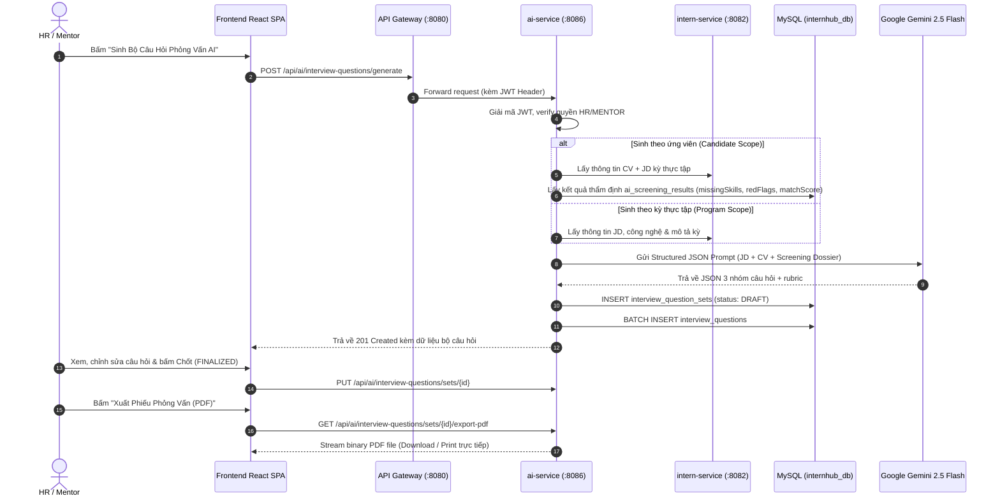

# Đặc Tả Kỹ Thuật (PRD / Technical Specification)
# Module AI-104: AI Tự Động Sinh Bộ Câu Hỏi Phỏng Vấn (Kỹ Thuật, Dự Án & Văn Hóa)

- **Mã sáng kiến:** `TM-104-AI-INTERVIEW-QUESTION-GENERATOR`
- **Tác giả:** Antigravity Pairing Assistant
- **Ngày lập:** 2026-10-15
- **Trạng thái:** DRAFT v2 (Đã bổ sung tích hợp sâu AI Screening Dossier & Phân nhóm 3 chiều)

---

## 1. Bối cảnh & Vấn đề Cần Giải Quyết (Problem Statement)
Trong quy trình tuyển dụng và đánh giá thực tập sinh:
1. **Thiếu chuẩn hóa:** Người phỏng vấn (HR hoặc Mentor) thường chuẩn bị câu hỏi theo cảm tính, dẫn đến việc đánh giá giữa các ứng viên trong cùng một vị trí thiếu tính nhất quán và công bằng.
2. **Mất thời gian chuẩn bị:** Mentor kỹ thuật bận rộn với dự án nên thường không có thời gian soi kỹ từng dòng trong CV của ứng viên để tìm ra các lỗ hổng năng lực hoặc đặt câu hỏi xác thực kinh nghiệm.
3. **Lãng phí dữ liệu từ bước Lọc CV:** Ở bước Thẩm định hồ sơ trước đó (AI Screening), hệ thống đã chỉ ra được điểm tương đồng (`matchScore`), các kỹ năng ứng viên còn thiếu (`missingSkills`) và các điểm đáng ngờ/bất thường (`redFlags`). Tuy nhiên, dữ liệu này hiện chưa được liên kết tự động sang vòng phỏng vấn để chất vấn ứng viên.

**Giải pháp:** Xây dựng tính năng **AI Tự động Sinh Bộ Câu Hỏi Phỏng Vấn** trong `ai-service`, tích hợp liền mạch dữ liệu từ Mô tả kỳ thực tập (JD), CV ứng viên và Hồ sơ thẩm định AI Screening để tự động tạo ra bộ câu hỏi phỏng vấn chuẩn hóa, có thể lưu trữ, chỉnh sửa và xuất file in trực tiếp.

---

## 2. Mục Tiêu & Tiêu Chí Thành Công (Acceptance Criteria - AC)

### 2.1. Mục tiêu (Goals)
- Hỗ trợ **2 phạm vi sinh câu hỏi (2-Tier Generation)**:
  - **Tầng 1 - Program Scope:** Sinh bộ câu hỏi khung tiêu chuẩn cho toàn bộ kỳ thực tập dựa trên JD và yêu cầu công nghệ của phòng ban.
  - **Tầng 2 - Candidate Scope:** Sinh bộ câu hỏi cá nhân hóa chuyên sâu cho từng ứng viên cụ thể, đối soát chéo giữa JD, CV và kết quả AI Screening.
- Phân nhóm câu hỏi thành **3 trụ cột cốt lõi**:
  1. `TECHNICAL_FOUNDATION`: Kiến thức nền tảng, tư duy lập trình và cấu trúc dữ liệu / giải thuật theo vị trí.
  2. `PROJECT_DEEP_DIVE`: Câu hỏi xoáy sâu vào các dự án/công nghệ mà ứng viên khai trong CV để kiểm chứng tính trung thực và mức độ đóng góp thực tế.
  3. `BEHAVIORAL_AND_CULTURE_FIT`: Thái độ làm việc, kỹ năng mềm, khả năng thích nghi và giải quyết xung đột nhóm.
- **Workflow hoàn chỉnh:** Sinh bằng AI ➔ Lưu DB ở trạng thái `DRAFT` ➔ Cho phép HR/Mentor sửa/xóa/thêm câu hỏi thủ công ➔ Chốt `FINALIZED` ➔ Xuất file PDF **Phiếu Phỏng Vấn (Printable Interview Evaluation Sheet)** có ô chấm điểm và nhận xét trực tiếp.

### 2.2. Tiêu chí nghiệm thu chi tiết (Acceptance Criteria)
- **AC-1:** Chỉ người dùng có vai trò `HR`, `MENTOR` hoặc `ADMIN` (hoặc có quyền `AI_INTERVIEW_MANAGE`) mới được phép sinh, xem, chỉnh sửa và xuất bộ câu hỏi phỏng vấn.
- **AC-2:** Khi sinh câu hỏi cấp độ ứng viên (`internId` hợp lệ), hệ thống **bắt buộc** phải truy vấn bảng `ai_screening_results` của ứng viên đó để lấy `match_score`, `missing_skills`, `red_flags` và `strengths`. Prompt của AI phải sinh ít nhất 2 câu hỏi nhằm chất vấn / làm rõ các `missing_skills` và `red_flags` này.
- **AC-3:** Mỗi câu hỏi phỏng vấn sinh ra phải có đầy đủ:
  - `questionText`: Nội dung câu hỏi rõ ràng, sư phạm.
  - `category`: Một trong 3 nhóm (`TECHNICAL_FOUNDATION`, `PROJECT_DEEP_DIVE`, `BEHAVIORAL_AND_CULTURE_FIT`).
  - `difficulty`: `EASY`, `MEDIUM`, `HARD`.
  - `expectedAnswer`: Gợi ý câu trả lời kỳ vọng và các từ khóa mấu chốt (Key points) giúp Mentor/HR nắm bắt nhanh câu trả lời đúng.
  - `evaluationCriteria`: Tiêu chí đánh giá cụ thể (VD: Trả lời được A được 5đ, giải thích được B được 8đ, có ví dụ thực tế được 10đ).
  - `suggestedScoreWeight`: Trọng số điểm (mặc định 10 điểm).
- **AC-4:** Bộ câu hỏi được lưu vào bảng `interview_question_sets` và `interview_questions` ở trạng thái `DRAFT`.
- **AC-5:** HR/Mentor có thể cập nhật nội dung câu hỏi, điều chỉnh trọng số điểm hoặc xóa bớt câu hỏi. Sau khi hài lòng, có thể bấm "Chốt Bộ Câu Hỏi" (`FINALIZED`).
- **AC-6:** Tính năng xuất PDF (`GET /api/ai/interview-questions/sets/{id}/export-pdf`) tạo ra file PDF định dạng A4 chuẩn in ấn, có Header chương trình/ứng viên, bảng câu hỏi chi tiết kèm khung ô trống để người phỏng vấn ghi điểm (1-10) và dòng chữ ký xác nhận của phỏng vấn viên.
- **AC-7:** Xử lý ngoại lệ (Fault Tolerance): Nếu Gemini LLM bị timeout hoặc quá tải, hệ thống phải trả về mã lỗi rõ ràng `504 Gateway Timeout` hoặc `503 Service Unavailable` và không tạo dữ liệu rác trong database.
- **AC-8:** Cơ chế Tự động Dự phòng (Profile Fallback): Nếu ứng viên chưa có kết quả AI Screening (hoặc file CV bị lỗi), hệ thống không báo lỗi mà tự động fallback lấy thông tin từ Profile ứng viên (kỹ năng, trường học, kinh nghiệm dự án đã khai) kết hợp với JD của kỳ thực tập để tạo bộ câu hỏi tiệm cận nhất.
- **AC-9:** Tính năng "Đổi câu hỏi khác" (Regenerate Single Question): Cung cấp endpoint `POST /api/ai/interview-questions/sets/{setId}/questions/{questionId}/regenerate` cho phép AI tạo ra 1 câu hỏi mới thay thế đúng vị trí, đúng nhóm (`category`) và độ khó (`difficulty`) mà không làm thay đổi các câu hỏi khác trong bộ.

---

## 3. Kiến Trúc Kỹ Thuật & Luồng Tích Hợp (Architecture & Data Flow)



---

## 4. Thiết Kế Cơ Sở Dữ Liệu (Database Schema)

```sql
-- Bảng quản lý Bộ Câu Hỏi Phỏng Vấn
CREATE TABLE IF NOT EXISTS interview_question_sets (
    id BIGINT AUTO_INCREMENT PRIMARY KEY,
    title VARCHAR(255) NOT NULL COMMENT 'Tiêu đề bộ câu hỏi (VD: Phỏng vấn Backend - Đặng Văn GPA)',
    program_id BIGINT NULL COMMENT 'Mã kỳ thực tập liên kết',
    intern_id BIGINT NULL COMMENT 'Mã ứng viên (nếu sinh cá nhân hóa theo CV)',
    scope VARCHAR(30) NOT NULL DEFAULT 'PROGRAM' COMMENT 'PROGRAM hoặc CANDIDATE',
    target_role VARCHAR(100) NOT NULL COMMENT 'Vị trí chuyên môn (Backend, Frontend, Fullstack...)',
    status VARCHAR(30) NOT NULL DEFAULT 'DRAFT' COMMENT 'DRAFT (cho phép sửa) hoặc FINALIZED (đã chốt)',
    total_questions INT NOT NULL DEFAULT 0 COMMENT 'Tổng số câu hỏi trong bộ',
    screening_result_id BIGINT NULL COMMENT 'Liên kết sang bảng ai_screening_results (nếu có)',
    screening_match_score DECIMAL(5,2) NULL COMMENT 'Điểm match score tham chiếu từ bước screening',
    created_by_user_id VARCHAR(100) NOT NULL COMMENT 'ID người tạo (HR / Mentor)',
    created_by_name VARCHAR(150) NOT NULL COMMENT 'Tên người tạo',
    created_at DATETIME(6) NOT NULL DEFAULT CURRENT_TIMESTAMP(6),
    updated_at DATETIME(6) NOT NULL DEFAULT CURRENT_TIMESTAMP(6) ON UPDATE CURRENT_TIMESTAMP(6),
    INDEX idx_iqs_program (program_id),
    INDEX idx_iqs_intern (intern_id),
    INDEX idx_iqs_status (status)
) ENGINE=InnoDB DEFAULT CHARSET=utf8mb4 COLLATE=utf8mb4_unicode_ci;

-- Bảng chi tiết từng Câu Hỏi trong Bộ
CREATE TABLE IF NOT EXISTS interview_questions (
    id BIGINT AUTO_INCREMENT PRIMARY KEY,
    set_id BIGINT NOT NULL COMMENT 'Khóa ngoại liên kết interview_question_sets',
    category VARCHAR(50) NOT NULL COMMENT 'TECHNICAL_FOUNDATION, PROJECT_DEEP_DIVE, BEHAVIORAL_AND_CULTURE_FIT',
    difficulty VARCHAR(30) NOT NULL DEFAULT 'MEDIUM' COMMENT 'EASY, MEDIUM, HARD',
    question_text TEXT NOT NULL COMMENT 'Nội dung câu hỏi phỏng vấn',
    expected_answer TEXT NULL COMMENT 'Gợi ý câu trả lời kỳ vọng / Điểm mấu chốt',
    evaluation_criteria TEXT NULL COMMENT 'Tiêu chí đánh giá / Thang điểm chi tiết',
    suggested_score_weight INT NOT NULL DEFAULT 10 COMMENT 'Thang điểm tối đa của câu hỏi',
    display_order INT NOT NULL DEFAULT 1 COMMENT 'Thứ tự hiển thị trong bộ câu hỏi',
    focus_area VARCHAR(150) NULL COMMENT 'Điểm mấu chốt nhắm tới (VD: Xử lý Missing Skill Docker, Kiểm chứng Project E-commerce)',
    created_at DATETIME(6) NOT NULL DEFAULT CURRENT_TIMESTAMP(6),
    updated_at DATETIME(6) NOT NULL DEFAULT CURRENT_TIMESTAMP(6) ON UPDATE CURRENT_TIMESTAMP(6),
    CONSTRAINT fk_iq_set FOREIGN KEY (set_id) REFERENCES interview_question_sets (id) ON DELETE CASCADE,
    INDEX idx_iq_category (category),
    INDEX idx_iq_order (set_id, display_order)
) ENGINE=InnoDB DEFAULT CHARSET=utf8mb4 COLLATE=utf8mb4_unicode_ci;
```

---

## 5. Thiết Kế Prompt Engineering Cho Gemini AI

### 5.1. System Prompt
```text
Bạn là Trợ lý Chuyên gia Tuyển dụng Kỹ thuật và Phỏng vấn cấp cao của tập đoàn InternHub.
Nhiệm vụ của bạn là xây dựng bộ câu hỏi phỏng vấn thực tập sinh cực kỳ sắc bén, thực tế và khách quan.

BẠN PHẢI PHÂN CHIA BỘ CÂU HỎI THÀNH ĐÚNG 3 NHÓM:
1. TECHNICAL_FOUNDATION: Kiểm tra kiến thức nền tảng vững chắc, tư duy thuật toán/hệ thống theo vị trí.
2. PROJECT_DEEP_DIVE: Hỏi xoáy sâu vào các dự án ứng viên khai trong CV để xác minh độ trung thực, vai trò thực tế và cách giải quyết bài toán.
3. BEHAVIORAL_AND_CULTURE_FIT: Kiểm tra tinh thần học hỏi, khả năng chịu áp lực, giao tiếp và văn hóa làm việc nhóm.

ĐẶC BIỆT KHI CÓ DỮ LIỆU AI SCREENING (missingSkills, redFlags):
- Bạn PHẢI tạo ít nhất 2 câu hỏi nhắm thẳng vào các kỹ năng còn thiếu (missingSkills) để kiểm tra khả năng tự học/học bù.
- Bạn PHẢI tạo ít nhất 1 câu hỏi đối chất với các điểm bất thường (redFlags) trong CV để kiểm chứng tính xác thực.

ĐẦU RA BẮT BUỘC LÀ JSON NGUYÊN BẢN (KHÔNG BỌC TRONG MARKDOWN CODE BLOCK):
{
  "title": "Bộ câu hỏi phỏng vấn ...",
  "questions": [
    {
      "category": "TECHNICAL_FOUNDATION | PROJECT_DEEP_DIVE | BEHAVIORAL_AND_CULTURE_FIT",
      "difficulty": "EASY | MEDIUM | HARD",
      "questionText": "...",
      "expectedAnswer": "...",
      "evaluationCriteria": "...",
      "suggestedScoreWeight": 10,
      "focusArea": "..."
    }
  ]
}
```

---

## 6. Đặc Tả Chi Tiết API Endpoints

### 6.1. Sinh bộ câu hỏi phỏng vấn bằng AI
- **Endpoint:** `POST /api/ai/interview-questions/generate`
- **Quyền:** `hasAnyRole('HR', 'MENTOR', 'ADMIN')`
- **Request Body DTO:**
  ```json
  {
    "programId": 1,
    "internId": 4,                       // Optional (nếu có -> sinh cá nhân hóa)
    "targetRole": "Backend Developer",
    "totalQuestions": 8,                 // Số lượng câu hỏi mong muốn (mặc định 6-9 câu)
    "includeScreeningDossier": true      // Có tích hợp missingSkills/redFlags không
  }
  ```
- **Response 201 Created:**
  ```json
  {
    "code": 201,
    "message": "Sinh bộ câu hỏi phỏng vấn thành công",
    "data": {
      "id": 12,
      "title": "Bộ câu hỏi phỏng vấn Backend Developer - Ứng viên Đặng Văn GPA",
      "scope": "CANDIDATE",
      "status": "DRAFT",
      "totalQuestions": 8,
      "screeningMatchScore": 75.5,
      "questions": [
        {
          "id": 45,
          "category": "PROJECT_DEEP_DIVE",
          "difficulty": "MEDIUM",
          "questionText": "Trong dự án E-commerce bạn khai đã tối ưu query MySQL, hãy mô tả cụ thể bạn đã đánh Index như thế nào và đo lường hiệu năng bằng công cụ gì?",
          "expectedAnswer": "Ứng viên nêu được lệnh EXPLAIN, chỉ mục B-Tree, Composite Index và slow query log.",
          "evaluationCriteria": "Hiểu bản chất Index: 7-8đ; có số liệu đo lường cụ thể trước/sau tối ưu: 9-10đ.",
          "suggestedScoreWeight": 10,
          "focusArea": "Xác minh kinh nghiệm tối ưu database trong CV"
        }
      ]
    }
  }
  ```

### 6.2. Lấy chi tiết bộ câu hỏi
- **Endpoint:** `GET /api/ai/interview-questions/sets/{id}`
- **Response 200 OK:** Toàn bộ thông tin bộ câu hỏi và danh sách câu hỏi sắp xếp theo `display_order`.

### 6.3. Cập nhật / Tùy chỉnh bộ câu hỏi (Manual Customization & Finalization)
- **Endpoint:** `PUT /api/ai/interview-questions/sets/{id}`
- **Request Body:**
  ```json
  {
    "title": "Bộ câu hỏi phỏng vấn Backend - Đã hiệu chỉnh",
    "status": "FINALIZED",               // Chuyển sang FINALIZED khi đã duyệt xong
    "questions": [
      {
        "id": 45,
        "questionText": "Nội dung câu hỏi đã được Mentor sửa lại...",
        "expectedAnswer": "...",
        "evaluationCriteria": "...",
        "suggestedScoreWeight": 15
      }
    ]
  }
  ```

### 6.4. Đổi / Tái sinh riêng 1 câu hỏi cụ thể (Regenerate Single Question)
- **Endpoint:** `POST /api/ai/interview-questions/sets/{setId}/questions/{questionId}/regenerate`
- **Mô tả:** Giữ nguyên các câu khác, AI chỉ sinh 1 câu hỏi mới cùng nhóm (`category`) và độ khó (`difficulty`) thay thế cho câu hiện tại.
- **Response 200 OK:** Chi tiết câu hỏi mới được cập nhật trong Database.

### 6.4. Xuất file Phiếu Phỏng Vấn (Printable PDF Sheet)
- **Endpoint:** `GET /api/ai/interview-questions/sets/{id}/export-pdf`
- **Headers:** `Content-Type: application/pdf`, `Content-Disposition: inline; filename="phieu-phong-van-INT4.pdf"`
- **Đặc điểm file PDF:**
  - Tiêu đề trang trọng: TẬP ĐOÀN INTERNHUB - PHIẾU ĐÁNH GIÁ PHỎNG VẤN THỰC TẬP SINH.
  - Thông tin ứng viên / kỳ thực tập, điểm sàng lọc AI Screening.
  - Bảng 3 nhóm câu hỏi với 4 cột: STT & Câu hỏi | Gợi ý trả lời & Tiêu chí | Điểm chấm (1-10) | Ghi chú người phỏng vấn.
  - Phần tổng kết điểm số, đánh giá chung ĐẠT / KHÔNG ĐẠT và chỗ ký tên của người phỏng vấn.

---

## 7. Giao Diện Người Dùng (Frontend UI/UX)

1. **Điểm kích hoạt (Entry Points):**
   - **Tại Workspace Kỳ Thực Tập:** Tab "Đội Ngũ Mentors" hoặc "Tổng Quan" có nút *"Sinh Bộ Câu Hỏi Khung Cho Kỳ"* ➔ Tạo bộ câu hỏi tầng Chương trình.
   - **Tại Danh Sách Ứng Viên / Chi Tiết Ứng Viên (Applications Tab):** Cột thao tác của từng ứng viên có nút icon *"Phỏng Vấn AI"* (bên cạnh nút xem AI Screening) ➔ Tạo bộ câu hỏi tầng Cá nhân hóa.
2. **Modal Xem & Chỉnh Sửa Bộ Câu Hỏi (`InterviewQuestionSetModal.tsx`):**
   - Phân chia tab trực quan theo 3 nhóm: `Kiến thức nền tảng`, `Đào sâu dự án`, `Kỹ năng mềm & Văn hóa`.
   - Các câu hỏi nhắm vào `missingSkills` hoặc `redFlags` được gắn badge highlight nổi bật (VD: `⚠️ Đối chất điểm nghi vấn`, `🎯 Kiểm tra kỹ năng thiếu`).
   - Có nút *Chỉnh sửa trực tiếp*, *Thêm câu hỏi mới*, *Lưu nháp (DRAFT)*, *Chốt câu hỏi (FINALIZED)* và *In / Xuất PDF Phiếu Đánh Giá*.
3. **Tuân thủ chuẩn thiết kế:** Giao diện sáng (Light Theme) đồng bộ 100%, card trắng viền xám sáng, icon Lucide trực quan, typography rõ ràng, không sử dụng class dark mode gây vỡ màu.

---

## 8. Ma Trận Phân Quyền (RBAC Matrix) & Quyền Hạn
- Thêm permission mới: `AI_INTERVIEW_MANAGE` (Quản lý và sinh bộ câu hỏi phỏng vấn AI).
- Seed tự động cho 2 role: `ROLE_HR` và `ROLE_MENTOR` (cùng `ROLE_ADMIN`).
- **Ma trận quyền hạn chi tiết:**

| Role | Sinh bộ câu hỏi | Xem danh sách | Sửa/Xóa câu hỏi | Đổi câu hỏi (Regenerate) | Chốt FINALIZED | Xuất PDF |
| :--- | :---: | :---: | :---: | :---: | :---: | :---: |
| **HR** | ✅ | ✅ | ✅ | ✅ | ✅ | ✅ |
| **MENTOR** | ✅ | ✅ | ✅ | ✅ | ✅ | ✅ |
| **ADMIN** | ✅ | ✅ | ✅ | ✅ | ✅ | ✅ |
| **INTERN** | ❌ (403) | ❌ (403) | ❌ (403) | ❌ (403) | ❌ (403) | ❌ (403) |

---

## 9. Kế Hoạch Kiểm Thử & Kịch Bản Thử Nghiệm (Test Plan)
- **TC-01 (Program Scope Generation):** Sinh bộ câu hỏi theo kỳ thực tập (chỉ truyền `programId`). Kỳ vọng: Sinh đủ 3 nhóm câu hỏi bám sát JD, không có câu hỏi xoáy CV cá nhân.
- **TC-02 (Candidate Scope + Screening Dossier):** Sinh bộ câu hỏi cho ứng viên đã qua AI Screening có `missingSkills` (VD: Docker) và `redFlags`. Kỳ vọng: Tối thiểu 2 câu hỏi kỹ thuật nhắm vào Docker và 1 câu hỏi kiểm chứng red flag.
- **TC-03 (Candidate Scope Profile Fallback):** Sinh bộ câu hỏi cho ứng viên chưa qua AI Screening. Kỳ vọng: Hệ thống tự động fallback đọc kỹ năng từ Profile ứng viên, không văng lỗi 500.
- **TC-04 (Regenerate Single Question):** Bấm "Đổi câu hỏi khác" cho câu hỏi số 3. Kỳ vọng: Chỉ câu số 3 thay đổi nội dung, các câu hỏi 1, 2, 4-8 giữ nguyên 100%.
- **TC-05 (Manual Edit & Finalize):** Mentor sửa nội dung câu hỏi và bấm Chốt. Kỳ vọng: Status chuyển sang `FINALIZED`, lưu DB thành công.
- **TC-06 (Export PDF Evaluation Sheet):** Tải file PDF. Kỳ vọng: File PDF A4 mở được, có font tiếng Việt chuẩn không bị lỗi font, bảng biểu căn chỉnh ngay ngắn kèm ô điểm và chữ ký.
- **TC-07 (Security & RBAC):** Dùng token của Thực tập sinh gọi API. Kỳ vọng: Nhận `403 Forbidden`.

