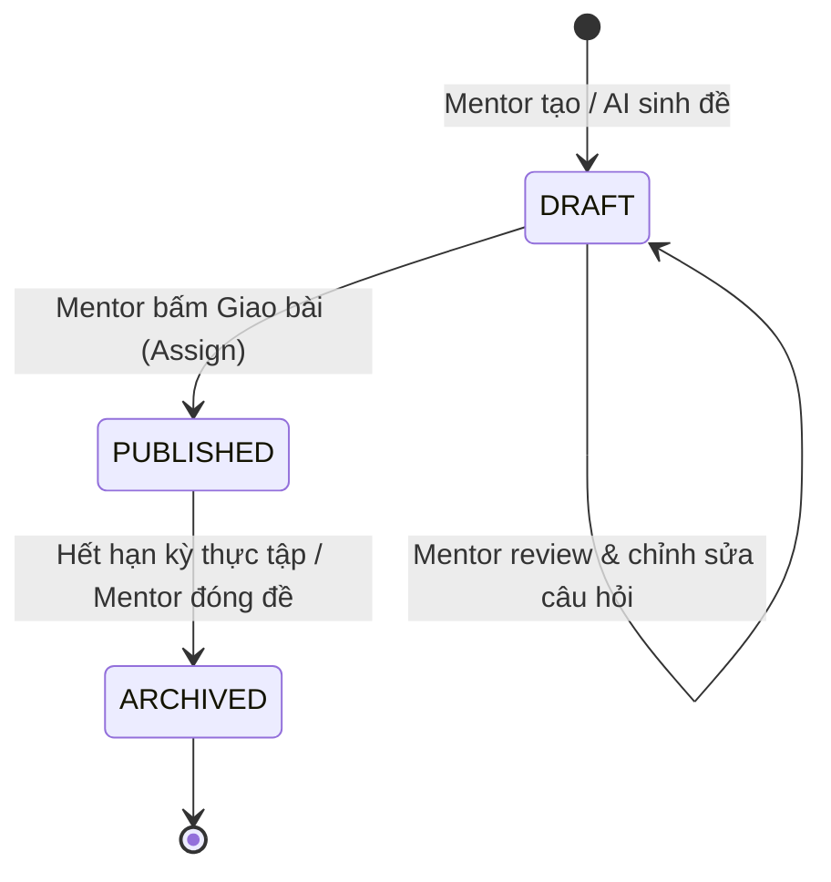
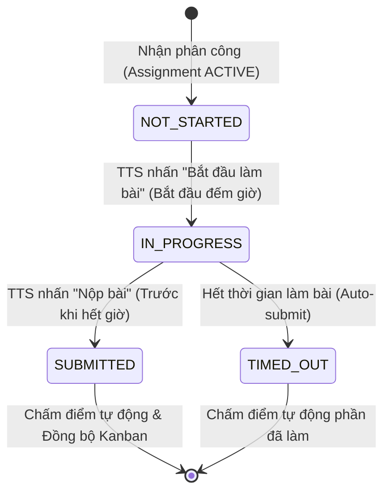
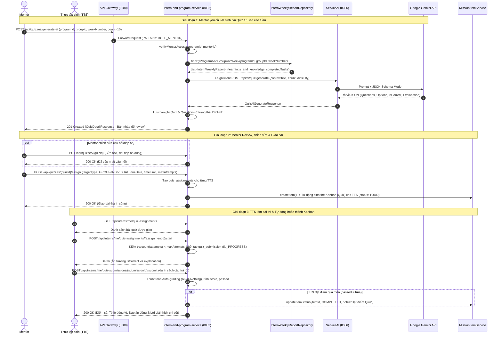
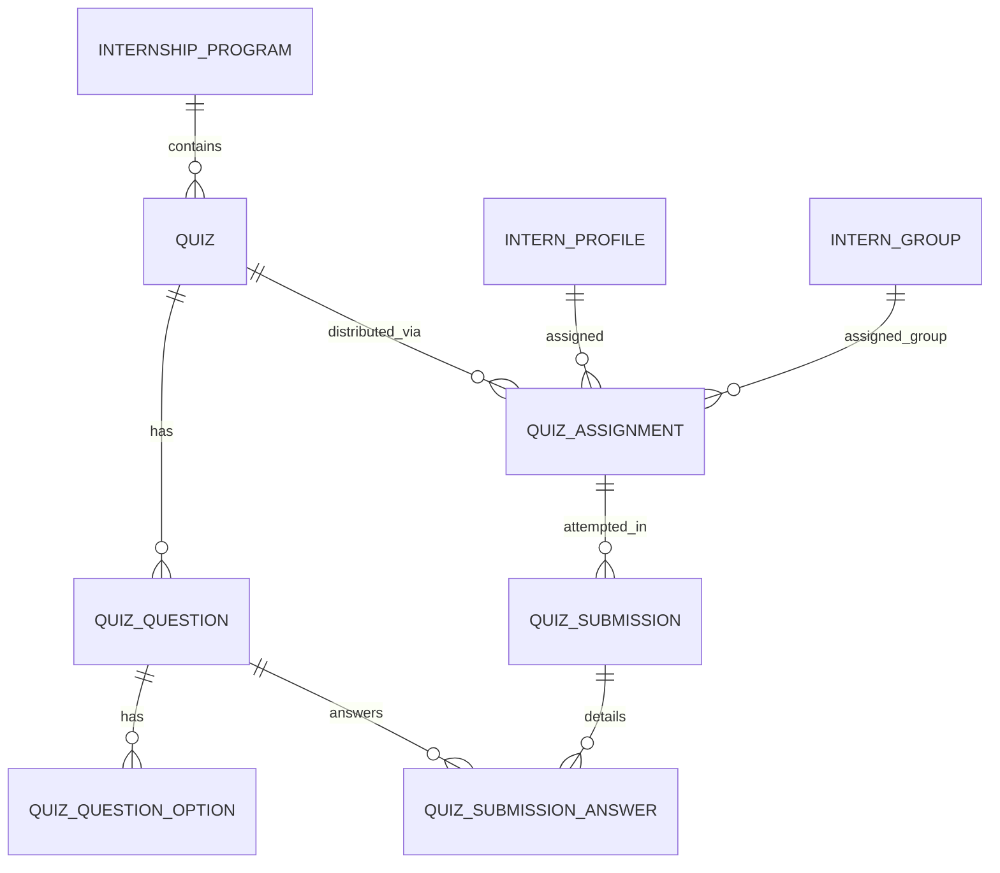

# Specification: Hệ Thống Sinh Bài Quiz Bằng AI & Phân Công Nhiệm Vụ Cho Thực Tập Sinh (TM-104)

> **Tài liệu Đặc Tả Kỹ Thuật (Feature Specification)**  
> **Dự án:** [InternHub](file:///d:/codegym_final_project/InternHub) (Backend Microservices - `intern-and-program-service` & `ServiceAI`)  
> **Mã Jira Ticket:** [TM-104](https://robluccibn9935.atlassian.net/browse/TM-104): *Mentor AI Quiz Generation & Intern Task Delegation System*  
> **Trạng thái:** APPROVED / READY FOR IMPLEMENTATION  
> **Lưu trữ tại:** `InternHub/docs/specs/TM-104-mentor-ai-quiz-generation-and-assignment-spec.md`  
> **Cấp độ thay đổi (Change Level):** **L3** (Tích hợp liên dịch vụ giữa `intern-and-program-service` và `ServiceAI` qua OpenFeign, mở rộng mô hình dữ liệu Quiz/Assignment/Submission kế thừa `BaseEntity`, khai thác dữ liệu báo cáo tuần `InternWeeklyReport` làm ngữ cảnh AI, tự động hóa chấm điểm và đồng bộ Kanban Mission).  
> **Tuân thủ quy chuẩn:** Tuân thủ 100% tài liệu [AGENTS.md](file:///d:/codegym_final_project/InternHub/AGENTS.md) và thư mục [`.agents/`](file:///d:/codegym_final_project/InternHub/.agents/).

---

## 0. Nhật Ký Thay Đổi & Giải Trình Kỹ Thuật (Revision History & Change Rationale)

| Phiên bản | Ngày | Người thực hiện | Task / Jira | Loại thay đổi | Lý do & Giải trình kỹ thuật (Rationale) |
| :---: | :---: | :---: | :---: | :---: | :--- |
| **v1.0** | 2026-10-14 | AI Senior Backend Pair-Programmer & User | `TM-104` | Khởi tạo Đặc Tả Kỹ Thuật | Khởi tạo tài liệu đặc tả 14 phần chuẩn hóa cho phân hệ Quiz AI. Kết hợp nguồn dữ liệu báo cáo tuần (`learnings_and_knowledge`) với Google Gemini Structured Output, hỗ trợ trắc nghiệm đơn/đa lựa chọn, cấu hình số lần làm bài (`maxAttempts`), tự động chấm điểm tức thì và đồng bộ thẻ nhiệm vụ Kanban. |
| **v1.1** | 2026-10-14 | AI Senior Backend Pair-Programmer & User | `TM-104` | Cập nhật quy tắc bảo mật đáp án | Bổ sung ràng buộc bảo mật: Bài Quiz bắt buộc phải hoàn thành nộp bài trước (trạng thái `SUBMITTED` hoặc `TIMED_OUT`), hệ thống mới mở khóa và hiển thị đáp án đúng (`correctOptionIds`) cùng lời giải thích chi tiết (`explanation`). |
| **v1.2** | 2026-10-26 | AI Senior Backend Pair-Programmer & User | `TM-104` | Tái cấu trúc tích hợp Kanban Task Modal | Hợp nhất luồng tạo đề Quiz AI vào trực tiếp Modal Giao Việc Kanban (`MissionItemModal`). Mentor bấm nút tạo câu hỏi để mở form cấu hình (số câu, độ khó, chủ đề bám theo task), hệ thống tổng hợp prompt template chuẩn gửi Gemini AI, liên kết bài Quiz với Task Kanban và phân công tự động cho TTS phụ trách. Mở quyền `/api/ai/quiz/**` trong `ai-service` cho FeignClient nội bộ. |

---

## 1. Feature Overview (Tổng Quan Tính Năng)

- **Tên tính năng:** Hệ thống sinh bài Quiz bằng AI & Phân công nhiệm vụ cho Thực tập sinh / Nhóm thực tập sinh (Mentor AI Quiz Generation & Intern Task Delegation System).
- **Mã Jira Ticket:** `TM-104`.
- **Target Microservices:**
  - `intern-and-program-service` (Port 8082, Spring Boot 3, Java 17): Đóng vai trò **Quiz Core & Business Domain** (lưu trữ đề thi, câu hỏi, phân bổ bài làm cho 1 TTS hoặc 1 nhóm TTS, tự động chấm điểm, tính phổ điểm và đồng bộ thẻ Kanban).
  - `ServiceAI` (Port 8086, Spring Boot 4 / Spring Cloud 2025): Đóng vai trò **AI Generation Engine** (nhận ngữ cảnh báo cáo tuần hoặc chủ đề từ Mentor $\rightarrow$ gọi Google Gemini 1.5 Flash với chế độ Structured JSON $\rightarrow$ trả về bộ câu hỏi chuẩn trắc nghiệm).
  - `api-gateway` (Port 8080): Định tuyến thông suốt và xác thực quyền JWT Bearer Token.
- **Target Users & Roles:**
  - `ROLE_MENTOR`: Yêu cầu AI sinh bài quiz, xem trước (Review), chỉnh sửa câu hỏi/đáp án, cấu hình thời gian & số lần làm lại, giao bài cho 1 TTS hoặc 1 nhóm TTS, xem bảng điểm thống kê.
  - `ROLE_INTERN`: Xem danh sách bài Quiz được giao, thực hiện làm bài có đếm giờ, nộp bài, xem điểm số tức thì và giải thích chi tiết, xem lại lịch sử các bài đã làm.
  - `ROLE_HR`, `ROLE_ADMIN`: Xem báo cáo kết quả đánh giá năng lực TTS phục vụ tổng kết kỳ thực tập.

---

## 2. Business Goal & Core Objectives (Mục Tiêu Nghiệp Vụ)

1. **AI Trợ Giảng Thông Minh Bám Sát Thực Tế (Data-Driven AI Quiz):** Khác với các hệ thống sinh câu hỏi ngẫu nhiên chung chung, TM-104 khai thác trực tiếp trường `learnings_and_knowledge` và `completed_tasks_summary` trong Báo cáo tuần ([`InternWeeklyReport`](file:///d:/codegym_final_project/InternHub/intern-and-program-service/src/main/java/org/example/internservice/intern/entity/InternWeeklyReport.java)) của chính các TTS trong nhóm để tạo bài ôn tập đo lường đúng những gì các bạn đã học và làm trong tuần.
2. **Quy Trình Kiểm Duyệt Nhân Văn (Human-in-the-Loop Review):** AI đóng vai trò soạn thảo sơ bộ (DRAFT); Mentor luôn có toàn quyền xem trước (Preview), chỉnh sửa câu chữ, điều chỉnh phương án đúng/sai, thêm bớt câu hỏi để bảo đảm độ chính xác 100% trước khi giao cho học viên.
3. **Đa Dạng Hóa Hình Thức Đánh Giá (Single & Multiple Choice):** Hỗ trợ linh hoạt cả câu hỏi 1 đáp án đúng (`SINGLE_CHOICE`) và câu hỏi nhiều đáp án đúng (`MULTIPLE_CHOICE`), áp dụng quy chuẩn chấm điểm chuẩn quốc tế (**All-or-Nothing Rule**).
4. **Thúc Đẩy Tinh Thần Học Tập Tiến Bộ (Mastery Learning via `maxAttempts`):** Mentor có thể cho phép TTS làm lại bài nhiều lần (ví dụ 2 hoặc 3 lần) để rút kinh nghiệm từ lỗi sai, hệ thống tự động ghi nhận điểm cao nhất (`MAX(score)`).
5. **Đồng Bộ Tự Động Bảng Nhiệm Vụ Kanban (Seamless Kanban Integration):** Giao bài Quiz sẽ tự động tạo một thẻ nhiệm vụ [`MissionItem`](file:///d:/codegym_final_project/InternHub/intern-and-program-service/src/main/java/org/example/internservice/mission/entity/MissionItem.java) trên cột `TODO` của TTS; khi TTS làm bài đạt điểm qua môn, thẻ nhiệm vụ tự động chuyển sang `COMPLETED`, giúp luồng công việc của Mentor và TTS thống nhất một mối.
6. **Không Gian Lưu Trữ & Tra Cứu Chuyên Biệt (Dedicated Quiz Hub):** Cung cấp giao diện quản lý Quiz độc lập cho phép học viên ôn lại kiến thức và Mentor theo dõi phổ điểm của toàn bộ thực tập sinh.

---

## 3. Scope of Work (Phạm Vi Tính Năng)

### 3.1. Trong phạm vi (In Scope)

1. **Phân hệ `ServiceAI` (Port 8086):**
   - Bổ sung Prompt Template và JSON Schema cho chức năng sinh đề thi trắc nghiệm (`SINGLE_CHOICE` và `MULTIPLE_CHOICE`).
   - Endpoint nội bộ: `POST /api/ai/quiz/generate` nhận thông tin ngữ cảnh (chủ đề, kiến thức báo cáo tuần hoặc tiêu đề task Kanban, số lượng câu, độ khó).
   - Cấu hình bảo mật `SecurityConfig`: Mở quyền `permitAll()` cho route `/api/ai/quiz/**` để FeignClient nội bộ từ `intern-and-program-service` gọi thông suốt mà không phát sinh lỗi 403.
   - Cơ chế Mock Mode (`GEMINI_MOCK_MODE=true`) sinh dữ liệu mẫu giả lập chuẩn xác khi dev/test không có Internet hoặc không có API Key.
2. **Phân hệ `intern-and-program-service` (Port 8082):**
   - **Tích hợp FeignClient:** Gọi sang `ServiceAI` truyền ngữ cảnh lấy từ Báo cáo tuần (`InternWeeklyReport`) hoặc từ Tiêu đề công việc Kanban (`MissionItem`).
   - **Hỗ trợ 2 chế độ sinh đề AI (`POST /api/quizzes/generate-ai`):**
     - Chế độ 1: Bóc tách kiến thức từ Báo cáo tuần (`groupId` + `weekNumber`).
     - Chế độ 2: Sinh nhanh theo chủ đề công việc (`topic`), không bắt buộc có nhóm hoặc tuần.
   - **Mô hình dữ liệu Quiz:** Tạo 6 bảng CSDL kế thừa `BaseEntity` (`quizzes`, `quiz_questions`, `quiz_question_options`, `quiz_assignments`, `quiz_submissions`, `quiz_submission_answers`).
   - **Quản lý vòng đời Quiz:** Tạo nháp $\rightarrow$ Cập nhật câu hỏi $\rightarrow$ Xuất bản $\rightarrow$ Lưu trữ.
   - **Cơ chế Phân công (Assignment Engine):**
     - Giao cho **1 hoặc nhiều TTS cụ thể**: Tạo các bản ghi `quiz_assignments` theo danh sách `internIds` được giao task.
     - Giao cho **1 Nhóm TTS (`InternGroup`)**: Hệ thống tự động quét toàn bộ TTS thuộc nhóm và tạo bản ghi phân công cho từng học viên.
   - **Đồng bộ Kanban Mission:** Tự động liên kết `quiz_id` với thẻ nhiệm vụ `MissionItem`, và tự động cập nhật `COMPLETED` khi học viên làm đạt điểm qua môn.
   - **Bộ máy Chấm Điểm Tự Động (Auto-grading Engine):** Chấm điểm tức thì, xác định Đạt/Trượt (`passed`), tính điểm cao nhất trong các lượt thi (`attempt_number`).
   - **Bảo mật RBAC:** Kiểm tra chặt chẽ quyền Mentor đối với chương trình thông qua `verifyMentorAccess`, chống IDOR truy cập chéo giữa các chương trình.

### 3.2. Ngoài phạm vi (Out of Scope - *Ngăn chặn suy diễn sai*)

- **Tuyệt đối KHÔNG sửa Frontend:** Mọi công việc trong ticket này thuộc phân hệ Backend. Frontend sẽ được triển khai theo spec riêng tuân thủ ranh giới cách ly (Boundary Isolation).
- **Không hỗ trợ câu hỏi Tự luận (Free-text Essay):** TM-104 tập trung 100% vào trắc nghiệm khách quan để hệ thống chấm điểm tự động trong $O(1)$ thời gian, không phát sinh chi phí và độ trễ gọi AI chấm bài luận.
- **Không thay đổi cấu trúc bảng `intern_weekly_reports`:** Chỉ đọc (Read-only) dữ liệu báo cáo tuần để làm ngữ cảnh AI.

---

## 4. State Machine & Luồng Xử Lý (Workflow Diagrams)

### 4.1. Vòng Đời Trạng Thái Bài Quiz (Quiz Lifecycle)



### 4.2. Vòng Đời Lượt Làm Bài Của TTS (Submission Lifecycle)



### 4.3. Sequence Diagram Toàn Diện (End-to-End Execution Flow)



---

## 5. Potential Logic Loopholes & Mitigations (Các Lỗ Hổng & Giải Pháp)

| STT | Tình huống rủi ro / Lỗ hổng | Hậu quả tiềm ẩn | Giải pháp khắc phục triệt để |
| :---: | :--- | :--- | :--- |
| **1** | **Nhóm chưa nộp hoặc nộp quá ít báo cáo tuần** | AI nhận nội dung rỗng hoặc câu hỏi sinh ra sơ sài, thiếu chính xác | Kiểm tra độ dài văn bản tổng hợp. Nếu `< 50 ký tự` hoặc không có báo cáo tuần nào hợp lệ, Service tự động fallback sử dụng thông tin Chương trình (`program.name`, `program.description`) và ném cảnh báo kèm đề xuất Mentor nhập chủ đề bổ sung |
| **2** | **Gian lận xem trước đáp án qua DevTools (Network tab)** | Học viên F12 xem response API khi đang làm bài để biết đáp án đúng | Khi TTS bắt đầu làm bài (`/start`), DTO trả về ([`QuizTakingResponse`](#)) **loại bỏ hoàn toàn trường `isCorrect` và `explanation`**. Hệ thống áp dụng nguyên tắc nghiêm ngặt: **Học viên bắt buộc phải hoàn thành nộp bài thi (`SUBMITTED` hoặc `TIMED_OUT`) trước thì mới được phép mở khóa và xem đáp án cùng giải thích chi tiết** |
| **3** | **Cố tình nộp bài sau khi hết thời gian làm bài (Client Timer Tampering)** | Học viên sửa đồng hồ máy tính hoặc cố tình ngâm đề thi để tra cứu tài liệu | Server lưu mốc `startedAt` trong DB. Khi nhận request `/submit`, Server kiểm tra: $\text{elapsedMinutes} > \text{timeLimitMinutes} + 1\text{ phút (grace period)}$. Nếu quá thời gian cho phép, Server tự động đóng bài thi với trạng thái `TIMED_OUT` và chỉ chấm các câu đã lưu |
| **4** | **Gian lận vượt số lần làm bài cho phép (`maxAttempts`)** | TTS gửi liên tiếp nhiều request `/start` để tạo nhiều bài thi song song | Sử dụng giao dịch `@Transactional` kết hợp đếm số bản ghi `quiz_submissions` có trạng thái khác `CANCELLED`. Nếu $\text{count} \ge \text{maxAttempts}$, ném ngay `BadRequestException("Bạn đã sử dụng hết số lượt làm bài cho phép (" + maxAttempts + " lượt)")` |
| **5** | **Thao tác dữ liệu chéo giữa các Mentor (Cross-Program IDOR)** | Mentor A cố tình giao bài Quiz của Chương trình 1 cho học viên thuộc Chương trình 2 | Áp dụng hàm `verifyMentorAccess` kiểm tra tính hợp lệ của `programId`. Mọi TTS hoặc Nhóm được gán phải có quan hệ chặt chẽ với `programId` của bài Quiz, nếu không ném ngay `AccessDeniedException` (HTTP 403) |
| **6** | **Chấm sai câu hỏi Nhiều đáp án (`MULTIPLE_CHOICE`)** | Học viên chỉ chọn 1 đáp án đúng trong số 3 đáp án đúng nhưng vẫn được trọn điểm | Áp dụng giải thuật so sánh hai tập hợp (Set Equality): $\text{selectedOptionIds} = \text{correctOptionIds}$. Phải khớp chính xác 100% cả về số lượng và ID mới được tính điểm |

---

## 6. Functional Requirements (Yêu Cầu Chức Năng)

- **FR-1 (AI Generation from Weekly Reports):** Cho phép Mentor chọn chương trình, nhóm học viên và số tuần; hệ thống tự động bóc tách kiến thức từ `intern_weekly_reports` và gọi `ServiceAI` sinh bộ câu hỏi trắc nghiệm tương ứng.
- **FR-2 (AI Generation from Free Topic):** Cho phép Mentor nhập chủ đề tự do (ví dụ: *"Spring Security JWT và Hibernate Caching"*), chọn số lượng câu (5 - 20 câu), chọn độ khó (`EASY`, `MEDIUM`, `HARD`) để AI sinh đề thi tức thì.
- **FR-3 (Mentor Preview & Modification):** Cho phép Mentor xem trước toàn bộ câu hỏi nháp, chỉnh sửa nội dung câu hỏi, chỉnh sửa text của từng phương án, thay đổi đáp án đúng, thêm câu hỏi mới hoặc xóa bớt câu hỏi.
- **FR-4 (Flexible Quiz Assignment):** Cho phép Mentor giao bài Quiz cho:
  - Một học viên cụ thể (`INDIVIDUAL`).
  - Toàn bộ thành viên của một nhóm (`GROUP`).
  Kèm cấu hình: Hạn chót nộp bài (`dueDate`), Thời gian làm bài (`timeLimitMinutes`), Điểm đạt (`passingScore`), Số lần được làm lại (`maxAttempts`).
- **FR-5 (Automatic Kanban Synchronization):** Khi bài Quiz được xuất bản và giao cho học viên, hệ thống tự động tạo một thẻ nhiệm vụ `MissionItem` (tiền tố `[Quiz]`) trên Kanban Board của chương trình.
- **FR-6 (Secure Quiz Taking):** Thực tập sinh xem danh sách bài thi và bắt đầu làm bài (`/start`). Trong suốt thời gian làm bài thi, hệ thống ẩn 100% đáp án đúng (`isCorrect`) và lời giải thích (`explanation`) để bảo mật đề thi tuyệt đối.
- **FR-7 (Post-Completion Instant Auto-Grading & Detailed Feedback):** Yêu cầu bài Quiz **phải được hoàn thành trước** (học viên bấm Nộp bài hoặc hệ thống tự động đóng khi hết giờ $\rightarrow$ trạng thái `SUBMITTED`/`TIMED_OUT`), sau đó hệ thống mới chấm điểm tự động và **mở khóa hiển thị đáp án đúng cùng lời giải thích chi tiết** cho từng câu hỏi.
- **FR-8 (Retake Management & Highest Score Tracking):** Nếu bài Quiz cho phép làm lại (`maxAttempts > 1`), TTS có thể thi lại; hệ thống lưu trữ lịch sử tất cả các lần thi và tự động lấy lần có điểm cao nhất làm điểm đánh giá chính thức.
- **FR-9 (Kanban Auto-Completion):** Khi TTS đạt điểm qua môn (`passed = true`), hệ thống tự động cập nhật thẻ nhiệm vụ Kanban tương ứng sang trạng thái `COMPLETED`.
- **FR-10 (Mentor Scoreboard & Analytics):** Cung cấp API cho Mentor xem thống kê bảng điểm của toàn bộ học viên trong nhóm hoặc chương trình (điểm cao nhất, số lần thi, trạng thái hoàn thành).

---

## 7. Business Rules (Quy Tắc Nghiệp Vụ)

- **BR-1 (Quyền hạn Mentor):** Mentor chỉ được phép tạo, sửa, xóa, giao bài Quiz và xem điểm số của các học viên thuộc chương trình mà Mentor được phân công phụ trách.
- **BR-2 (Ràng buộc thời hạn bài Quiz):**
  $$\text{LocalDate.now()} \le \text{dueDate} \le \text{program.endDate}$$
- **BR-3 (Ràng buộc cấu hình bài thi):**
  - Thời gian làm bài: $5 \le \text{timeLimitMinutes} \le 180$ phút.
  - Điểm đạt: $1 \le \text{passingScore} \le \text{totalPoints}$ (mặc định $70\%$ tổng điểm).
  - Số lần làm lại: $\text{maxAttempts} \ge 1$ (mặc định là 1 lần).
- **BR-4 (Quy chuẩn cấu trúc câu hỏi):**
  - Mỗi câu hỏi phải có tối thiểu 2 phương án và tối đa 6 phương án (chuẩn mực là 4 phương án A, B, C, D).
  - Câu hỏi `SINGLE_CHOICE`: Bắt buộc có **chính xác 1** phương án đúng.
  - Câu hỏi `MULTIPLE_CHOICE`: Bắt buộc có **tối thiểu 2** phương án đúng.
- **BR-5 (Thuật toán chấm điểm All-or-Nothing):**
  - Câu trắc nghiệm chỉ được tính trọn điểm khi tập hợp lựa chọn của học viên trùng khớp hoàn toàn với tập hợp đáp án đúng. Bất kỳ lựa chọn thiếu đáp án đúng hoặc chọn thừa đáp án sai đều bị tính 0 điểm cho câu đó.
- **BR-6 (Tính điểm chính thức):**
  $$\text{FinalScore} = \max(\text{score}_1, \text{score}_2, \dots, \text{score}_k) \quad \text{với } k \le \text{maxAttempts}$$
- **BR-7 (Bảo vệ tính toàn vẹn của Báo cáo tuần):** Báo cáo tuần được sử dụng để sinh đề phải có trạng thái `SUBMITTED` hoặc `APPROVED`. Báo cáo ở trạng thái `DRAFT` sẽ bị bỏ qua.
- **BR-8 (Nguyên tắc bảo mật đáp án - Hoàn thành trước mới mở khóa đáp án):**
  1. Trong suốt quá trình làm bài thi (khi `quiz_submissions.status = 'IN_PROGRESS'`), hệ thống **tuyệt đối không trả về** trường `isCorrect`, `correctOptionIds`, hoặc `explanation` trong bất kỳ REST API response nào.
  2. Học viên **bắt buộc phải hoàn thành nộp bài thi** (bằng cách chủ động bấm "Nộp bài" $\rightarrow$ trạng thái `SUBMITTED`, hoặc tự động hết giờ $\rightarrow$ trạng thái `TIMED_OUT`).
  3. **Chỉ khi bài làm đã chuyển sang trạng thái hoàn thành (`SUBMITTED` hoặc `TIMED_OUT`)**, hệ thống mới mở khóa tính toán và trả về đáp án đúng cùng lời giải thích chi tiết cho học viên tra cứu và ôn tập.
  4. Nếu bài thi chưa hoàn thành (chưa submit hoặc bỏ dở giữa chừng), API tra cứu chi tiết sẽ từ chối hiển thị đáp án.

---

## 8. Data Model & Database Schema

> [!IMPORTANT]
> Toàn bộ 6 thực thể mới kế thừa [`BaseEntity`](file:///d:/codegym_final_project/InternHub/intern-and-program-service/src/main/java/org/example/internservice/common/entity/BaseEntity.java) (`id`, `created_at`, `updated_at`). Đặt tại package `org.example.internservice.quiz.entity`.

### 8.1. Sơ Đồ Thực Thể Quan Hệ (ERD)



### 8.2. Chi Tiết Các Bảng CSDL (MySQL 8.0)

```sql
-- 1. Bảng Quizzes (Đề thi tổng thể)
CREATE TABLE quizzes (
    id BIGINT AUTO_INCREMENT PRIMARY KEY,
    program_id BIGINT NOT NULL,
    mentor_id BIGINT NOT NULL,
    title VARCHAR(200) NOT NULL,
    description TEXT,
    topic VARCHAR(150),
    difficulty VARCHAR(20) NOT NULL DEFAULT 'MEDIUM', -- EASY, MEDIUM, HARD
    time_limit_minutes INT NOT NULL DEFAULT 15,
    passing_score INT NOT NULL DEFAULT 70,
    total_questions INT NOT NULL DEFAULT 0,
    total_points INT NOT NULL DEFAULT 100,
    max_attempts INT NOT NULL DEFAULT 1,
    status VARCHAR(20) NOT NULL DEFAULT 'DRAFT', -- DRAFT, PUBLISHED, ARCHIVED
    created_at DATETIME NOT NULL DEFAULT CURRENT_TIMESTAMP,
    updated_at DATETIME NOT NULL DEFAULT CURRENT_TIMESTAMP ON UPDATE CURRENT_TIMESTAMP,
    INDEX idx_quiz_program_status (program_id, status),
    INDEX idx_quiz_mentor (mentor_id)
) ENGINE=InnoDB DEFAULT CHARSET=utf8mb4 COLLATE=utf8mb4_unicode_ci;

-- 2. Bảng Quiz Questions (Câu hỏi)
CREATE TABLE quiz_questions (
    id BIGINT AUTO_INCREMENT PRIMARY KEY,
    quiz_id BIGINT NOT NULL,
    question_text TEXT NOT NULL,
    question_type VARCHAR(20) NOT NULL DEFAULT 'SINGLE_CHOICE', -- SINGLE_CHOICE, MULTIPLE_CHOICE
    order_index INT NOT NULL DEFAULT 0,
    points INT NOT NULL DEFAULT 10,
    explanation TEXT,
    created_at DATETIME NOT NULL DEFAULT CURRENT_TIMESTAMP,
    updated_at DATETIME NOT NULL DEFAULT CURRENT_TIMESTAMP ON UPDATE CURRENT_TIMESTAMP,
    INDEX idx_question_quiz (quiz_id),
    CONSTRAINT fk_question_quiz FOREIGN KEY (quiz_id) REFERENCES quizzes(id) ON DELETE CASCADE
) ENGINE=InnoDB DEFAULT CHARSET=utf8mb4 COLLATE=utf8mb4_unicode_ci;

-- 3. Bảng Quiz Question Options (Các lựa chọn đáp án)
CREATE TABLE quiz_question_options (
    id BIGINT AUTO_INCREMENT PRIMARY KEY,
    question_id BIGINT NOT NULL,
    option_label VARCHAR(10) NOT NULL, -- A, B, C, D
    option_text TEXT NOT NULL,
    is_correct BOOLEAN NOT NULL DEFAULT FALSE,
    order_index INT NOT NULL DEFAULT 0,
    created_at DATETIME NOT NULL DEFAULT CURRENT_TIMESTAMP,
    updated_at DATETIME NOT NULL DEFAULT CURRENT_TIMESTAMP ON UPDATE CURRENT_TIMESTAMP,
    INDEX idx_option_question (question_id),
    CONSTRAINT fk_option_question FOREIGN KEY (question_id) REFERENCES quiz_questions(id) ON DELETE CASCADE
) ENGINE=InnoDB DEFAULT CHARSET=utf8mb4 COLLATE=utf8mb4_unicode_ci;

-- 4. Bảng Quiz Assignments (Phân công bài thi cho 1 TTS hoặc 1 Nhóm)
CREATE TABLE quiz_assignments (
    id BIGINT AUTO_INCREMENT PRIMARY KEY,
    quiz_id BIGINT NOT NULL,
    target_type VARCHAR(20) NOT NULL, -- INDIVIDUAL, GROUP
    intern_id BIGINT NULL,
    group_id BIGINT NULL,
    mission_item_id BIGINT NULL, -- Khóa liên kết tới Kanban Mission Item
    assigned_by_mentor_id BIGINT NOT NULL,
    due_date DATE NOT NULL,
    status VARCHAR(20) NOT NULL DEFAULT 'ACTIVE', -- ACTIVE, CLOSED, CANCELLED
    created_at DATETIME NOT NULL DEFAULT CURRENT_TIMESTAMP,
    updated_at DATETIME NOT NULL DEFAULT CURRENT_TIMESTAMP ON UPDATE CURRENT_TIMESTAMP,
    INDEX idx_assign_quiz (quiz_id),
    INDEX idx_assign_intern (intern_id),
    INDEX idx_assign_group (group_id),
    INDEX idx_assign_mission (mission_item_id),
    CONSTRAINT fk_assign_quiz FOREIGN KEY (quiz_id) REFERENCES quizzes(id) ON DELETE CASCADE
) ENGINE=InnoDB DEFAULT CHARSET=utf8mb4 COLLATE=utf8mb4_unicode_ci;

-- 5. Bảng Quiz Submissions (Lượt làm bài thực tế của từng TTS)
CREATE TABLE quiz_submissions (
    id BIGINT AUTO_INCREMENT PRIMARY KEY,
    assignment_id BIGINT NOT NULL,
    quiz_id BIGINT NOT NULL,
    intern_id BIGINT NOT NULL,
    attempt_number INT NOT NULL DEFAULT 1,
    started_at DATETIME NOT NULL,
    submitted_at DATETIME NULL,
    score INT NOT NULL DEFAULT 0,
    total_points INT NOT NULL DEFAULT 100,
    percentage_score DECIMAL(5,2) NOT NULL DEFAULT 0.00,
    passed BOOLEAN NOT NULL DEFAULT FALSE,
    status VARCHAR(20) NOT NULL DEFAULT 'IN_PROGRESS', -- IN_PROGRESS, SUBMITTED, TIMED_OUT
    created_at DATETIME NOT NULL DEFAULT CURRENT_TIMESTAMP,
    updated_at DATETIME NOT NULL DEFAULT CURRENT_TIMESTAMP ON UPDATE CURRENT_TIMESTAMP,
    INDEX idx_sub_assignment (assignment_id),
    INDEX idx_sub_intern (intern_id),
    INDEX idx_sub_quiz (quiz_id),
    CONSTRAINT fk_sub_assignment FOREIGN KEY (assignment_id) REFERENCES quiz_assignments(id) ON DELETE CASCADE
) ENGINE=InnoDB DEFAULT CHARSET=utf8mb4 COLLATE=utf8mb4_unicode_ci;

-- 6. Bảng Quiz Submission Answers (Chi tiết từng câu trả lời)
CREATE TABLE quiz_submission_answers (
    id BIGINT AUTO_INCREMENT PRIMARY KEY,
    submission_id BIGINT NOT NULL,
    question_id BIGINT NOT NULL,
    selected_option_ids VARCHAR(255) NOT NULL, -- Chuỗi phân tách dấu phẩy (vd: '101,103')
    is_correct BOOLEAN NOT NULL DEFAULT FALSE,
    score_awarded INT NOT NULL DEFAULT 0,
    created_at DATETIME NOT NULL DEFAULT CURRENT_TIMESTAMP,
    updated_at DATETIME NOT NULL DEFAULT CURRENT_TIMESTAMP ON UPDATE CURRENT_TIMESTAMP,
    INDEX idx_ans_submission (submission_id),
    INDEX idx_ans_question (question_id),
    CONSTRAINT fk_ans_submission FOREIGN KEY (submission_id) REFERENCES quiz_submissions(id) ON DELETE CASCADE
) ENGINE=InnoDB DEFAULT CHARSET=utf8mb4 COLLATE=utf8mb4_unicode_ci;
```

---

## 9. API Contracts (REST Endpoints)

> [!NOTE]
> 100% Endpoints được bao bọc trong định dạng chuẩn [`ApiResponse<T>`](file:///d:/codegym_final_project/InternHub/ServiceAI/src/main/java/org/example/aiservice/common/dto/ApiResponse.java).

### 9.1. Dành Cho Mentor: Quản Lý & Giao Bài Quiz

#### 1. Yêu cầu AI sinh bài Quiz từ Báo cáo tuần hoặc Chủ đề tự do
- **Endpoint:** `POST /api/quizzes/generate-ai`
- **Quyền:** `ROLE_MENTOR`, `ROLE_HR`, `ROLE_ADMIN`
- **Request Body (Mẫu 1: Dựa trên báo cáo tuần của nhóm):**
```json
{
  "programId": 12,
  "groupId": 3,
  "weekNumber": 4,
  "questionCount": 10,
  "difficulty": "MEDIUM"
}
```
- **Request Body (Mẫu 2: Dựa trên chủ đề tự do):**
```json
{
  "programId": 12,
  "topic": "Spring Boot Data JPA, N+1 Query & Transaction Management",
  "questionCount": 10,
  "difficulty": "MEDIUM"
}
```
- **Response 201 Created (Bản nháp DRAFT để Mentor Review):**
```json
{
  "success": true,
  "statusCode": 201,
  "message": "AI đã sinh thành công bộ câu hỏi bài Quiz nháp",
  "data": {
    "quizId": 45,
    "programId": 12,
    "title": "Bài Quiz Ôn Tập Kiến Thức Tuần 4 - Nhóm 01",
    "topic": "Spring Boot JPA & Microservices",
    "difficulty": "MEDIUM",
    "timeLimitMinutes": 15,
    "passingScore": 70,
    "totalQuestions": 10,
    "status": "DRAFT",
    "questions": [
      {
        "id": 201,
        "questionText": "Nguyên nhân chính dẫn đến vấn đề N+1 Query trong Spring Data JPA là gì?",
        "questionType": "SINGLE_CHOICE",
        "points": 10,
        "explanation": "N+1 Query xảy ra khi truy vấn 1 danh sách cha và sau đó Hibernate tự động thực thi N câu truy vấn phụ để nạp các quan hệ con.",
        "options": [
          { "id": 801, "optionLabel": "A", "optionText": "Do cấu hình fetch type EAGER hoặc lặp qua lazy collection trong vòng lặp", "isCorrect": true },
          { "id": 802, "optionLabel": "B", "optionText": "Do không khai báo Primary Key cho Entity", "isCorrect": false },
          { "id": 803, "optionLabel": "C", "optionText": "Do sử dụng Hibernate 6 thay vì Hibernate 5", "isCorrect": false },
          { "id": 804, "optionLabel": "D", "optionText": "Do đặt tên method trong Repository sai chuẩn", "isCorrect": false }
        ]
      },
      {
        "id": 202,
        "questionText": "Những phương pháp nào sau đây giúp khắc phục triệt để lỗi N+1 Query trong JPA? (Chọn nhiều đáp án)",
        "questionType": "MULTIPLE_CHOICE",
        "points": 10,
        "explanation": "Sử dụng JOIN FETCH trong JPQL và sử dụng @EntityGraph là 2 giải pháp tối ưu nhất để nạp dữ liệu liên kết trong 1 truy vấn SQL duy nhất.",
        "options": [
          { "id": 805, "optionLabel": "A", "optionText": "Sử dụng từ khóa JOIN FETCH trong câu lệnh JPQL", "isCorrect": true },
          { "id": 806, "optionLabel": "B", "optionText": "Khai báo chú thích @EntityGraph trên Repository method", "isCorrect": true },
          { "id": 807, "optionLabel": "C", "optionText": "Chuyển toàn bộ quan hệ thành FetchType.EAGER", "isCorrect": false },
          { "id": 808, "optionLabel": "D", "optionText": "Sử dụng DTO Projection với constructor expression", "isCorrect": true }
        ]
      }
    ]
  }
}
```

#### 2. Mentor chỉnh sửa câu hỏi/đáp án bài Quiz nháp
- **Endpoint:** `PUT /api/quizzes/{quizId}`
- **Quyền:** `ROLE_MENTOR`, `ROLE_HR`, `ROLE_ADMIN`
- **Response:** `200 OK` (Cập nhật thành công nội dung câu hỏi/đáp án).

#### 3. Mentor Phê duyệt & Giao bài Quiz (Assign)
- **Endpoint:** `POST /api/quizzes/{quizId}/assign`
- **Quyền:** `ROLE_MENTOR`, `ROLE_HR`, `ROLE_ADMIN`
- **Request Body (Giao cho 1 Nhóm TTS hoặc 1 TTS cụ thể):**
```json
{
  "targetType": "GROUP",
  "targetId": 3,
  "dueDate": "2026-10-25",
  "timeLimitMinutes": 20,
  "passingScore": 70,
  "maxAttempts": 2,
  "createKanbanTask": true
}
```
- **Response 200 OK:**
```json
{
  "success": true,
  "statusCode": 200,
  "message": "Giao bài Quiz thành công cho 4 thực tập sinh trong nhóm",
  "data": {
    "quizId": 45,
    "assignedCount": 4,
    "targetType": "GROUP",
    "targetName": "Nhóm 01 - E-Commerce API",
    "dueDate": "2026-10-25",
    "kanbanItemCreated": true
  }
}
```

#### 4. Xem thống kê bảng điểm của bài Quiz
- **Endpoint:** `GET /api/quizzes/{quizId}/report`
- **Quyền:** `ROLE_MENTOR`, `ROLE_HR`, `ROLE_ADMIN`
- **Response 200 OK:** Trả về danh sách học viên, số lần đã thi, điểm cao nhất, trạng thái Đạt/Không đạt.

---

### 9.2. Dành Cho Thực Tập Sinh (Intern Quiz Flow)

#### 1. Lấy danh sách bài Quiz được giao của tôi
- **Endpoint:** `GET /api/interns/me/quiz-assignments`
- **Quyền:** `ROLE_INTERN`
- **Response 200 OK:**
```json
{
  "success": true,
  "statusCode": 200,
  "message": "Lấy danh sách bài Quiz thành công",
  "data": [
    {
      "assignmentId": 12,
      "quizId": 45,
      "title": "Bài Quiz Ôn Tập Kiến Thức Tuần 4 - Nhóm 01",
      "timeLimitMinutes": 20,
      "totalQuestions": 10,
      "passingScore": 70,
      "dueDate": "2026-10-25",
      "maxAttempts": 2,
      "attemptsTaken": 1,
      "highestScore": 80,
      "passed": true,
      "status": "COMPLETED"
    }
  ]
}
```

#### 2. Bắt đầu làm bài thi (Start Quiz Attempt)
- **Endpoint:** `POST /api/interns/me/quiz-assignments/{assignmentId}/start`
- **Quyền:** `ROLE_INTERN`
- **Response 200 OK (Đã ẩn toàn bộ đáp án đúng để chống gian lận):**
```json
{
  "success": true,
  "statusCode": 200,
  "message": "Bắt đầu làm bài thi",
  "data": {
    "submissionId": 108,
    "quizTitle": "Bài Quiz Ôn Tập Kiến Thức Tuần 4 - Nhóm 01",
    "attemptNumber": 2,
    "timeLimitMinutes": 20,
    "startedAt": "2026-10-14T10:30:00",
    "questions": [
      {
        "id": 201,
        "questionText": "Nguyên nhân chính dẫn đến vấn đề N+1 Query trong Spring Data JPA là gì?",
        "questionType": "SINGLE_CHOICE",
        "points": 10,
        "options": [
          { "id": 801, "optionLabel": "A", "optionText": "Do cấu hình fetch type EAGER hoặc lặp qua lazy collection trong vòng lặp" },
          { "id": 802, "optionLabel": "B", "optionText": "Do không khai báo Primary Key cho Entity" },
          { "id": 803, "optionLabel": "C", "optionText": "Do sử dụng Hibernate 6 thay vì Hibernate 5" },
          { "id": 804, "optionLabel": "D", "optionText": "Do đặt tên method trong Repository sai chuẩn" }
        ]
      }
    ]
  }
}
```

#### 3. Nộp bài thi (Submit Quiz & Auto-Grading)
- **Endpoint:** `POST /api/interns/me/quiz-submissions/{submissionId}/submit`
- **Quyền:** `ROLE_INTERN`
- **Request Body:**
```json
{
  "answers": [
    { "questionId": 201, "selectedOptionIds": [801] },
    { "questionId": 202, "selectedOptionIds": [805, 806, 808] }
  ]
}
```
- **Response 200 OK (Kết quả, Điểm số, Đáp án đúng & Lời giải thích):**
```json
{
  "success": true,
  "statusCode": 200,
  "message": "Nộp bài thi thành công",
  "data": {
    "submissionId": 108,
    "score": 90,
    "totalPoints": 100,
    "percentageScore": 90.0,
    "passed": true,
    "attemptNumber": 2,
    "submittedAt": "2026-10-14T10:42:15",
    "results": [
      {
        "questionId": 201,
        "isCorrect": true,
        "scoreAwarded": 10,
        "selectedOptionIds": [801],
        "correctOptionIds": [801],
        "explanation": "Chính xác! N+1 Query xảy ra khi truy vấn 1 danh sách cha và sau đó Hibernate tự động thực thi N câu truy vấn phụ."
      }
    ]
  }
}
```

---

## 10. Auto-Grading & Scoring Algorithm (Thuật Toán Chấm Điểm)

### Giải Thuật Chấm Điểm All-or-Nothing Bằng Java:

```java
public boolean evaluateAnswer(QuizQuestion question, List<Long> userSelectedIds) {
    Set<Long> userSelection = (userSelectedIds != null) ? new HashSet<>(userSelectedIds) : Collections.emptySet();
    Set<Long> correctSelection = question.getOptions().stream()
            .filter(QuizQuestionOption::getIsCorrect)
            .map(QuizQuestionOption::getId)
            .collect(Collectors.toSet());

    // Cả 2 tập hợp phải trùng khớp 100%
    return userSelection.equals(correctSelection);
}
```

- **Quy tắc tính điểm tổng kết:**
  $$\text{TotalScore} = \sum_{i=1}^{N} \text{scoreAwarded}_i$$
  $$\text{PercentageScore} = \text{Math.round}\left(\frac{\text{TotalScore}}{\text{TotalPoints}} \times 100.0 \times 10.0\right) / 10.0$$
  $$\text{Passed} = (\text{TotalScore} \ge \text{quiz.getPassingScore()})$$

---

## 11. Kanban Mission Synchronization & Automation (Tự Động Hóa Kanban)

1. **Khi xuất bản bài Quiz (`assignQuiz`):**
   - Service tự động tạo một thẻ nhiệm vụ trong bảng `mission_items` thông qua `MissionItemService`:
     - `title`: `[Quiz] ` + `quiz.getTitle()`
     - `description`: `"Bài kiểm tra trắc nghiệm ôn tập. Thời lượng: " + quiz.getTimeLimitMinutes() + " phút. Điểm đạt: " + quiz.getPassingScore() + " điểm."`
     - `priority`: `MissionPriority.MEDIUM`
     - `status`: `MissionItemStatus.TODO`
     - `dueDate`: `assignment.getDueDate()`
     - `submissionUrl`: `"/intern/quizzes/" + assignment.getId()`
     - `assignees`: Gán cho thực tập sinh tương ứng.
   - Lưu `missionItemId` vào bảng `quiz_assignments` để giữ liên kết 2 chiều.
2. **Khi nộp bài đạt (`submitQuiz` có `passed = true`):**
   - Hệ thống tự động kích hoạt cập nhật trạng thái thẻ Kanban:
     - `status`: `MissionItemStatus.COMPLETED`
     - `completionNote`: `"Đã hoàn thành bài Quiz. Điểm số: " + score + "/" + totalPoints + " (" + percentageScore + "%). Đạt kết quả yêu cầu."`
     - `submittedAt`: `LocalDateTime.now()`

---

## 12. Test Matrix & Acceptance Criteria Checklist

| Mã Test | Kịch bản kiểm thử (Test Scenario) | Kết quả kỳ vọng |
| :---: | :--- | :--- |
| **TC-01** | Mentor sinh đề Quiz từ tuần 4 của nhóm (có báo cáo tuần) | FeignClient gọi ServiceAI với ngữ cảnh báo cáo tuần; trả về Quiz DRAFT 10 câu hỏi chuẩn |
| **TC-02** | Mentor chỉnh sửa câu hỏi nháp (thêm option, sửa text) | Cập nhật thành công vào CSDL; trạng thái vẫn giữ `DRAFT` |
| **TC-03** | Mentor giao bài Quiz cho 1 nhóm TTS | Tạo 1 bản ghi `quiz_assignments` cho mỗi TTS; sinh thẻ Kanban `[Quiz]` trên cột TODO |
| **TC-04** | TTS mở bài thi làm | Response trả về **không chứa** trường `isCorrect` và `explanation` |
| **TC-05** | TTS làm câu `MULTIPLE_CHOICE` chọn thiếu 1 đáp án đúng | Hệ thống chấm 0 điểm cho câu đó theo chuẩn All-or-Nothing |
| **TC-06** | TTS nộp bài đạt điểm $\ge 70$ điểm | Trả về kết quả kèm đáp án; thẻ nhiệm vụ Kanban tự động chuyển sang `COMPLETED` |
| **TC-07** | TTS làm bài lần 2 (trong hạn `maxAttempts = 2`) | Lưu lượt thi thứ 2 (`attemptNumber = 2`); bảng điểm ghi nhận điểm cao nhất |
| **TC-08** | TTS cố tình bắt đầu thi lần 3 khi `maxAttempts = 2` | Backend ném `BadRequestException("Bạn đã sử dụng hết số lượt làm bài cho phép")` |

---

## 13. Implementation Checklist (Cấu Trúc Package-by-Feature)

### 13.1. Phân hệ `ServiceAI` (Port 8086)
- [ ] `modules/quiz/controller/AiQuizController.java`
- [ ] `modules/quiz/service/AiQuizService.java`
- [ ] `modules/quiz/dto/request/AiQuizGenerateRequest.java`
- [ ] `modules/quiz/dto/response/AiQuizGenerateResponse.java`
- [ ] `core/provider/gemini/GeminiAiProvider.java`: Bổ sung method `generateQuizQuestions(...)`

### 13.2. Phân hệ `intern-and-program-service` (Port 8082)
- [ ] `quiz/entity/Quiz.java`, `QuizQuestion.java`, `QuizQuestionOption.java`
- [ ] `quiz/entity/QuizAssignment.java`, `QuizSubmission.java`, `QuizSubmissionAnswer.java`
- [ ] `quiz/entity/enums/QuizStatus.java`, `QuestionType.java`, `QuizDifficulty.java`, `SubmissionStatus.java`
- [ ] `quiz/repository/*Repository.java` (6 repositories)
- [ ] `quiz/client/AiServiceClient.java` (OpenFeign interface gọi ServiceAI)
- [ ] `quiz/dto/request/*` & `quiz/dto/response/*` (Phân tách Request/Response tường minh)
- [ ] `quiz/service/QuizMentorService.java` & `impl/QuizMentorServiceImpl.java`
- [ ] `quiz/service/QuizInternService.java` & `impl/QuizInternServiceImpl.java`
- [ ] `quiz/controller/MentorQuizController.java` & `InternQuizController.java`
- [ ] `quiz/listener/QuizKanbanSyncHelper.java` (Helper tạo và cập nhật MissionItem)

---

## 14. Operational Runbook & How to Test Local / Mock Mode

1. **Khởi động các dịch vụ phụ trợ:**
   - Eureka Discovery Server (`8761`)
   - API Gateway (`8080`)
   - `intern-and-program-service` (`8082`)
   - `ServiceAI` (`8086`)
2. **Chế độ Mock Mode khi chưa có API Key Gemini thật:**
   - Khi chạy ở môi trường phát triển local, nếu biến môi trường `GEMINI_MOCK_MODE=true`, `ServiceAI` sẽ tự động trả về bộ câu hỏi trắc nghiệm mẫu có cấu trúc chuẩn 100% về Java Spring Boot / React mà không phát sinh lỗi kết nối.
3. **Lệnh kiểm tra biên dịch bắt buộc (Quy tắc 27):**
   ```powershell
   .\gradlew :ServiceAI:compileJava
   .\gradlew :intern-and-program-service:compileJava
   .\gradlew :intern-and-program-service:test
   ```
