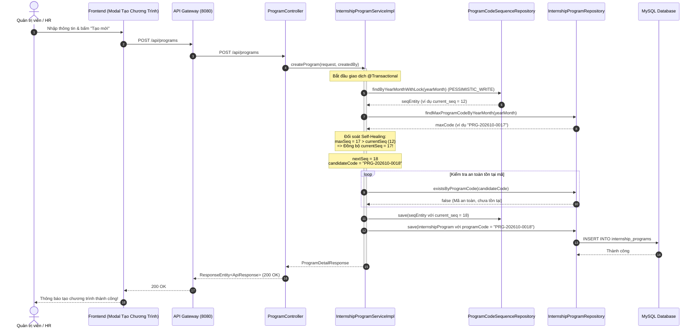

# Specification: Cơ Chế Tự Phục Hồi Sinh Mã Chương Trình & Xử Lý Toàn Vẹn Dữ Liệu (TM-105-FIX)

> **Trạng thái:** DRAFT  
> **Lưu trữ tại:** `InternHub/docs/specs/TM-105-self-healing-program-sequence-spec.md`  
> **Áp dụng quy tắc:** [Persistent Spec & Change Rationale](file:///d:/Certificate_CodeGym/Module%206/InternHub/.agents/04-development-guide.md), [InternHub Backend Rules](file:///d:/codegym_final_project/InternHub/AGENTS.md)

---

## 0. Nhật Ký Thay Đổi & Giải Trình Kỹ Thuật (Revision History & Change Rationale)

> [!IMPORTANT]
> **BẮT BUỘC ĐIỀN ĐẦY ĐỦ**: Bất kể khi nào Lập trình viên hay AI Agent thay đổi mã nguồn ảnh hưởng đến logic, API, validation hay database (từ cấp độ L2 trở lên), **bắt buộc** phải ghi thêm một dòng vào bảng này để giải trình lý do trước khi coi nhiệm vụ là hoàn tất.

| Phiên bản | Ngày | Người thực hiện | Task / Jira | Loại thay đổi | Lý do & Giải trình kỹ thuật (Rationale) |
| :---: | :---: | :---: | :---: | :---: | :--- |
| **v1.0** | 2026-10-23 | Senior Backend AI Agent | `TM-105` | Sửa lỗi & Nâng cấp kiến trúc | Khắc phục triệt để lỗi HTTP 500 khi gọi `POST /api/programs` do va chạm Unique Key `program_code` (`PRG-202610-0013`). Xây dựng cơ chế Self-Healing Sequence tự động đối soát với cơ sở dữ liệu và phòng ngừa xung đột vĩnh viễn. |

---

## 1. Feature Overview (Tổng Quan Tính Năng)

- **Feature Name:** Cơ Chế Tự Phục Hồi Sinh Mã Chương Trình Thực Tập & Xử Lý Toàn Vẹn Dữ Liệu (Self-Healing Program Code Sequence & Data Integrity Hardening)
- **Jira Ticket:** [TM-105](https://robluccibn9935.atlassian.net/browse/TM-105) (Sub-task: `TM-105-FIX-PROGRAM-CODE-COLLISION`)
- **Target Microservice:** `intern-and-program-service` (Port 8082, định tuyến qua `api-gateway` 8080)
- **Target Users & Roles:** `ADMIN`, `HR`
- **Change Level:** **L2** (Cải tiến Logic Service, bổ sung Query Repository đối soát, chuẩn hóa Global Exception Handling)

---

## 2. Business Goal & Core Objectives (Mục Tiêu Nghiệp Vụ)

1. **Khắc phục triệt để lỗi HTTP 500 khi tạo chương trình:** Ngăn chặn hoàn toàn lỗi trùng lặp mã chương trình thực tập (`SQLIntegrityConstraintViolationException: Duplicate entry 'PRG-yyyyMM-xxxx' for key 'internship_programs.UK90f2atg4j4rfn8777w0ebh9bt'`).
2. **Cơ chế tự phục hồi thông minh (Self-Healing Sequence):** Khi bảng `program_code_sequence` bị tụt lại phía sau dữ liệu thực tế (do dữ liệu seed, chèn trực tiếp, migration hay phục hồi backup), hệ thống tự động phát hiện số thứ tự lớn nhất đang có trong `internship_programs` và đồng bộ sequence lên mức an toàn.
3. **Phòng thủ chiều sâu chống va chạm mã (Defense-in-Depth):** Kết hợp kiểm tra chủ động (`existsByProgramCode`) trước khi lưu và bảo đảm transaction lock an toàn bằng `PESSIMISTIC_WRITE`.
4. **Chuẩn hóa thông điệp lỗi RESTful:** Nếu có va chạm dữ liệu bất thường ở tầng persistence, `GlobalExceptionHandler` bắt riêng `DataIntegrityViolationException` và trả về `409 CONFLICT` có thông điệp tiếng Việt thân thiện thay vì `500 INTERNAL_SERVER_ERROR`.

---

## 3. Scope of Work (Phạm Vi Tính Năng)

### 3.1. Trong phạm vi (In Scope)
- **Đồng bộ dữ liệu tức thời (Data Reconciliation):** Khắc phục giá trị `current_seq` trong bảng `program_code_sequence` của tháng hiện tại (`202610`) để thông luồng ngay lập tức.
- **Repository Layer:** Bổ sung query `findMaxProgramCodeByYearMonth` vào [InternshipProgramRepository.java](file:///d:/codegym_final_project/InternHub/intern-and-program-service/src/main/java/org/example/internservice/program/repository/InternshipProgramRepository.java).
- **Service Layer:** Tái cấu trúc hàm `generateUniqueProgramCode` trong [InternshipProgramServiceImpl.java](file:///d:/codegym_final_project/InternHub/intern-and-program-service/src/main/java/org/example/internservice/program/service/impl/InternshipProgramServiceImpl.java):
  - Đối soát giữa `seqEntity.getCurrentSeq()` và mã lớn nhất thực tế từ database.
  - Vòng lặp an toàn `while (programRepository.existsByProgramCode(candidateCode))` trước khi gán.
  - Cập nhật và lưu `seqEntity` với giá trị sequence thực tế lớn nhất.
- **Exception Layer:** Bổ sung handler xử lý `DataIntegrityViolationException` trong [GlobalExceptionHandler.java](file:///d:/codegym_final_project/InternHub/intern-and-program-service/src/main/java/org/example/internservice/exception/GlobalExceptionHandler.java).
- **Kiểm thử tự động:** Bổ sung Unit Test bao phủ ca va chạm sequence và ca sequence bị tụt hậu.

### 3.2. Ngoài phạm vi (Out of Scope - *Ngăn chặn suy diễn sai*)
- **Tuyệt đối không sửa đổi bảng/Schema MySQL:** Không thay đổi khóa chính, kiểu dữ liệu hay cấu trúc bảng `internship_programs` và `program_code_sequence`.
- **Tuyệt đối không sửa đổi mã nguồn Frontend:** Giữ nguyên 100% hợp đồng API, Request DTO và Response DTO để Frontend không bị ảnh hưởng.
- **Không thay đổi định dạng mã:** Vẫn giữ nguyên chuẩn mã chương trình `PRG-yyyyMM-xxxx`.

---

## 4. Potential Logic Loopholes & Mitigations (Tối Thiểu 5 Edge Cases Cốt Lõi)

### 4.1. Case 1: Sequence trong bảng `program_code_sequence` bị tụt hậu so với dữ liệu thực tế
- **Vấn đề:** Bảng `program_code_sequence` ghi nhận `current_seq = 12`, nhưng bảng `internship_programs` đã tồn tại các bản ghi đến `PRG-202610-0013` và `PRG-202610-0017` (do import seed data hoặc test). Thuật toán cũ lấy `12 + 1 = 13` gây đụng độ Unique Key.
- **Giải pháp:** Truy vấn `findMaxProgramCodeByYearMonth("202610")`. Nếu trích xuất được số lớn nhất là `17`, hệ thống so sánh `Math.max(currentSeq, 17) = 17` và đẩy sequence lên `17`, sinh mã kế tiếp `18` (`PRG-202610-0018`).

### 4.2. Case 2: Dữ liệu mã chương trình bị ngắt quãng (Gaps in Sequence Numbers)
- **Vấn đề:** Database có `PRG-202610-0012`, `PRG-202610-0013` và `PRG-202610-0017` (khuyết các mã `0014, 0015, 0016`).
- **Giải pháp:** Sau khi lấy `nextSeq`, hệ thống kiểm tra qua vòng lặp an toàn:
  ```java
  String candidateCode = String.format("PRG-%s-%04d", yearMonth, nextSeq);
  while (programRepository.existsByProgramCode(candidateCode)) {
      nextSeq++;
      candidateCode = String.format("PRG-%s-%04d", yearMonth, nextSeq);
  }
  ```
  Nếu có bất kỳ mã nào vô tình bị trùng trước đó, con trỏ sequence sẽ tự động nhảy vượt qua mã trùng để tìm mã an toàn nhất.

### 4.3. Case 3: Tranh chấp tải đồng thời cao (High-Concurrency Race Condition)
- **Vấn đề:** Hai người dùng HR cùng nhấn nút "Tạo chương trình" trong cùng một mili-giây cho cùng một tháng.
- **Giải pháp:** Duy trì khóa bi quan `PESSIMISTIC_WRITE` (`SELECT ... FOR UPDATE`) trên bản ghi `ProgramCodeSequence` của tháng đó. Request thứ hai bắt buộc phải đợi Request thứ nhất hoàn tất giao dịch mới được đọc sequence, bảo đảm tính tuần tự và loại bỏ xung đột đồng thời.

### 4.4. Case 4: Định dạng mã trong database không chuẩn hoặc có chuỗi lạ
- **Vấn đề:** Nếu ai đó nhập tay vào cơ sở dữ liệu một mã không theo format (ví dụ: `PRG-202610-ABC` hoặc `PRG-CUSTOM`), hàm cắt chuỗi parse số có thể ném `NumberFormatException` hoặc `IndexOutOfBoundsException`.
- **Giải pháp:** Bọc khối parse `substring` trong `try-catch (NumberFormatException | IndexOutOfBoundsException)`, ghi log cảnh báo (`log.warn`) và dùng giá trị fallback an toàn từ `seqEntity.getCurrentSeq()`.

### 4.5. Case 5: Vòng lặp Rollback vĩnh viễn trong `@Retryable`
- **Vấn đề:** Trong mã nguồn cũ, khi `DataIntegrityViolationException` xảy ra, `@Transactional` rollback khiến `seqEntity.setCurrentSeq(...)` bị trả về số cũ. `@Retryable` kích hoạt lần 2, 3 vẫn đọc số cũ và crash 3 lần liên tiếp.
- **Giải pháp:** Nhờ cơ chế Self-Healing kiểm tra đối soát `findMaxProgramCodeByYearMonth` và `existsByProgramCode` ngay trong lần chạy đầu tiên, mã sinh ra luôn luôn là mã chưa từng tồn tại trong database. Lệnh `INSERT` luôn thành công ngay ở Attempt 1, loại bỏ hoàn toàn việc phát sinh lỗi và không bao giờ kích hoạt vòng lặp rollback.

---

## 5. Functional Requirements (Yêu Cầu Chức Năng)

- **FR-1:** Khi tạo chương trình thực tập mới, hệ thống tự động sinh mã chương trình có định dạng `PRG-yyyyMM-xxxx` (với `yyyyMM` lấy theo ngày bắt đầu chương trình).
- **FR-2:** Hệ thống tự động so khớp giá trị sequence hiện tại với mã chương trình lớn nhất thực tế đang tồn tại trong bảng `internship_programs`.
- **FR-3:** Nếu giá trị sequence nhỏ hơn mã lớn nhất thực tế, hệ thống tự động đồng bộ sequence lên mức cao nhất và cấp mã số tiếp theo.
- **FR-4:** Giá trị sequence mới sau khi cấp phát phải được cập nhật và lưu bền vững vào bảng `program_code_sequence`.
- **FR-5:** Trường hợp có ngoại lệ vi phạm ràng buộc dữ liệu (`DataIntegrityViolationException`), `GlobalExceptionHandler` trả về HTTP `409 CONFLICT` kèm thông báo giải thích rõ ràng.

---

## 6. Business Rules (Quy Tắc Nghiệp Vụ)

- **BR-1 (Tính duy nhất):** Mã chương trình (`programCode`) là duy nhất trên toàn hệ thống và không được phép trùng lặp trong bất kỳ hoàn cảnh nào.
- **BR-2 (Tính bất biến):** Mã chương trình được cấp phát tự động một lần duy nhất tại thời điểm tạo và không bao giờ cho phép người dùng chỉnh sửa trong suốt vòng đời.
- **BR-3 (Quy chuẩn định dạng):** Mã bắt buộc bắt đầu bằng tiền tố `PRG-`, theo sau là 6 chữ số năm tháng (`yyyyMM`), dấu gạch nối `-`, và 4 chữ số thứ tự (`%04d`).
- **BR-4 (Đồng bộ theo tháng):** Mỗi tháng (`yearMonth`) sở hữu một chuỗi số thứ tự độc lập bắt đầu từ `0001`.

---

## 7. Data Model & Khảo Sát Tái Sử Dụng (Data Model & Reuse Assessment)

### 7.1. Đánh giá tái sử dụng (Quy tắc 31 - InternHub/AGENTS.md)
- **Tái sử dụng 100% bảng cơ sở dữ liệu hiện có:**
  - Bảng `internship_programs`: Sử dụng cột `program_code` (VARCHAR(50), Unique Key).
  - Bảng `program_code_sequence`: Sử dụng cột `year_month` (VARCHAR(6), PK) và `current_seq` (BIGINT).
  - **Tuyệt đối không tạo thêm bảng mới, không thêm cột mới.**
- **Kế thừa pattern đã chạy ổn định trong dự án:**
  - Tái sử dụng thiết kế tự phục hồi đã được áp dụng thành công tại [InternProfileServiceImpl.java:432-456](file:///d:/codegym_final_project/InternHub/intern-and-program-service/src/main/java/org/example/internservice/intern/service/impl/InternProfileServiceImpl.java#L432-L456) (`generateInternCode`).
  - Tái sử dụng method đã có sẵn trong repository: `existsByProgramCode` ([InternshipProgramRepository.java:25](file:///d:/codegym_final_project/InternHub/intern-and-program-service/src/main/java/org/example/internservice/program/repository/InternshipProgramRepository.java#L25)).

### 7.2. Cấu Trúc Bảng Hiện Tại (Giữ Nguyên)
```sql
-- Bảng chính lưu trữ chương trình
CREATE TABLE `internship_programs` (
    `id` BIGINT NOT NULL AUTO_INCREMENT PRIMARY KEY,
    `program_code` VARCHAR(50) NOT NULL UNIQUE,
    `name` VARCHAR(150) NOT NULL,
    `department_id` BIGINT NOT NULL,
    `start_date` DATE NOT NULL,
    `end_date` DATE NOT NULL,
    `max_interns` INT NOT NULL,
    `current_interns` INT NOT NULL DEFAULT 0,
    ...
);

-- Bảng quản lý chuỗi số thứ tự độc lập
CREATE TABLE `program_code_sequence` (
    `year_month` VARCHAR(6) NOT NULL PRIMARY KEY,
    `current_seq` BIGINT NOT NULL DEFAULT 0,
    `updated_at` DATETIME NOT NULL
);
```

---

## 8. API Contract (Đặc Tả Giao Tiếp REST API)

### Endpoint: `POST /api/programs`
- **Authentication:** `Bearer Token`
- **Quyền hạn:** `@PreAuthorize("hasAnyRole('ADMIN', 'HR')")`

#### Request Body (Giữ nguyên không đổi):
```json
{
  "name": "Chương trình Thực tập Kỹ sư AI 2026",
  "departmentId": 1,
  "description": "Đào tạo thực chiến AI Fullstack",
  "startDate": "2026-11-01",
  "endDate": "2027-01-31",
  "maxInterns": 15,
  "isHistorical": false
}
```

#### Phản Hồi Thành Công (200 OK / 201 Created):
```json
{
  "code": 200,
  "message": "Thực hiện thành công",
  "data": {
    "id": 19,
    "programCode": "PRG-202611-0001",
    "name": "Chương trình Thực tập Kỹ sư AI 2026",
    "department": {
      "id": 1,
      "name": "Phòng Công Nghệ Thông Tin"
    },
    "startDate": "2026-11-01",
    "endDate": "2027-01-31",
    "status": "PLANNING",
    "maxInterns": 15,
    "currentInterns": 0,
    "isRecruitmentOpen": true
  }
}
```

#### Phản Hồi Xung Đột Dữ Liệu (409 Conflict - Chuẩn hóa mới):
```json
{
  "code": 409,
  "message": "Xung đột dữ liệu: Mã chương trình thực tập hoặc tài nguyên đã tồn tại trong hệ thống. Vui lòng thử lại."
}
```

---

## 9. Core Flow / Luồng Xử Lý Cốt Lõi (Self-Healing Flow)



---

## 10. Non-Functional Requirements & Performance Constraints

- **Hiệu năng (Latency):** Thời gian sinh mã và kiểm tra đối soát không vượt quá **15ms**; tổng thời gian phản hồi API tạo mới < **200ms**.
- **An toàn giao dịch:** Sử dụng `PESSIMISTIC_WRITE` trên bảng sequence độc lập để tránh table lock trên bảng chính `internship_programs`.
- **Anti-God-Class (Trụ cột III - Rule 17):** Các method bổ sung phải ngắn gọn (< 30 dòng), không làm phình to service.
- **Tiêu chuẩn Clean Code (Trụ cột V):** Sử dụng import tường minh, không dùng FQN, khai báo constructor injection qua `@RequiredArgsConstructor`.

---

## 11. Acceptance Criteria Checklist (Tiêu Chí Chấp Nhận)

- [ ] **AC-1:** Gửi request tạo chương trình mới cho tháng `202610` thành công với HTTP 200/201, sinh ra mã `PRG-202610-0018` (vượt qua tất cả các mã cũ `0012, 0013, 0017`).
- [ ] **AC-2:** Giá trị trong bảng `program_code_sequence` cho tháng `202610` được tự động cập nhật lên `18`.
- [ ] **AC-3:** Nếu tiếp tục gửi request tạo chương trình tiếp theo, hệ thống sinh mã tuần tự tiếp theo là `PRG-202610-0019` một cách trơn tru.
- [ ] **AC-4:** Khi tạo chương trình ở tháng mới (ví dụ `202611`), sequence bắt đầu độc lập từ `PRG-202611-0001`.
- [ ] **AC-5:** Tuyệt đối không bao giờ trả về HTTP 500 mơ hồ nếu xảy ra va chạm dữ liệu persistence; thay vào đó trả về HTTP 409 có thông báo rõ ràng.

---

## 12. Unit Test Cases Checklist (Kế Hoạch Kiểm Thử Tự Động)

- [ ] **UT-BE-01 (`testCreateProgram_WhenSequenceIsBehind_ShouldAutoHealAndAdvance`):**
  - Giả lập `seqEntity.getCurrentSeq() = 12`, `findMaxProgramCodeByYearMonth` trả về `PRG-202610-0017`.
  - Kỳ vọng: Chương trình mới sinh ra có mã `PRG-202610-0018` và `seqEntity.getCurrentSeq()` được lưu là `18`.
- [ ] **UT-BE-02 (`testCreateProgram_WhenCandidateExists_ShouldLoopUntilAvailable`):**
  - Giả lập mã `0018` đã tồn tại qua `existsByProgramCode`.
  - Kỳ vọng: Hệ thống tự động tăng lên `PRG-202610-0019`.
- [ ] **UT-BE-03 (`testCreateProgram_WhenNewMonth_ShouldStartFromOne`):**
  - Giả lập tháng mới chưa có bản ghi sequence và chưa có chương trình nào.
  - Kỳ vọng: Sinh mã `PRG-202611-0001` và lưu sequence là `1`.
- [ ] **UT-BE-04 (`testGlobalExceptionHandler_DataIntegrityViolation_ShouldReturn409`):**
  - Kiểm tra handler bắt `DataIntegrityViolationException` trả về HTTP status `409 CONFLICT`.

---

## 13. Implementation Checklist (Danh Sách File Can Thiệp)

1. **Database Immediate Fix (Chạy SQL qua Docker exec):**
   - Đồng bộ `program_code_sequence` cho `202610` lên `17` để phục hồi API tức thì.
2. **Repository Layer:**
   - [InternshipProgramRepository.java](file:///d:/codegym_final_project/InternHub/intern-and-program-service/src/main/java/org/example/internservice/program/repository/InternshipProgramRepository.java): Bổ sung `findMaxProgramCodeByYearMonth`.
3. **Service Layer:**
   - [InternshipProgramServiceImpl.java](file:///d:/codegym_final_project/InternHub/intern-and-program-service/src/main/java/org/example/internservice/program/service/impl/InternshipProgramServiceImpl.java): Tái cấu trúc `generateUniqueProgramCode` thành thuật toán Self-Healing.
4. **Exception Handling Layer:**
   - [GlobalExceptionHandler.java](file:///d:/codegym_final_project/InternHub/intern-and-program-service/src/main/java/org/example/internservice/exception/GlobalExceptionHandler.java): Thêm `@ExceptionHandler(DataIntegrityViolationException.class)`.
5. **Spec Update:**
   - Cập nhật Revision History tại [TM-15-18-manage-internship-programs-spec.md](file:///d:/codegym_final_project/InternHub/docs/specs/TM-15-18-manage-internship-programs-spec.md) để đồng bộ nguyên tử (Atomic Spec-Code Sync).
6. **Kiểm thử tự động:**
   - Chạy `.\gradlew :intern-and-program-service:test` bảo đảm 100% test suites pass.
