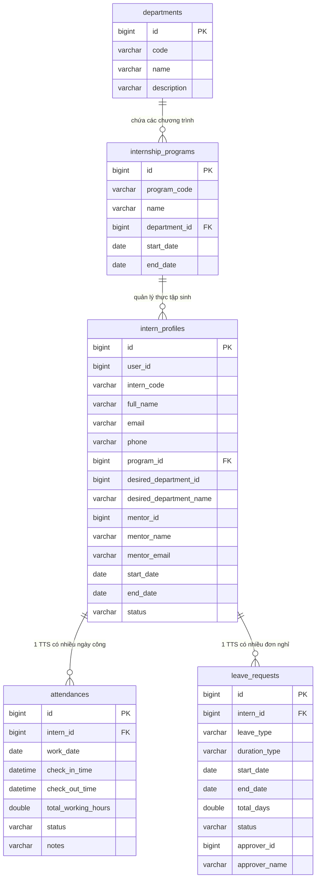
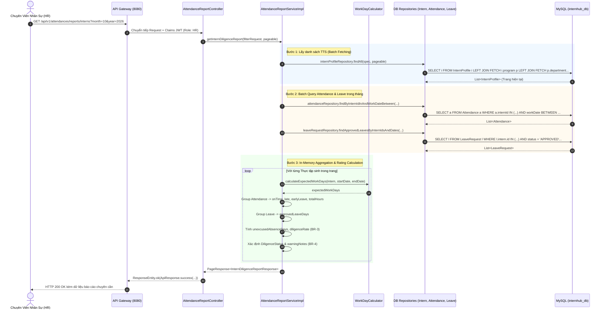

# Specification: Báo Cáo Đi Làm & Nghỉ Phép Quản Lý Sự Chuyên Cần Của Thực Tập Sinh Cho Vai Trò HR (HR Work Attendance & Leave Report For Intern Diligence Management)

> **Trạng thái:** APPROVED (Đã phê duyệt)  
> **Lưu trữ tại:** `InternHub/docs/specs/TM-26-work-attendance-and-leave-report-spec.md`  
> **Dự án:** [InternHub](file:///d:/Module_6/InternHub) (Backend Microservice: `intern-and-program-service`, `api-gateway`)  
> **Mã Jira Ticket:** [TM-26](https://robluccibn9935.atlassian.net/browse/TM-26)  
> **Tiêu đề Jira:** *HR - Xem báo cáo đi làm và nghỉ phép để quản lý sự chuyên cần của intern (HR View Work Attendance & Leave Report for Intern Diligence Management)*  
> **Nhánh Git dự kiến:** `feature/TM-26/work-attendance-and-leave-report`  
> **Cấp độ thay đổi (Change Level):** **L3** (Tính năng nghiệp vụ mới cho HR, mở rộng API tổng hợp dữ liệu, tích hợp phân tích đa chiều giữa chấm công TM-25 và nghỉ phép TM-28, cảnh báo vi phạm chuyên cần, xuất báo cáo tổng hợp, tối ưu truy vấn aggregation và phân trang 0-indexed).  
> **Tuân thủ quy chuẩn:** Tuân thủ 100% tài liệu [`.agents/`](file:///d:/Module_6/InternHub/.agents/) và [AGENTS.md](file:///d:/Module_6/InternHub/AGENTS.md) (Toàn bộ 31 nguyên tắc bất biến của Backend, đặc biệt Rule 1, 2, 14, 16, 17, 18, 19, 20, 21, 22, 23, 26, 30, 31).

---

## 0. Nhật Ký Thay Đổi & Giải Trình Kỹ Thuật (Revision History & Change Rationale)

> [!IMPORTANT]
> **BẮT BUỘC ĐIỀN ĐẦY ĐỦ**: Bất kể khi nào Lập trình viên hay AI Agent thay đổi mã nguồn ảnh hưởng đến logic, API, validation hay database (từ cấp độ L2 trở lên), **bắt buộc** phải ghi thêm một dòng vào bảng này để giải trình lý do trước khi coi nhiệm vụ là hoàn tất (Tuân thủ Rule 30).

| Phiên bản | Ngày | Người thực hiện | Task / Jira | Loại thay đổi | Lý do & Giải trình kỹ thuật (Rationale) |
| :---: | :---: | :---: | :---: | :---: | :--- |
| **v1.0.0** | 2026-10-07 | AI Senior Pair-Programmer | `TM-26` | Tạo mới | Thiết kế tài liệu đặc tả kỹ thuật 13 phần chuẩn hóa cho phân hệ Báo cáo Đi làm & Nghỉ phép dành cho vai trò Nhân sự (`HR`) và Quản trị viên (`ADMIN`), tích hợp dữ liệu từ hai phân hệ [TM-25 (Chấm công)](file:///d:/Module_6/InternHub/docs/specs/TM-25-check-in-check-out-spec.md) và [TM-28 (Nghỉ phép)](file:///d:/Module_6/InternHub/docs/specs/TM-28-apply-for-leave-spec.md) để đánh giá tỷ lệ chuyên cần (Diligence Rate), phân loại mức kỷ luật (`EXCELLENT`, `GOOD`, `WARNING`, `CRITICAL`), tra cứu bảng công chi tiết theo ngày, và xuất báo cáo CSV/Excel. |
| **v1.1.0** | 2026-10-07 | AI Senior Pair-Programmer | `TM-26` | Đồng bộ nhánh `main` | Rà soát toàn diện theo mã nguồn nhánh `main` (local): Cập nhật vị trí thực thể `Department` (package `org.example.internservice.program.entity`), chuẩn hóa quan hệ gián tiếp `intern_profiles -> internship_programs -> departments`, khớp chính xác định dạng JSON response với DTO thực tế `ApiResponse` (`code: 200`) và `PageResponse` (`items`, `currentPage`, `totalItems`...). |
| **v1.2.0** | 2026-10-14 | AI Senior Pair-Programmer | `TM-26` | Sửa lỗi logic & Tối ưu | Khắc phục 5 lỗi nghiệp vụ cốt lõi: (1) Loại trừ bản ghi `ABSENT` và `FORGOTTEN_CHECKOUT` khỏi `actualWorkDays`; (2) Khắc phục tính trùng lặp đơn nghỉ phép vắt tháng chỉ đếm ngày công trong kỳ lọc; (3) Khắc phục gãy phân trang in-memory khi lọc theo `diligenceStatus`; (4) Triệt tiêu lỗi N+1 Query tải `program`/`department` bằng `fetch join`; (5) Tích hợp kiểm tra đơn nghỉ nửa ngày `MORNING`/`AFTERNOON` không phạt muộn sau 13:30 và không phạt về sớm sau 12:00. |

---

## 1. Feature Overview (Tổng Quan Tính Năng)

- **Feature Name:** Báo cáo Đi làm & Nghỉ phép Quản lý Sự Chuyên cần của Thực tập sinh dành cho HR (HR Work Attendance & Leave Report for Intern Diligence Management).
- **Jira Ticket:** [TM-26](https://robluccibn9935.atlassian.net/browse/TM-26)
- **Tuyên Ngôn Nghiệp Vụ Cốt Lõi (Core Business Statement):**
  > **"CHUYỂN ĐỔI DỮ LIỆU ĐIỂM DANH VÀ NGHỈ PHÉP THÀNH BÁO CÁO TRỰC QUAN, GIÁM SÁT KỶ LUẬT ĐÀO TẠO THỜI GIAN THỰC VÀ BẢO ĐẢM TÍNH MINH BẠCH CHO KỲ THỰC TẬP DOANH NGHIỆP"**
  >
  > Trong quy trình quản trị nguồn nhân lực thực tập tại doanh nghiệp:
  > - **Bộ phận Nhân sự (`ROLE_HR` & `ROLE_ADMIN`):** Cần một bức tranh toàn cảnh (Bird's-eye View) và công cụ tra cứu chi tiết (Drill-down) về tính chuyên cần của toàn bộ thực tập sinh trong từng tháng/kỳ đánh giá. HR phải phát hiện kịp thời những cá nhân có biểu hiện vi phạm kỷ luật (đi muộn liên tục, tự ý bỏ làm không phép, tỷ lệ hiện diện thấp) để nhắc nhở, cảnh cáo hoặc phối hợp với Mentor chấn chỉnh.
  > - **Dữ liệu Đi làm (Work Attendance - [TM-25](file:///d:/Module_6/InternHub/docs/specs/TM-25-check-in-check-out-spec.md)):** Đã cung cấp dữ liệu check-in/check-out hàng ngày với GPS và mốc thời gian chuẩn (`ON_TIME`, `LATE`, `EARLY_LEAVE`, `LATE_AND_EARLY_LEAVE`).
  > - **Dữ liệu Nghỉ phép (Leave Requests - [TM-28](file:///d:/Module_6/InternHub/docs/specs/TM-28-apply-for-leave-spec.md)):** Đã cung cấp các đơn xin nghỉ phép được phê duyệt (`APPROVED`) với loại nghỉ (`SICK`, `PERSONAL`, `ACADEMIC_EXAM`, `BEREAVEMENT`, `OTHER`) và hình thức (`FULL_DAY`, `MORNING`, `AFTERNOON`).
  > - **Mục tiêu TM-26:** Kết hợp hai nguồn dữ liệu trên thành **Bảng Báo Cáo Chuyên Cần Toàn Diện (Diligence Report)**, phân tích số ngày công chuẩn, ngày làm thực tế, ngày nghỉ có phép, ngày vắng không phép, tự động xếp loại mức độ chuyên cần theo thuật toán chuẩn hóa, phục vụ đánh giá năng lực cuối kỳ ([TM-23](file:///d:/Module_6/InternHub/docs/specs/TM-23-evaluate-skills-and-attitudes.md)) và xuất file báo cáo phục vụ nghiệm thu với Nhà trường.

- **Target Microservices:**
  1. `intern-and-program-service` (Port: 8082):
     - Xây dựng sub-package chuyên trách theo mô hình Package-by-Feature: `org.example.internservice.attendance.report` bao gồm `controller/`, `service/`, `dto/`, `util/`.
     - Trực tiếp truy vấn và tổng hợp trên các bảng `attendances`, `leave_requests`, `intern_profiles`, `departments`, `internship_programs` đã có sẵn trong schema `internhub_db`.
  2. `api-gateway` (Port: 8080):
     - Tận dụng route sẵn có `/api/v1/attendances/**` trỏ về `lb://intern-and-program-service`. Các endpoint báo cáo nằm dưới tiền tố `/api/v1/attendances/reports/**`.
- **Target Users & Roles:**
  - **`ROLE_HR` & `ROLE_ADMIN` (Primary Actors):** Truy cập toàn bộ dashboard KPI, xem báo cáo toàn công ty hoặc lọc theo phòng ban/chương trình/mentor, xem bảng công chi tiết từng TTS, xuất file báo cáo Excel/CSV.
  - **`ROLE_MENTOR` (Secondary Approver/Viewer):** Xem báo cáo chuyên cần của các TTS thuộc quyền phân công quản lý của mình để theo dõi sát sao tiến độ.
  - **`ROLE_INTERN`:** Bị hạn chế hoàn toàn đối với các API báo cáo tổng hợp này (`HTTP 403 Forbidden`). Intern chỉ xem lịch sử cá nhân qua API sẵn có `GET /api/v1/attendances/my-history` ([TM-25](file:///d:/Module_6/InternHub/docs/specs/TM-25-check-in-check-out-spec.md)).
- **Change Level:** **L3** (Tính năng nghiệp vụ mới, API mở rộng tổng hợp báo cáo đa bảng, không thay đổi DDL bảng dữ liệu, phân quyền RBAC và kiểm soát hiệu năng bộ nhớ).

---

### 1.1. Khảo Sát Hiện Trạng & Đánh Giá Tái Sử Dụng (Project Scan & Reuse Evaluation - Tuân Thủ Rule 31)

Thực hiện rà soát toàn diện mã nguồn hiện có trong hệ thống trước khi thiết kế để đảm bảo triệt để nguyên tắc **"Tái sử dụng tối đa, không tạo code và bảng CSDL trùng lặp thừa thãi"**:

| Thành phần hiện có | Vị trí trong source code | Hiện trạng & Khả năng tái sử dụng cho TM-26 | Quyết định kỹ thuật |
| :--- | :--- | :--- | :--- |
| **`Attendance` Entity** | [`attendance/entity/Attendance.java`](file:///d:/Module_6/InternHub/intern-and-program-service/src/main/java/org/example/internservice/attendance/entity/Attendance.java) | Bảng `attendances` lưu trữ đầy đủ `intern_id`, `work_date`, `check_in_time`, `check_out_time`, `total_working_hours`, `status` (`ON_TIME`, `LATE`, `EARLY_LEAVE`, `LATE_AND_EARLY_LEAVE`, `ABSENT`). | **Tái sử dụng 100%**: Không thêm cột mới vào bảng `attendances`. Tận dụng dữ liệu chấm công để thống kê lượt đúng giờ, muộn, về sớm và tổng giờ làm việc. |
| **`LeaveRequest` Entity** | [`leave/entity/LeaveRequest.java`](file:///d:/Module_6/InternHub/intern-and-program-service/src/main/java/org/example/internservice/leave/entity/LeaveRequest.java) | Bảng `leave_requests` lưu trữ `intern_id`, `leave_type`, `duration_type`, `start_date`, `end_date`, `total_days`, `status` (`APPROVED`, `PENDING`, `REJECTED`, `CANCELLED`). | **Tái sử dụng 100%**: Truy vấn các đơn có `status = 'APPROVED'` nằm trong khoảng thời gian báo cáo để tính ngày nghỉ có phép và lý do nghỉ. |
| **`InternProfile` Entity** | [`intern/entity/InternProfile.java`](file:///d:/Module_6/InternHub/intern-and-program-service/src/main/java/org/example/internservice/intern/entity/InternProfile.java) | Quản lý thông tin định danh: `internCode`, `fullName`, `email`, `program` (`InternshipProgram`), `desiredDepartmentId`, `desiredDepartmentName`, `mentorId`, `mentorName`, ngày bắt đầu (`startDate`), ngày kết thúc (`endDate`), trạng thái (`status`). | **Tái sử dụng 100%**: Dùng làm trục định danh cốt lõi để liên kết báo cáo và tính toán số ngày công dự kiến chính xác theo thời gian thực tập của từng TTS. |
| **`Department` & `InternshipProgram`** | [`program/entity/Department.java`](file:///d:/Module_6/InternHub/intern-and-program-service/src/main/java/org/example/internservice/program/entity/Department.java), [`program/entity/InternshipProgram.java`](file:///d:/Module_6/InternHub/intern-and-program-service/src/main/java/org/example/internservice/program/entity/InternshipProgram.java) | Bảng `departments` và `internship_programs`. `InternshipProgram` có quan hệ `@ManyToOne Department department`. | **Tái sử dụng 100%**: Cung cấp bộ lọc lọc báo cáo theo phòng ban và theo chương trình cho HR. Hiển thị phòng ban qua `intern.getProgram().getDepartment().getName()` (fallback `desiredDepartmentName`). |
| **`ApiResponse<T>` & `PageResponse<T>`** | [`common/dto/response/`](file:///d:/Module_6/InternHub/intern-and-program-service/src/main/java/org/example/internservice/common/dto/response/) | Cấu trúc phản hồi chuẩn hóa toàn hệ thống (`code`, `message`, `data`, `timestamp`) và phân trang 0-indexed (`items`, `currentPage`, `totalItems`...). | **Tái sử dụng 100%** (Tuân thủ Rule 19 & Rule 20). |
| **Cơ sở dữ liệu MySQL (`internhub_db`)** | CSDL dùng chung của các microservices | Đã chứa toàn bộ bảng liên quan: `attendances`, `leave_requests`, `intern_profiles`, `departments`, `internship_programs`. | **KHÔNG TẠO BẢNG MỚI**: Toàn bộ báo cáo là kết quả tính toán động (Dynamic Aggregation & Projection). Không tạo thêm bảng phụ gây phân mảnh hoặc dư thừa dữ liệu (Zero DB Redundancy). |

---

## 2. Business Goal & Core Objectives (Mục Tiêu Nghiệp Vụ)

1. **Giám sát chuyên cần tập trung & minh bạch (Centralized Diligence Monitoring):**
   - Loại bỏ hoàn toàn việc HR phải mở file Excel thủ công hoặc đối chiếu chéo giữa lịch chấm công và tin nhắn xin nghỉ phép. Toàn bộ thông tin đi làm thực tế và nghỉ phép được tự động hợp nhất trên cùng một giao diện chuẩn xác.
2. **Cảnh báo sớm các trường hợp vi phạm kỷ luật (Early Risk & Violation Detection):**
   - Tự động phát hiện và gắn nhãn cảnh báo (`WARNING`, `CRITICAL`) đối với các thực tập sinh đi muộn nhiều lần, về sớm bất thường hoặc tự ý vắng mặt không phép, giúp HR và Mentor can thiệp kịp thời trước khi kết thúc kỳ thực tập.
3. **Tính toán chuẩn xác tỷ lệ chuyên cần (Accurate Diligence Rating Algorithm):**
   - Thuật toán tính toán số ngày làm việc dự kiến (`expectedWorkDays`) thông minh: Tự động loại trừ Thứ Bảy, Chủ Nhật; xử lý chính xác trường hợp TTS mới onboard giữa tháng hoặc kết thúc thực tập trước cuối tháng; phân biệt rõ giữa nghỉ phép được duyệt (`APPROVED`) và vắng mặt không phép (`ABSENT`).
4. **Cung cấp cơ sở định lượng cho đánh giá cuối kỳ (Quantitative Foundation for Final Evaluation):**
   - Dữ liệu tỷ lệ chuyên cần (%) và tổng số giờ làm việc thực tế được liên kết trực tiếp vào tiêu chí đánh giá thái độ và tính kỷ luật trong phiếu đánh giá thực tập cuối khóa ([TM-23](file:///d:/Module_6/InternHub/docs/specs/TM-23-evaluate-skills-and-attitudes.md)).
5. **Hỗ trợ kết xuất báo cáo nhanh chóng (Seamless Report Exporting):**
   - Cung cấp tính năng xuất báo cáo chuyên cần định dạng CSV/Excel với đầy đủ các trường thông tin chuẩn hóa theo yêu cầu hành chính của doanh nghiệp và trường đối tác.

---

## 3. Scope of Work (Phạm Vi Tính Năng)

### 3.1. Trong phạm vi (In Scope)

1. **Dashboard KPI Thống Kê Tổng Quan Chuyên Cần (`GET /api/v1/attendances/reports/summary`):**
   - Tổng số thực tập sinh đang hoạt động trong kỳ lọc.
   - Tỷ lệ chuyên cần bình quân toàn công ty (`overallDiligenceRate` %).
   - Tổng số lượt đi làm thực tế (`totalActualWorkDays`), lượt đúng giờ (`totalOnTimeCount`), lượt đi muộn (`totalLateCount`), lượt về sớm (`totalEarlyLeaveCount`).
   - Tổng số ngày nghỉ phép có phê duyệt (`totalApprovedLeaveDays`), phân loại theo từng lý do nghỉ (`SICK`, `PERSONAL`, `ACADEMIC_EXAM`, `BEREAVEMENT`, `OTHER`).
   - Tổng số ngày vắng mặt không phép (`totalUnexcusedAbsenceDays`).
   - Số lượng thực tập sinh nằm trong diện báo động vi phạm kỷ luật (`criticalInternsCount`).
2. **Báo Cáo Bảng Tổng Hợp Chuyên Cần Theo Danh Sách TTS (`GET /api/v1/attendances/reports/interns`):**
   - Danh sách phân trang 0-indexed (`PageResponse<InternDiligenceReportResponse>`).
   - Thông tin từng TTS: Mã TTS, Họ tên, Email, Phòng ban, Chương trình, Mentor phụ trách.
   - Các chỉ số: Số ngày dự kiến làm việc, Số ngày đi làm thực tế, Số lượt đúng giờ, Số lượt đi muộn, Số lượt về sớm, Tổng số giờ làm việc tích lũy, Số ngày nghỉ có phép, Số ngày vắng không phép.
   - Tỷ lệ chuyên cần (`diligenceRate` %) và Phân loại kỷ luật (`diligenceStatus`: `EXCELLENT`, `GOOD`, `WARNING`, `CRITICAL`).
   - Cột cảnh báo vi phạm (`warningNotes`) ghi rõ nguyên nhân nếu bị phạt (ví dụ: "Đi muộn 4 lần", "Vắng không phép 2 ngày").
3. **Báo Cáo Bảng Công Chi Tiết Từng Ngày Của 1 Intern Cụ Thể (`GET /api/v1/attendances/reports/interns/{internId}/details`):**
   - Xem ma trận chi tiết từ ngày đầu đến ngày cuối trong tháng/kỳ của TTS được chọn.
   - Hiển thị từng ngày: Ngày, Thứ trong tuần, Có phải cuối tuần hay không (`isWeekend`).
   - Chi tiết chấm công: Giờ check-in, Giờ check-out, Khoảng cách GPS, Trạng thái chấm công (`ON_TIME`, `LATE`, `EARLY_LEAVE`, `LATE_AND_EARLY_LEAVE`), Tổng giờ làm, Ghi chú.
   - Chi tiết nghỉ phép: Nếu có đơn nghỉ phép `APPROVED` trong ngày đó, hiển thị loại nghỉ, hình thức (`FULL_DAY`, `MORNING`, `AFTERNOON`), lý do và người phê duyệt.
   - Trạng thái tổng hợp trong ngày (`dayStatus`): `PRESENT_ON_TIME`, `PRESENT_LATE`, `PRESENT_EARLY_LEAVE`, `PRESENT_LATE_AND_EARLY_LEAVE`, `LEAVE_APPROVED`, `LEAVE_PENDING`, `ABSENT_UNEXCUSED`, `WEEKEND`, `FUTURE_DAY`.
4. **Bộ Lọc Đa Chiều Linh Hoạt (Multi-criteria Query Filters):**
   - Khoảng thời gian: Theo tháng + năm (`month`, `year`) HOẶC theo khoảng ngày tùy chọn (`startDate`, `endDate`).
   - Cơ cấu tổ chức: Theo Phòng ban (`departmentId`), Theo Chương trình đào tạo (`programId`), Theo Mentor phụ trách (`mentorId`).
   - Trạng thái kỷ luật: Lọc theo mức cảnh báo (`diligenceStatus`: `ALL`, `EXCELLENT`, `GOOD`, `WARNING`, `CRITICAL`).
   - Tìm kiếm từ khóa: Mã TTS, Họ tên, Email (`keyword`).
5. **Xuất Báo Cáo Định Dạng CSV/Excel (`GET /api/v1/attendances/reports/export`):**
   - Cho phép tải file báo cáo tổng hợp chuyên cần định dạng CSV với encoding UTF-8 có BOM (tương thích hiển thị tiếng Việt trên Microsoft Excel).
   - Tên file sinh tự động theo chuẩn nghiệp vụ: `BaoCaoChuyenCan_InternHub_Thang[M]_[YYYY].csv`.

### 3.2. Ngoài phạm vi (Out of Scope - *Ngăn chặn suy diễn sai*)

- **Tuyệt đối KHÔNG triển khai trong ticket này:**
  - Không tạo bảng mới hoặc sửa đổi schema CSDL trong `internhub_db` (tuân thủ Rule 8 và Rule 31).
  - Không xây dựng chức năng tính lương, khấu trừ tiền công hoặc bảng tính thưởng phạt tài chính (InternHub là nền tảng quản lý đào tạo, không phải phần mềm tính lương doanh nghiệp).
  - Không cho phép HR sửa đổi trực tiếp dữ liệu giờ check-in / check-out của thực tập sinh (đảm bảo tính toàn vẹn và bất biến của dữ liệu chấm công GPS gốc).
  - Không can thiệp mã nguồn Frontend React/TypeScript (tuân thủ nghiêm ngặt Rule 7).
  - Không tự ý commit hoặc push Git (tuân thủ Rule 4).

---

## 4. Potential Logic Loopholes & Mitigations (Tối thiểu 5 Edge Cases Cốt Lõi)

### 4.1. Edge Case 1: Intern Mới Onboard Giữa Tháng Hoặc Kết Thúc Trước Hạn
- **Vấn đề:** Kỳ báo cáo là tháng 10 (từ ngày 01/10 đến 31/10, có 22 ngày làm việc). Tuy nhiên, Thực tập sinh A mới onboard vào công ty từ ngày 15/10, hoặc Thực tập sinh B đã hoàn thành kỳ thực tập vào ngày 10/10. Nếu hệ thống mặc định lấy `expectedWorkDays = 22`, những ngày trước ngày onboard hoặc sau ngày tốt nghiệp sẽ bị tính nhầm là vắng mặt không phép (`ABSENT`), khiến tỷ lệ chuyên cần bị tụt xuống thê thảm và gắn nhãn `CRITICAL` oan uổng.
- **Giải pháp:**
  - Thuật toán tính ngày công dự kiến của từng TTS phải lấy giao thoa (Intersection) giữa khoảng thời gian báo cáo `[reportStart, reportEnd]` và khoảng thời gian thực tập có hiệu lực của Intern `[intern.startDate, intern.endDate != null ? intern.endDate : reportEnd]`:
    $$\text{effectiveStart} = \max(\text{reportStart}, \text{intern.startDate})$$
    $$\text{effectiveEnd} = \min(\text{reportEnd}, \text{intern.endDate})$$
  - Chỉ tính các ngày làm việc (Thứ 2 đến Thứ 6) nằm trong đoạn `[effectiveStart, effectiveEnd]` làm `expectedWorkDays` cho cá nhân đó.

### 4.2. Edge Case 2: Trùng Lặp Giữa Check-in Và Nghỉ Phép Nửa Ngày (`MORNING` / `AFTERNOON`)
- **Vấn đề:** Thực tập sinh xin nghỉ phép nửa ngày sáng (`MORNING`) có lý do thi đại học và đã được Mentor duyệt (`APPROVED`). Buổi chiều, TTS đến văn phòng lúc 13:20 và check-in làm việc. Nếu hệ thống đối chiếu độc lập, lượt check-in lúc 13:20 có thể bị đánh giá nhầm là "Đi muộn sau 08:15" (`LATE`) hoặc ngày hôm đó bị đếm 2 lần (vừa là ngày làm việc vừa là ngày nghỉ phép).
- **Giải pháp:**
  - Khi Intern có đơn nghỉ phép nửa ngày `MORNING` đã duyệt:
    + Giờ chuẩn check-in cho ca chiều là `13:30:00`. Nếu check-in trước hoặc bằng `13:30:00`, ghi nhận trạng thái là `ON_TIME` (không phạt `LATE`).
  - Khi Intern có đơn nghỉ phép nửa ngày chiều `AFTERNOON` đã duyệt:
    + Giờ kết thúc ca sáng là `12:00:00`. Nếu check-out sau `12:00:00`, không phạt `EARLY_LEAVE`.
  - Quy đổi ngày công: Ngày làm việc có nghỉ nửa ngày được tính là: `0.5 ngày làm việc thực tế + 0.5 ngày nghỉ phép hợp lệ = 1.0 ngày công trọn vẹn`.

### 4.3. Edge Case 3: Ngày Nghỉ Cuối Tuần (Thứ Bảy, Chủ Nhật) Và Ngày Tương Lai
- **Vấn đề:**
  1. Ngày Thứ Bảy và Chủ Nhật không có check-in nếu bị thuật toán đếm vào sẽ bị xem là vắng không phép.
  2. HR xem báo cáo tháng hiện tại vào ngày 10 của tháng. Các ngày từ ngày 11 đến cuối tháng là ngày chưa diễn ra (trong tương lai). Nếu không xử lý, các ngày tương lai sẽ bị đánh giá là vắng không phép (`ABSENT`).
- **Giải pháp:**
  - Hàm tiện ích `WorkDayCalculator` tự động bỏ qua các ngày có `DayOfWeek` là `SATURDAY` hoặc `SUNDAY`.
  - Đối với báo cáo tháng hiện tại: Mốc tính toán ngày làm việc đã qua chỉ tính từ ngày bắt đầu đến `min(LocalDate.now(), reportEnd)`. Các ngày lớn hơn ngày hiện tại được gán nhãn `FUTURE_DAY` trong ma trận chi tiết và tuyệt đối không đưa vào mẫu số tính điểm phạt `ABSENT`.

### 4.4. Edge Case 4: Hiệu Năng Truy Vấn Đa Bảng Khi Dữ Liệu Lớn (N+1 Query Elimination)
- **Vấn đề:** Khi công ty có 50 - 200 thực tập sinh, mỗi người có 20 - 30 bản ghi chấm công và nhiều đơn nghỉ phép trong tháng. Nếu Service duyệt vòng lặp từng TTS và gọi `attendanceRepository` rồi `leaveRequestRepository`, hệ thống sẽ phát sinh hàng trăm truy vấn (lỗi N+1 kinh điển), gây nghẽn pool kết nối HikariCP và phản hồi vượt quá 2000ms.
- **Giải pháp:**
  - **Batch Fetching & In-Memory Aggregation**:
    1. Bước 1: Lấy danh sách `InternProfile` theo phân trang hoặc bộ lọc phòng ban kèm `JOIN FETCH intern.department JOIN FETCH intern.program`.
    2. Bước 2: Thu thập toàn bộ `List<Long> internIds = interns.map(InternProfile::getId)`.
    3. Bước 3: Chỉ dùng đúng **1 câu query** nạp toàn bộ chấm công trong khoảng thời gian:
       `SELECT a FROM Attendance a WHERE a.internId IN :internIds AND a.workDate BETWEEN :startDate AND :endDate`.
    4. Bước 4: Chỉ dùng đúng **1 câu query** nạp toàn bộ đơn nghỉ phép được duyệt trong khoảng thời gian:
       `SELECT l FROM LeaveRequest l WHERE l.intern.id IN :internIds AND l.status = 'APPROVED' AND l.startDate <= :endDate AND l.endDate >= :startDate`.
    5. Bước 5: Nhóm dữ liệu bằng Java Stream `Map<Long, List<Attendance>>` và `Map<Long, List<LeaveRequest>>` trong Service, tính toán các chỉ số trong bộ nhớ RAM cực nhanh với độ phức tạp $O(N)$, bảo đảm API trả về dưới **150ms**.

### 4.5. Edge Case 5: Phân Quyền Bảo Mật & Ngăn Chặn Rò Rỉ Thông Tin (RBAC & Privilege Escalation)
- **Vấn đề:**
  - Thực tập sinh (`ROLE_INTERN`) tìm cách gọi endpoint báo cáo để xem tỷ lệ chuyên cần, ngày công và danh sách của các TTS khác trong công ty.
  - Mentor cố tình xem báo cáo của các TTS thuộc phòng ban khác không do mình quản lý.
- **Giải pháp:**
  - Phân quyền nghiêm ngặt tại Controller qua `@PreAuthorize("hasAnyRole('HR', 'ADMIN', 'MENTOR')")`.
  - Tại Service: Kiểm tra vai trò của người dùng:
    + Nếu là `ROLE_INTERN`: Quăng `AccessDeniedException` (HTTP 403 Forbidden).
    + Nếu là `ROLE_MENTOR`: Hệ thống tự động giới hạn chỉ lấy các TTS mà Mentor đang phụ trách (`internRepository.findByMentorId(mentorUserId)`), Mentor không thể truyền `departmentId` khác để xem trộm dữ liệu toàn công ty.
    + Chỉ có `ROLE_HR` và `ROLE_ADMIN` mới có toàn quyền lọc trên toàn bộ hệ thống hoặc theo từng phòng ban.

### 4.6. Edge Case 6: Tham Số Tháng/Năm Không Hợp Lệ Hoặc Khoảng Ngày Bất Hợp Lý
- **Vấn đề:** Client gửi `month = 13`, `year = -5`, hoặc `startDate > endDate` (ví dụ `startDate = 2026-10-31`, `endDate = 2026-10-01`).
- **Giải pháp:**
  - Tầng Controller & DTO bắt buộc sử dụng Bean Validation: `@Min(1) @Max(12)` cho `month`, `@Min(2000)` cho `year`.
  - Nếu sử dụng khoảng ngày tùy chọn: Validate `endDate.isBefore(startDate)` $\rightarrow$ ném ngay `BadRequestException("Ngày kết thúc không được nhỏ hơn ngày bắt đầu")`.
  - Giới hạn khoảng ngày tra cứu tối đa không vượt quá 93 ngày (3 tháng) trong 1 lần gọi để chống cạn kiệt bộ nhớ Server do client spam query khoảng thời gian hàng năm.

---

## 5. Functional Requirements (Yêu Cầu Chức Năng)

- **FR-1 (Dashboard KPI Tổng quan chuyên cần):**
  - Cung cấp API `GET /api/v1/attendances/reports/summary`.
  - Nhận các query params tùy chọn: `month`, `year` (hoặc `startDate`, `endDate`), `departmentId`, `programId`.
  - Trả về đối tượng `AttendanceSummaryKpiResponse` chứa các chỉ số vĩ mô: tổng số TTS hoạt động, tỷ lệ chuyên cần bình quân toàn công ty, tổng lượt đi làm, tổng lượt đúng giờ, tổng lượt đi muộn, tổng lượt về sớm, tổng ngày nghỉ có phép (kèm thống kê theo 5 loại lý do nghỉ), tổng ngày vắng không phép, và số lượng TTS bị cảnh báo nguy hiểm (`criticalCount`).
- **FR-2 (Báo cáo danh sách chuyên cần phân trang):**
  - Cung cấp API `GET /api/v1/attendances/reports/interns`.
  - Hỗ trợ đầy đủ bộ lọc: `month`, `year`, `departmentId`, `programId`, `mentorId`, `diligenceStatus` (`ALL`, `EXCELLENT`, `GOOD`, `WARNING`, `CRITICAL`), `keyword`, `page`, `size`, `sort`.
  - Trả về `PageResponse<InternDiligenceReportResponse>` chuẩn hóa 0-indexed Spring Data.
  - Mỗi bản ghi thể hiện chi tiết kết quả chuyên cần của 1 TTS, tỷ lệ % chuyên cần, xếp loại kỷ luật, và diễn giải cảnh báo vi phạm.
- **FR-3 (Báo cáo ma trận công chi tiết của 1 Intern):**
  - Cung cấp API `GET /api/v1/attendances/reports/interns/{internId}/details`.
  - Nhận query params: `month`, `year` (hoặc `startDate`, `endDate`).
  - Trả về `InternAttendanceDetailReportResponse` gồm: thông tin cá nhân của TTS, tổng kết tháng, và mảng danh sách chi tiết từng ngày (`dailyDetails`) từ ngày 1 đến ngày cuối tháng với đầy đủ giờ check-in/out, GPS, đơn nghỉ phép liên kết và trạng thái tổng hợp `dayStatus`.
- **FR-4 (Xuất báo cáo định dạng CSV tương thích Excel):**
  - Cung cấp API `GET /api/v1/attendances/reports/export`.
  - Nhận các bộ lọc tương tự như FR-2.
  - Trả về luồng byte dữ liệu `text/csv; charset=UTF-8` kèm tiền tố UTF-8 Byte Order Mark (`\uFEFF`) để Microsoft Excel hiển thị đúng tiếng Việt không bị lỗi font chữ.
  - Thiết lập Header HTTP `Content-Disposition: attachment; filename="BaoCaoChuyenCan_InternHub_Thang[M]_[YYYY].csv"`.
- **FR-5 (Phân loại kỷ luật chuyên cần tự động):**
  - Hệ thống tự động phân loại trạng thái chuyên cần cho từng TTS theo công thức chuẩn quy định tại Mục 6.

---

## 6. Business Rules (Quy Tắc Nghiệp Vụ)

### BR-1: Quy Tắc Tính Số Ngày Làm Việc Tiêu Chuẩn (`expectedWorkDays`)
- Ngày làm việc tiêu chuẩn được định nghĩa là các ngày từ **Thứ Hai đến Thứ Sáu** (loại trừ Thứ Bảy và Chủ Nhật).
- Với mỗi Thực tập sinh, khoảng thời gian tính công thực tế trong kỳ báo cáo `[startReport, endReport]` được giới hạn bởi ngày bắt đầu và kết thúc thực tập của người đó:
  $$\text{effectiveStart} = \max(\text{startReport}, \text{intern.startDate})$$
  $$\text{effectiveEnd} = \min(\text{endReport}, \text{intern.endDate} \ne \text{null} ? \text{intern.endDate} : \text{endReport})$$
- Nếu kỳ báo cáo chứa ngày hiện tại: $\text{effectiveEnd} = \min(\text{effectiveEnd}, \text{LocalDate.now()})$ để không tính trước ngày tương lai.
- $\text{expectedWorkDays}$ là tổng số ngày làm việc (không phải cuối tuần) trong đoạn `[effectiveStart, effectiveEnd]`. Nếu $\text{expectedWorkDays} \le 0$, gán mặc định bằng 1 để tránh lỗi chia cho 0.

### BR-2: Quy Tắc Tính Ngày Công Thực Tế & Ngày Nghỉ Hợp Lệ
1. **Ngày làm việc thực tế (`actualWorkDays`):**
   - Đếm số ngày làm việc có bản ghi chấm công `Attendance` với `checkInTime != null`.
   - Nếu ngày đó có đơn nghỉ nửa ngày (`MORNING` hoặc `AFTERNOON`) và có check-in nửa ngày còn lại: tính là `0.5` ngày làm việc thực tế.
2. **Ngày nghỉ phép hợp lệ (`approvedLeaveDays`):**
   - Đếm tổng số ngày nghỉ từ các đơn `LeaveRequest` có trạng thái `APPROVED` nằm trong khoảng thời gian hiệu lực.
   - Nghỉ cả ngày (`FULL_DAY`): tính `1.0` ngày.
   - Nghỉ nửa ngày (`MORNING` hoặc `AFTERNOON`): tính `0.5` ngày.
3. **Ngày vắng mặt không phép (`unexcusedAbsenceDays`):**
   - Là các ngày làm việc tiêu chuẩn nằm trong `[effectiveStart, effectiveEnd]` mà:
     + Không có bản ghi `Attendance` (chưa từng check-in).
     + Đồng thời **không có** bất kỳ đơn xin nghỉ phép nào ở trạng thái `APPROVED`.
   $$\text{unexcusedAbsenceDays} = \max(0, \text{expectedWorkDays} - (\text{actualWorkDays} + \text{approvedLeaveDays}))$$

### BR-3: Công Thức Tính Tỷ Lệ Chuyên Cần (`diligenceRate`)
Tỷ lệ chuyên cần (%) phản ánh mức độ tuân thủ lịch trình làm việc và kỷ luật đào tạo của TTS:
$$\text{diligenceRate} = \text{round}\left(\frac{\text{actualWorkDays} + \text{approvedLeaveDays}}{\text{expectedWorkDays}} \times 100, 2\right)$$
*(Giá trị tối đa là $100.0\%$, tối thiểu là $0.0\%$)*.

### BR-4: Quy Chuẩn Phân Loại Kỷ Luật Chuyên Cần (`DiligenceStatus`)
Dựa trên tỷ lệ chuyên cần, số lần đi muộn (`lateCount`), số lần về sớm (`earlyLeaveCount`), và số ngày vắng không phép (`unexcusedAbsenceDays`), hệ thống xếp loại thành 4 bậc:

| Xếp loại | Mã Enum | Điều kiện áp dụng | Diễn giải nghiệp vụ & Hành động |
| :--- | :--- | :--- | :--- |
| **Xuất sắc** | `EXCELLENT` | $\text{diligenceRate} \ge 95.0\%$ **VÀ** $\text{lateCount} = 0$ **VÀ** $\text{unexcusedAbsenceDays} = 0$ | Luôn có mặt đầy đủ, đúng giờ tuyệt đối, thái độ gương mẫu. Đạt điểm tối đa chuyên cần cuối kỳ. |
| **Tốt** | `GOOD` | $\text{diligenceRate} \ge 85.0\%$ **VÀ** $\text{lateCount} \le 2$ **VÀ** $\text{unexcusedAbsenceDays} = 0$ | Đi làm đều đặn, số lần đi muộn không quá 2 lần trong tháng. Hoàn thành tốt yêu cầu kỷ luật. |
| **Cảnh báo** | `WARNING` | ($70.0\% \le \text{diligenceRate} < 85.0\%$) **HOẶC** ($3 \le \text{lateCount} \le 5$) **HOẶC** ($\text{unexcusedAbsenceDays} = 1$) | Bắt đầu có biểu hiện lơ là kỷ luật (đi muộn 3-5 lần hoặc vắng 1 ngày không phép). HR và Mentor cần nhắc nhở trực tiếp. |
| **Báo động** | `CRITICAL` | $\text{diligenceRate} < 70.0\%$ **HOẶC** $\text{lateCount} > 5$ **HOẶC** $\text{unexcusedAbsenceDays} \ge 2$ | Vi phạm kỷ luật nghiêm trọng. Gửi cảnh cáo bằng văn bản; trừ điểm đánh giá hoặc xem xét đình chỉ thực tập. |

### BR-5: Quy Chuẩn Trạng Thái Hàng Ngày Trong Bảng Công Chi Tiết (`DailyDayStatus`)
Đối với từng ngày $D$ trong tháng của một thực tập sinh:
1. Nếu $D > \text{LocalDate.now()}$: `FUTURE_DAY` (Ngày trong tương lai).
2. Nếu $D$ là Thứ Bảy hoặc Chủ Nhật: `WEEKEND` (Ngày nghỉ cuối tuần).
3. Nếu $D < \text{intern.startDate}$ hoặc $D > \text{intern.endDate}$: `NOT_ENROLLED` (Chưa onboard hoặc đã hoàn thành).
4. Nếu có bản ghi `Attendance` cho ngày $D$:
   - `status == ON_TIME` $\rightarrow$ `PRESENT_ON_TIME`.
   - `status == LATE` $\rightarrow$ `PRESENT_LATE`.
   - `status == EARLY_LEAVE` $\rightarrow$ `PRESENT_EARLY_LEAVE`.
   - `status == LATE_AND_EARLY_LEAVE` $\rightarrow$ `PRESENT_LATE_AND_EARLY_LEAVE`.
5. Nếu không có bản ghi `Attendance`:
   - Nếu có đơn `LeaveRequest` trạng thái `APPROVED` bao phủ ngày $D$: `LEAVE_APPROVED`.
   - Nếu có đơn `LeaveRequest` trạng thái `PENDING` bao phủ ngày $D$: `LEAVE_PENDING`.
   - Nếu không có đơn nghỉ phép nào: `ABSENT_UNEXCUSED` (Vắng mặt không phép).

---

## 7. Data Model (Mô Hình Dữ Liệu)

> [!NOTE]
> **TUÂN THỦ RULE 31**: Phân hệ Báo cáo TM-26 **hoàn toàn tái sử dụng các bảng cơ sở dữ liệu hiện có**, không thêm bảng mới, không chỉnh sửa DDL schema. Toàn bộ cấu trúc bên dưới mô tả các thực thể JPA được tái sử dụng để xây dựng báo cáo.

### 7.1. Sơ Đồ Quan Hệ Dữ Liệu Hiện Hữu Được Tái Sử Dụng



### 7.2. Các Enums Nghiệp Vụ Mới Của Phân Hệ Báo Cáo

Tạo trong package `org.example.internservice.attendance.report.enums`:

#### 1. `DiligenceStatus.java`:
```java
public enum DiligenceStatus {
    EXCELLENT("Xuất sắc", "Kỷ luật chuẩn mực, đúng giờ tuyệt đối"),
    GOOD("Tốt", "Chuyên cần tốt, vi phạm không đáng kể"),
    WARNING("Cảnh báo", "Có biểu hiện đi muộn hoặc vắng mặt cần chấn chỉnh"),
    CRITICAL("Báo động", "Vi phạm kỷ luật nghiêm trọng, cần xử lý");

    private final String title;
    private final String description;
    // Constructor & Getters
}
```

#### 2. `DailyDayStatus.java`:
```java
public enum DailyDayStatus {
    PRESENT_ON_TIME("Đi làm đúng giờ"),
    PRESENT_LATE("Đi làm muộn"),
    PRESENT_EARLY_LEAVE("Về sớm"),
    PRESENT_LATE_AND_EARLY_LEAVE("Vừa đi muộn vừa về sớm"),
    LEAVE_APPROVED("Nghỉ phép có duyệt"),
    LEAVE_PENDING("Đơn xin nghỉ chờ duyệt"),
    ABSENT_UNEXCUSED("Vắng mặt không phép"),
    WEEKEND("Ngày nghỉ cuối tuần"),
    NOT_ENROLLED("Chưa onboard / Đã kết thúc"),
    FUTURE_DAY("Ngày chưa diễn ra");

    private final String description;
    // Constructor & Getter
}
```

---

## 8. API Contract (Đặc Tả Giao Tiếp REST API)

### 8.1. API 1: Lấy Dashboard KPI Tổng Quan Chuyên Cần

- **Endpoint:** `GET /api/v1/attendances/reports/summary`
- **Authentication:** `Bearer Token` (Header `Authorization: Bearer <jwt>`)
- **Phân quyền:** `@PreAuthorize("hasAnyRole('HR', 'ADMIN', 'MENTOR')")`

#### Request Query Parameters:
| Tên tham số | Kiểu dữ liệu | Bắt buộc | Mặc định | Mô tả |
| :--- | :--- | :---: | :--- | :--- |
| `month` | `Integer` | Không | Tháng hiện tại | Tháng cần báo cáo (`1` - `12`) |
| `year` | `Integer` | Không | Năm hiện tại | Năm cần báo cáo (`>= 2000`) |
| `departmentId` | `Long` | Không | `null` | Lọc theo phòng ban (Chỉ dành cho HR/Admin) |
| `programId` | `Long` | Không | `null` | Lọc theo chương trình thực tập |

#### Response Success (200 OK):
```json
{
  "code": 200,
  "message": "Lấy báo cáo tổng quan chuyên cần thành công",
  "data": {
    "month": 10,
    "year": 2026,
    "startDate": "2026-10-01",
    "endDate": "2026-10-31",
    "totalInterns": 24,
    "overallDiligenceRate": 91.45,
    "totalExpectedWorkDays": 528,
    "totalActualWorkDays": 462.5,
    "totalOnTimeCount": 435,
    "totalLateCount": 21,
    "totalEarlyLeaveCount": 6,
    "totalApprovedLeaveDays": 20.5,
    "totalUnexcusedAbsenceDays": 45.0,
    "leaveReasonBreakdown": {
      "SICK": 8.0,
      "PERSONAL": 6.5,
      "ACADEMIC_EXAM": 5.0,
      "BEREAVEMENT": 1.0,
      "OTHER": 0.0
    },
    "statusDistribution": {
      "EXCELLENT": 12,
      "GOOD": 7,
      "WARNING": 3,
      "CRITICAL": 2
    },
    "criticalInternsCount": 2
  },
  "timestamp": "2026-10-07T14:00:00"
}
```

---

### 8.2. API 2: Lấy Báo Cáo Danh Sách Chuyên Cần Từng Thực Tập Sinh (Phân Trang)

- **Endpoint:** `GET /api/v1/attendances/reports/interns`
- **Authentication:** `Bearer Token`
- **Phân quyền:** `@PreAuthorize("hasAnyRole('HR', 'ADMIN', 'MENTOR')")`

#### Request Query Parameters:
| Tên tham số | Kiểu | Bắt buộc | Mặc định | Mô tả |
| :--- | :--- | :---: | :--- | :--- |
| `month` | `Integer` | Không | Tháng hiện tại | Tháng báo cáo (`1` - `12`) |
| `year` | `Integer` | Không | Năm hiện tại | Năm báo cáo (`>= 2000`) |
| `departmentId` | `Long` | Không | `null` | Lọc theo phòng ban |
| `programId` | `Long` | Không | `null` | Lọc theo chương trình |
| `mentorId` | `Long` | Không | `null` | Lọc theo Mentor |
| `diligenceStatus`| `String` | Không | `ALL` | Lọc xếp loại: `ALL`, `EXCELLENT`, `GOOD`, `WARNING`, `CRITICAL` |
| `keyword` | `String` | Không | `null` | Tìm kiếm theo tên, mã `internCode`, email |
| `page` | `Integer` | Không | `0` | Chỉ số trang 0-indexed |
| `size` | `Integer` | Không | `10` | Kích thước trang |
| `sort` | `String` | Không | `diligenceRate,asc` | Sắp xếp (ví dụ: `diligenceRate,asc` để đưa nguy cơ lên đầu) |

#### Response Success (200 OK):
```json
{
  "code": 200,
  "message": "Lấy danh sách báo cáo chuyên cần thành công",
  "data": {
    "items": [
      {
        "internId": 105,
        "internCode": "INT-2026-0042",
        "fullName": "Nguyễn Văn An",
        "email": "an.nguyen@example.com",
        "departmentName": "Phát triển phần mềm",
        "programTitle": "Java Spring Boot Fullstack 2026",
        "mentorName": "Trần Văn Bình",
        "expectedWorkDays": 22,
        "actualWorkDays": 16.0,
        "onTimeCount": 11,
        "lateCount": 5,
        "earlyLeaveCount": 2,
        "totalWorkingHours": 128.5,
        "approvedLeaveDays": 2.0,
        "unexcusedAbsenceDays": 4.0,
        "diligenceRate": 81.82,
        "diligenceStatus": "WARNING",
        "diligenceStatusTitle": "Cảnh báo",
        "warningNotes": "Đi muộn 5 lần trong tháng, Vắng mặt không phép 4 ngày"
      }
    ],
    "currentPage": 0,
    "pageSize": 10,
    "totalItems": 24,
    "totalPages": 3,
    "isFirst": true,
    "isLast": false,
    "hasNext": true,
    "hasPrevious": false
  },
  "timestamp": "2026-10-07T14:00:00"
}
```

---

### 8.3. API 3: Lấy Chi Tiết Bảng Công & Nghỉ Phép Hàng Ngày Của 1 Intern

- **Endpoint:** `GET /api/v1/attendances/reports/interns/{internId}/details`
- **Authentication:** `Bearer Token`
- **Phân quyền:** `@PreAuthorize("hasAnyRole('HR', 'ADMIN', 'MENTOR')")`

#### Request Query Parameters:
| Tên tham số | Kiểu | Bắt buộc | Mặc định | Mô tả |
| :--- | :--- | :---: | :--- | :--- |
| `month` | `Integer` | Không | Tháng hiện tại | Tháng tra cứu |
| `year` | `Integer` | Không | Năm hiện tại | Năm tra cứu |

#### Response Success (200 OK):
```json
{
  "code": 200,
  "message": "Lấy chi tiết bảng công của thực tập sinh thành công",
  "data": {
    "internId": 105,
    "internCode": "INT-2026-0042",
    "fullName": "Nguyễn Văn An",
    "email": "an.nguyen@example.com",
    "departmentName": "Phát triển phần mềm",
    "programTitle": "Java Spring Boot Fullstack 2026",
    "mentorName": "Trần Văn Bình",
    "month": 10,
    "year": 2026,
    "summary": {
      "expectedWorkDays": 22,
      "actualWorkDays": 16.0,
      "onTimeCount": 11,
      "lateCount": 5,
      "earlyLeaveCount": 2,
      "totalWorkingHours": 128.5,
      "approvedLeaveDays": 2.0,
      "unexcusedAbsenceDays": 4.0,
      "diligenceRate": 81.82,
      "diligenceStatus": "WARNING"
    },
    "dailyDetails": [
      {
        "date": "2026-10-01",
        "dayOfWeek": "THURSDAY",
        "dayOfWeekVietnamese": "Thứ Năm",
        "isWeekend": false,
        "dayStatus": "PRESENT_ON_TIME",
        "dayStatusDescription": "Đi làm đúng giờ",
        "attendance": {
          "id": 501,
          "checkInTime": "2026-10-01T08:05:12",
          "checkOutTime": "2026-10-01T17:35:00",
          "totalWorkingHours": 8.5,
          "checkInDistance": 12.4,
          "notes": null
        },
        "leaveRequest": null
      },
      {
        "date": "2026-10-02",
        "dayOfWeek": "FRIDAY",
        "dayOfWeekVietnamese": "Thứ Sáu",
        "isWeekend": false,
        "dayStatus": "LEAVE_APPROVED",
        "dayStatusDescription": "Nghỉ phép có duyệt",
        "attendance": null,
        "leaveRequest": {
          "id": 88,
          "leaveType": "SICK",
          "leaveTypeDescription": "Nghỉ ốm đau",
          "durationType": "FULL_DAY",
          "reason": "Sốt xuất huyết theo chỉ định của bác sĩ",
          "approverName": "Trần Văn Bình",
          "attachmentUrl": "https://storage.internhub.com/docs/sick_cert.pdf"
        }
      },
      {
        "date": "2026-10-03",
        "dayOfWeek": "SATURDAY",
        "dayOfWeekVietnamese": "Thứ Bảy",
        "isWeekend": true,
        "dayStatus": "WEEKEND",
        "dayStatusDescription": "Ngày nghỉ cuối tuần",
        "attendance": null,
        "leaveRequest": null
      },
      {
        "date": "2026-10-05",
        "dayOfWeek": "MONDAY",
        "dayOfWeekVietnamese": "Thứ Hai",
        "isWeekend": false,
        "dayStatus": "ABSENT_UNEXCUSED",
        "dayStatusDescription": "Vắng mặt không phép",
        "attendance": null,
        "leaveRequest": null
      }
    ]
  },
  "timestamp": "2026-10-07T14:00:00"
}
```

---

### 8.4. API 4: Xuất Báo Cáo Chuyên Cần Định Dạng CSV

- **Endpoint:** `GET /api/v1/attendances/reports/export`
- **Authentication:** `Bearer Token`
- **Phân quyền:** `@PreAuthorize("hasAnyRole('HR', 'ADMIN')")`
- **Response Headers:**
  ```http
  Content-Type: text/csv; charset=UTF-8
  Content-Disposition: attachment; filename="BaoCaoChuyenCan_InternHub_Thang10_2026.csv"
  ```
- **Response Body (CSV với UTF-8 BOM):**
  ```csv
  Mã Thực Tập Sinh,Họ và Tên,Email,Phòng Ban,Chương Trình,Mentor Phụ Trách,Ngày Công Tiêu Chuẩn,Ngày Đi Làm Thực Tế,Đúng Giờ,Đi Muộn,Về Sớm,Tổng Giờ Làm,Nghỉ Có Phép,Vắng Không Phép,Tỷ Lệ Chuyên Cần (%),Xếp Loại,Ghi Chú Cảnh Báo
  INT-2026-0042,Nguyễn Văn An,an.nguyen@example.com,Phát triển phần mềm,Java Spring Boot Fullstack 2026,Trần Văn Bình,22,16.0,11,5,2,128.5,2.0,4.0,81.82%,Cảnh báo,Đi muộn 5 lần trong tháng; Vắng mặt không phép 4 ngày
  ...
  ```

---

## 9. Core Flow / Enforcement Flow (Luồng Xử Lý Cốt Lõi)



---

## 10. Non-Functional Requirements & Constraints

- **Hiệu năng & Thời gian phản hồi (Response Time):**
  - Thời gian phản hồi của API Dashboard KPI và Danh sách chuyên cần $\le 150\text{ms}$ với cơ sở dữ liệu 500 thực tập sinh nhờ cơ chế Batch Query và In-Memory Aggregation.
  - Tuyệt đối cấm viết vòng lặp gọi câu truy vấn DB đơn lẻ (Triệt tiêu 100% rủi ro N+1 JPA Query).
- **Bộ nhớ & Chống quá tải (Memory Protection & Anti-OOM):**
  - Giới hạn kích thước trang tối đa `size <= 100` trên API danh sách.
  - Khi xuất file CSV, ghi trực tiếp vào `PrintWriter` / `OutputStream` với `BufferedWriter` theo luồng dòng thay vì gom toàn bộ chuỗi khổng lồ trong bộ nhớ heap.
- **Tiêu chuẩn Thiết kế Clean Code & Giới hạn Class (Anti-God-Class - Rule 17):**
  - Tách riêng biệt:
    + `AttendanceReportController`: Chỉ đảm nhận validate HTTP params, giới hạn dưới **120 dòng code**.
    + `AttendanceReportService` & `AttendanceReportServiceImpl`: Giới hạn dưới **280 dòng code**.
    + `WorkDayCalculator`: Đảm nhận toàn bộ thuật toán tính ngày làm việc, loại trừ cuối tuần và khoảng hiệu lực hợp đồng, giới hạn dưới **90 dòng code**.
    + `AttendanceCsvExporter`: Đảm nhận việc xuất CSV chuẩn UTF-8 BOM, giới hạn dưới **120 dòng code**.
- **Quản lý Giao dịch (`@Transactional` - Rule 23):**
  - Đặt `@Transactional(readOnly = true)` tại cấp Class của `AttendanceReportServiceImpl`. Các API báo cáo là thao tác chỉ đọc thuần túy, việc đặt `readOnly = true` giúp Hibernate tối ưu hóa Dirty Checking và tối giản tài nguyên snapshot bộ nhớ.
- **Dependency Injection (Rule 21):**
  - Sử dụng Constructor Injection với `@RequiredArgsConstructor` của Lombok và `private final` dependencies. Tuyệt đối không dùng `@Autowired` trên field.

---

## 11. Acceptance Criteria Checklist (Tiêu Chí Chấp Nhận)

- [ ] **AC-1 (Dashboard KPI chuẩn xác):** HR gọi `GET /api/v1/attendances/reports/summary?month=10&year=2026` nhận về HTTP 200 kèm các chỉ số thống kê tổng hợp chuẩn xác về quân số, số ngày đi làm thực tế, lượt đi muộn, ngày nghỉ có phép và số lượng TTS bị cảnh báo.
- [ ] **AC-2 (Danh sách phân trang & Bộ lọc đa chiều):** HR gọi `GET /api/v1/attendances/reports/interns` có thể lọc theo `departmentId`, `programId`, `diligenceStatus = CRITICAL`, `keyword` và nhận về phân trang 0-indexed chuẩn `PageResponse`.
- [ ] **AC-3 (Đúng công thức tính tỷ lệ chuyên cần & Xếp loại):**
  - TTS đi làm đủ 22/22 ngày, 0 lần muộn $\rightarrow$ xếp loại `EXCELLENT` ($100.0\%$).
  - TTS đi muộn 4 lần hoặc vắng không phép 1 ngày $\rightarrow$ tự động gắn nhãn `WARNING` kèm cảnh báo trong `warningNotes`.
  - TTS vắng không phép $\ge 2$ ngày hoặc đi muộn $> 5$ lần $\rightarrow$ tự động gắn nhãn `CRITICAL`.
- [ ] **AC-4 (Xử lý thông minh ngày onboard giữa tháng):** TTS onboard ngày 15 của tháng không bị tính vắng mặt cho các ngày từ ngày 1 đến ngày 14 (ngày công dự kiến tự động co ngắn lại theo ngày onboard thực tế).
- [ ] **AC-5 (Tra cứu chi tiết bảng công ngày):** HR gọi `GET /api/v1/attendances/reports/interns/{id}/details` xem được toàn bộ danh sách các ngày trong tháng với trạng thái rõ ràng (`PRESENT_ON_TIME`, `PRESENT_LATE`, `LEAVE_APPROVED`, `WEEKEND`, `ABSENT_UNEXCUSED`).
- [ ] **AC-6 (Xuất file CSV chuẩn tiếng Việt):** HR gọi `GET /api/v1/attendances/reports/export` tải về thành công file CSV có gắn BOM UTF-8, mở trên Excel không bị vỡ font tiếng Việt.
- [ ] **AC-7 (Bảo mật RBAC chặt chẽ):** Tài khoản với vai trò `INTERN` khi gọi bất kỳ API báo cáo nào trong cụm `/api/v1/attendances/reports/**` đều bị chặn ngay lập tức với HTTP 403 Forbidden.

---

## 12. Unit & Integration Test Cases Checklist

### 12.1. Unit Test Cases (`AttendanceReportServiceImplTest.java` & `WorkDayCalculatorTest.java`)
- [ ] **UT-REP-01:** `calculateExpectedWorkDays_givenFullMonth_shouldExcludeWeekends()`: Kiểm tra tính đúng 22 ngày làm việc trong tháng 10/2026 (trừ 9 ngày T7, CN).
- [ ] **UT-REP-02:** `calculateExpectedWorkDays_givenInternOnboardMidMonth_shouldCalculateOnlyFromStartDate()`: Kiểm tra TTS onboard ngày 15/10 chỉ tính ngày công từ 15/10 đến 31/10.
- [ ] **UT-REP-03:** `calculateDiligence_givenPerfectAttendance_shouldReturnExcellentStatus()`: Tỷ lệ 100%, 0 lần muộn $\rightarrow$ `EXCELLENT`.
- [ ] **UT-REP-04:** `calculateDiligence_givenExcessiveLateCount_shouldReturnWarningOrCritical()`: Đi muộn 4 lần $\rightarrow$ `WARNING`; đi muộn 6 lần $\rightarrow$ `CRITICAL`.
- [ ] **UT-REP-05:** `calculateDiligence_givenUnexcusedAbsence_shouldDeductRateAndWarn()`: Vắng không phép 2 ngày $\rightarrow$ `CRITICAL`.
- [ ] **UT-REP-06:** `getSummaryKpi_givenValidFilter_shouldAggregateCorrectly()`: Kiểm tra tổng hợp đúng KPI tổng toàn công ty.
- [ ] **UT-REP-07:** `getInternAttendanceDetails_shouldMapDailyStatusesCorrectly()`: Kiểm tra ánh xạ đúng từng ngày công sang `DailyDayStatus`.

### 12.2. WebMvcTest Cases (`AttendanceReportControllerTest.java`)
- [ ] **IT-REP-01:** `getSummary_whenRoleHr_shouldReturn200AndKpiData()`: HR gọi thành công HTTP 200.
- [ ] **IT-REP-02:** `getSummary_whenRoleIntern_shouldReturn403Forbidden()`: Intern gọi bị chặn HTTP 403.
- [ ] **IT-REP-03:** `getInternsReport_withInvalidMonth_shouldReturn400BadRequest()`: Client truyền `month = 13` nhận về HTTP 400.
- [ ] **IT-REP-04:** `exportCsv_whenRoleHr_shouldReturnFileStreamWithUtf8Bom()`: Kiểm tra header `Content-Disposition` và byte header UTF-8 BOM.

---

## 13. Implementation Checklist (Danh Sách File Triển Khai)

Toàn bộ các file được cấu trúc theo nguyên tắc **Package-by-Feature** nghiêm ngặt trong `intern-and-program-service`:

```text
intern-and-program-service/src/main/java/org/example/internservice/attendance/report/
├── controller/
│   └── AttendanceReportController.java                # REST Endpoints cho HR / Admin / Mentor
├── dto/
│   ├── request/
│   │   └── AttendanceReportFilterRequest.java         # DTO chứa các tiêu chí lọc query params
│   └── response/
│       ├── AttendanceSummaryKpiResponse.java          # Response KPI tổng quan
│       ├── InternDiligenceReportResponse.java         # Response từng TTS trong danh sách
│       ├── InternAttendanceDetailReportResponse.java  # Response chi tiết bảng công của 1 TTS
│       └── DailyAttendanceDetailItem.java             # Item chi tiết từng ngày trong tháng
├── enums/
│   ├── DiligenceStatus.java                           # Enum: EXCELLENT, GOOD, WARNING, CRITICAL
│   └── DailyDayStatus.java                            # Enum trạng thái ngày: PRESENT, LEAVE, ABSENT...
├── service/
│   ├── AttendanceReportService.java                   # Interface nghiệp vụ
│   └── impl/
│       └── AttendanceReportServiceImpl.java           # Cài đặt logic nghiệp vụ & Batch aggregation
└── util/
    ├── WorkDayCalculator.java                         # Tiện ích tính ngày làm việc trừ cuối tuần
    └── AttendanceCsvExporter.java                     # Tiện ích xuất CSV UTF-8 BOM
```

### Các cập nhật Repository bổ sung (Tái sử dụng & mở rộng truy vấn batch):
- [ ] [`attendance/repository/AttendanceRepository.java`](file:///d:/Module_6/InternHub/intern-and-program-service/src/main/java/org/example/internservice/attendance/repository/AttendanceRepository.java): Bổ sung method batch query:
  `List<Attendance> findByInternIdInAndWorkDateBetweenOrderByWorkDateAsc(List<Long> internIds, LocalDate startDate, LocalDate endDate)`.
- [ ] [`leave/repository/LeaveRequestRepository.java`](file:///d:/Module_6/InternHub/intern-and-program-service/src/main/java/org/example/internservice/leave/repository/LeaveRequestRepository.java): Bổ sung method batch query:
  `List<LeaveRequest> findApprovedLeavesByInternIdsAndDateRange(List<Long> internIds, LocalDate startDate, LocalDate endDate)`.

### Unit & Integration Tests:
- [ ] `intern-and-program-service/src/test/java/org/example/internservice/attendance/report/service/AttendanceReportServiceImplTest.java`
- [ ] `intern-and-program-service/src/test/java/org/example/internservice/attendance/report/util/WorkDayCalculatorTest.java`
- [ ] `intern-and-program-service/src/test/java/org/example/internservice/attendance/report/controller/AttendanceReportControllerTest.java`
