# 📋 Kế Hoạch Triển Khai Kiểm Thử E2E Toàn Hệ Thống (Unit Test & Frontend API Testing Plan)

> **Mã tài liệu:** `PLAN-E2E-SYSTEM-TESTING-2026`  
> **Căn cứ đặc tả:** [E2E-SYSTEM-CORE-WORKFLOW-TEST-SCENARIOS.md](file:///d:/codegym_final_project/InternHub/docs/specs/E2E-SYSTEM-CORE-WORKFLOW-TEST-SCENARIOS.md)  
> **Quy chuẩn tuân thủ:** [AGENTS.md](file:///d:/codegym_final_project/InternHub/AGENTS.md), [InternHub-Frontend/AGENTS.md](file:///d:/codegym_final_project/InternHub-Frontend/AGENTS.md)  
> **Ràng buộc an ninh:** Strict Zero-Access to `.env*`, Boundary Isolation (Backend vs Frontend), Không chạy SQL phá hoại.

---

## 1. Khảo Sát Hiện Trạng & Đánh Giá Tái Sử Dụng Mã Nguồn (Survey & Reuse Assessment)

### 1.1. Hiện trạng Backend (`InternHub/`)
* **Kiến trúc dịch vụ:** Đang vận hành cụm Microservices với Spring Boot 3.x, Spring Cloud Gateway (`api-gateway`: 8080), Eureka (`discovery-server`: 8761), Config Server (8888), MySQL 8.0, Redis Broker (6379), S3 Mock (9090), Notification Service (8085) và Service AI (8086).
* **Mã nguồn Unit Test hiện có:**
  * `identity-and-access-service`: Đã có sẵn 9 test classes bao gồm `AuthControllerSecurityTest`, `AuthServiceTest`, `UserServiceTest`, `RefreshTokenServiceImplTest`, `PermissionCatalogServiceTest`, `RoleManagementServiceTest`, `GoogleOAuth2ServiceTest`, `DataInitializerTest`.
  * `intern-and-program-service`: Đã có sẵn 25+ test classes bao gồm `InternshipProgramServiceTest`, `ProgramMentorAssignmentTest`, `InternExcelImportServiceTest`, `InternProfileServiceTest`, `InternProfileServiceApplyTest`, `InternContractServiceTest`, `AttendanceServiceImplTest`, `AttendanceControllerTest`, `LeaveRequestServiceImplTest`, `MissionBoardServiceTest`, `MissionItemServiceTest`, `InternWeeklyReportServiceTest`, `WeeklyAssessmentServiceTest`, `QuizInternServiceImplTest`, `QuizMentorServiceImplTest`, `AllowanceServiceBusinessTest`, `SupportRequestServiceBusinessTest`.
  * `reporting-and-integration-service`: Đã có sẵn 6 test classes bao gồm `SystemBackupServiceTest`, `EmailDeliveryServiceTest`, `AuditLogServiceTest`, `DataMaskingUtilsTest`, `AuditLogControllerTest`, `SystemBackupControllerTest`.
  * `ServiceAI`: Đã có sẵn 3 test classes bao gồm `AiScreeningServiceTest`, `GeminiAiProviderTest`, `DocumentTextExtractorTest`.
* **Đánh giá tái sử dụng Backend:** Tận dụng 100% các bộ Unit Test và Controller Test hiện có mà không tạo thêm test thừa. Chỉ cần thực thi toàn bộ test suites hiện hữu và phân tích log kết quả.

### 1.2. Hiện trạng Frontend (`InternHub-Frontend/`)
* **Công nghệ:** React 18, TypeScript (`verbatimModuleSyntax`), Vite 6, TailwindCSS, `@tanstack/react-query`, Axios client với Token Rotation Interceptor.
* **Môi trường đang chạy:** Dev server Vite đang chạy tại cổng `5173`.
* **Hệ thống Scripts:**
  * `npm run build`: Thực hiện `tsc -b && vite build` (Type-check toàn dự án).
  * `npm run lint`: Thực hiện `oxlint` kiểm tra cú pháp và code smell.
* **Đánh giá tái sử dụng Frontend:** Tận dụng trực tiếp các trang chức năng đã hoàn thiện trong `src/pages/` (HR, Mentor, Intern, Admin, Public), các API client trong `src/services/` và các routes đã cấu hình trong `AppRoutes.tsx`.

---

## 2. Mục Tiêu & Tiêu Chí Nghiệm Thu (Acceptance Criteria)

1. **Backend Unit Test 100% Pass:**
   * Cả 4 microservice chứa logic nghiệp vụ (`identity-and-access-service`, `intern-and-program-service`, `reporting-and-integration-service`, `ServiceAI`) phải chạy hết toàn bộ các test cases với tỷ lệ thành công 100% (0 failures, 0 errors).
2. **Frontend Type-Check & Build 100% Pass:**
   * Lệnh `npm run build` kết thúc với Exit Code 0, không có lỗi TypeScript nào từ `tsc -b`.
3. **Microservices Health Check:**
   * Tất cả dịch vụ phải đăng ký thành công trên Eureka Dashboard (`http://localhost:8761`).
   * API Gateway (`http://localhost:8080`) định tuyến chính xác đến các service con.
4. **End-to-End API & Functional Testing Thành Công:**
   * Toàn bộ 29 kịch bản test thuộc luồng chính từ `TC-01` đến `TC-29` đều hoạt động bình thường, các API tương ứng trả về HTTP 200/201 OK, dữ liệu JSON chuẩn `ApiResponse<T>`, không bị lỗi CORS hay 500 Internal Server Error.

---

## 3. Kế Hoạch Thực Hiện Chi Tiết Theo Từng Giai Đoạn (Execution Phases)

```mermaid
flowchart TD
    subgraph Phase1["Phase 1: Backend Unit Tests"]
        P1A["identity-and-access-service Test"]
        P1B["intern-and-program-service Test"]
        P1C["reporting-and-integration-service Test"]
        P1D["ServiceAI Test"]
    end

    subgraph Phase2["Phase 2: Frontend Build & Type-Check"]
        P2A["npm run build (tsc -b & vite build)"]
        P2B["npm run lint (oxlint)"]
    end

    subgraph Phase3["Phase 3: Microservices Health & Registry Check"]
        P3A["docker compose ps & Actuator Health"]
        P3B["Eureka Service Discovery Registry (8761)"]
        P3C["API Gateway Connectivity (8080)"]
    end

    subgraph Phase4["Phase 4: Frontend UI & E2E API Verification"]
        P4A["HR Core Flow: Program & Template APIs"]
        P4B["Candidate Flow: Register, Apply & Upload CV APIs"]
        P4C["Screening Flow: AI Screening & Approval APIs"]
        P4D["Mentor & Contract Flow: Assignment & E-Sign APIs"]
        P4E["Daily Operations: Attendance, Leave, Kanban, Quiz APIs"]
        P4F["Weekly Cycle: Weekly Report & Mentor Review APIs"]
        P4G["Benefits: Allowance & Support Request APIs"]
        P4H["Graduation: Final Review & Certificate APIs"]
        P4I["Governance: Audit Log & RBAC Security APIs"]
    end

    subgraph Phase5["Phase 5: Báo Cáo & Nghiệm Thu"]
        P5A["Lập Walkthrough Report & Checklist Kết Quả"]
    end

    Phase1 --> Phase2
    Phase2 --> Phase3
    Phase3 --> Phase4
    Phase4 --> Phase5
```



---

### Phase 1: Thực Thi & Kiểm Tra Toàn Bộ Unit Test Backend

* **Lệnh thực thi:**
  1. `identity-and-access-service`:
     ```powershell
     .\gradlew :identity-and-access-service:test
     ```
  2. `intern-and-program-service`:
     ```powershell
     .\gradlew :intern-and-program-service:test
     ```
  3. `reporting-and-integration-service`:
     ```powershell
     .\gradlew :reporting-and-integration-service:test
     ```
  4. `ServiceAI`:
     ```powershell
     .\gradlew :ServiceAI:test
     ```
* **Giải trình lệnh (Theo Rule #3 AGENTS.md):**
  * *Mục đích:* Chạy kiểm thử đơn vị tự động cô lập cho từng microservice.
  * *Phân loại:* Chỉ đọc mã nguồn và ghi kết quả test vào thư mục `build/reports/tests/`. Không sửa đổi file mã nguồn, không ảnh hưởng Database thực tế.
  * *Kết quả kỳ vọng:* Toàn bộ test suites đạt trạng thái `BUILD SUCCESSFUL` với 100% tests PASSED.

---

### Phase 2: Kiểm Tra Biên Dịch Type-Check & Linter Frontend

* **Lệnh thực thi (tại `InternHub-Frontend/`):**
  1. `npm run build`: Chạy `tsc -b` kiểm tra tính toàn vẹn kiểu dữ liệu TypeScript và `vite build` kiểm tra đóng gói bundle.
  2. `npm run lint`: Chạy `oxlint` rà soát code quality.
* **Giải trình lệnh (Theo Rule #3 AGENTS.md):**
  * *Mục đích:* Xác nhận Frontend không có lỗi type nào, build production sẵn sàng.
  * *Phân loại:* Biên dịch và xuất bundle ra thư mục `dist/`.
  * *Kết quả kỳ vọng:* Exit Code 0, 0 error.

---

### Phase 3: Kiểm Tra Tình Trạng Cụm Dịch Vụ Microservices (Health Check & Connectivity)

* **Các bước thực hiện:**
  1. Kiểm tra trạng thái các container: `docker compose ps`.
  2. Kiểm tra Eureka Service Discovery tại `http://localhost:8761/eureka/apps` để đảm bảo cả 6 service nghiệp vụ và gateway đều có trạng thái `UP`.
  3. Kiểm tra API Gateway tại `http://localhost:8080/actuator/health`.
* **Kết quả kỳ vọng:** Toàn bộ container ở trạng thái `Up (healthy)`, tất cả các service đã đăng ký đầy đủ trên Eureka.

---

### Phase 4: Kiểm Thử Frontend & Toàn Bộ API Luồng Chính (Live API Testing)

Thực hiện kiểm thử thông qua API Gateway (`http://localhost:8080`) tương ứng với hành động trên giao diện Frontend:

| Bước | Module / Nhánh | API Endpoint Được Gọi | Method | Dữ Liệu & Hành Động Kiểm Thử | Kỳ Vọng |
| :---: | :--- | :--- | :---: | :--- | :--- |
| **4.1** | **Auth & HR Dashboard** | `/api/auth/login`<br/>`/api/users/me` | POST<br/>GET | Đăng nhập tài khoản HR (`hr`/`123456`), nhận AccessToken & HttpOnly Cookie | 200 OK, trả về thông tin user có role `HR` |
| **4.2** | **Quản Lý Chương Trình** | `/api/v1/programs`<br/>`/api/v1/contract-templates` | POST<br/>GET | HR tạo chương trình mới `PRG-TEST-2026`, kiểm tra template hợp đồng chuẩn | 201 Created, chương trình xuất hiện trong DB |
| **4.3** | **Tuyển Sinh Trực Tuyến** | `/api/auth/register`<br/>`/api/v1/interns/apply` | POST<br/>POST | Sinh viên đăng ký tài khoản mới, tải CV PDF lên File Service và gửi hồ sơ | 201 Created, đơn trạng thái `PENDING` |
| **4.4** | **Import Excel Hàng Loạt** | `/api/v1/programs/{id}/import-excel` | POST | HR upload file Excel thực tập sinh mẫu vào chương trình (TM-100) | 200 OK, import thành công các bản ghi |
| **4.5** | **AI Screening & Duyệt Đơn** | `/api/v1/ai/screening/analyze`<br/>`/api/v1/interns/{id}/approve` | POST<br/>POST | Chạy AI Screening phân tích CV; HR phê duyệt hồ sơ ứng viên | 200 OK, điểm AI trả về 80-90%, trạng thái `APPROVED` |
| **4.6** | **Gán Mentor & Hợp Đồng Số** | `/api/v1/programs/{id}/mentors`<br/>`/api/v1/contracts`<br/>`/api/v1/contracts/{id}/sign` | POST<br/>POST<br/>POST | Gán Mentor `Lê Hoàng Nam`; HR tạo hợp đồng; Intern ký số điện tử Canvas (TM-14) | 200 OK, hợp đồng `SIGNED`, Intern `ONBOARDED` |
| **4.7** | **Điểm Danh & Nghỉ Phép** | `/api/v1/attendance/check-in`<br/>`/api/v1/attendance/check-out`<br/>`/api/v1/leaves`<br/>`/api/v1/leaves/{id}/approve` | POST<br/>POST<br/>POST<br/>PUT | Intern Check-in đầu ca, Check-out cuối ca; Intern gửi đơn xin nghỉ phép; Mentor phê duyệt đơn | 200 OK, ghi nhận mốc giờ chuẩn xác, trạng thái đơn `APPROVED` |
| **4.8** | **Nhiệm Vụ Kanban & AI Quiz** | `/api/v1/missions`<br/>`/api/v1/missions/{id}/status`<br/>`/api/v1/quizzes/generate`<br/>`/api/v1/quizzes/submit` | POST<br/>PUT<br/>POST<br/>POST | Mentor giao task Kanban; Intern cập nhật tiến độ; Mentor tạo AI Quiz; Intern làm bài thi và nộp bài | 200 OK, task chuyển `COMPLETED`, Quiz chấm điểm tự động |
| **4.9** | **Báo Cáo Tuần & Đánh Giá** | `/api/v1/weekly-reports`<br/>`/api/v1/weekly-assessments` | POST<br/>POST | Intern nộp báo cáo tuần; Mentor chấm điểm và nhận xét tuần (TM-21/22) | 200 OK, trạng thái báo cáo `REVIEWED` |
| **4.10**| **Phụ Cấp & Hỗ Trợ** | `/api/v1/allowances/approve`<br/>`/api/v1/support-requests`<br/>`/api/v1/support-requests/{id}/resolve` | POST<br/>POST<br/>PUT | HR duyệt bảng phụ cấp; Intern xin cấp giấy xác nhận TT; HR phê duyệt và đính kèm file | 200 OK, trạng thái `PAID` và `RESOLVED` |
| **4.11**| **Tổng Kết & Tốt Nghiệp** | `/api/v1/evaluations/final`<br/>`/api/v1/evaluations/graduate` | POST<br/>POST | Mentor đánh giá cuối khóa; HR nghiệm thu tốt nghiệp và xuất chứng chỉ PDF | 200 OK, Intern `GRADUATED`, tải chứng chỉ thành công |
| **4.12**| **Kiểm Toán & An Ninh RBAC** | `/api/v1/audit-logs`<br/>`/api/v1/system/backup` | GET<br/>POST | Admin kiểm tra 100% nhật ký vết thao tác; Trigger backup dữ liệu MySQL; Thử truy cập trái phép bị chặn | 200 OK, ghi nhận đầy đủ logs; Chặn 403 Forbidden |

---

### Phase 5: Tổng Hợp Báo Cáo & Ma Trận Nghiệm Thu (Walkthrough Report)
* Lập tài liệu báo cáo `walkthrough.md` tổng kết:
  * Tỷ lệ Unit Test Passed.
  * Tình trạng Frontend Build & Type Check.
  * Bảng tổng hợp trạng thái 29 Test Cases luồng chính.
  * Danh sách API endpoints đã kiểm chứng kèm mã HTTP và payload minh họa.

---

## 4. Biện Pháp Phòng Ngừa Rủi Ro (Risk Management)

| Rủi ro tiềm ẩn | Biện pháp phòng ngừa |
| :--- | :--- |
| **Rò rỉ credentials hoặc vi phạm bảo mật file `.env`** | Tuyệt đối không mở, đọc, sửa hay parse bất kỳ file `.env*` nào trên hệ thống. Sử dụng tài khoản test seed sẵn trong `DataInitializer`. |
| **Xung đột mã nguồn giữa Backend và Frontend (Vi phạm Boundary Isolation)** | Tuyệt đối không sửa file Frontend khi đang thao tác Backend và ngược lại. Nếu phát hiện sai khác contract API, dừng lại và báo cáo cho người dùng. |
| **Mất dữ liệu trong cơ sở dữ liệu `internhub_db`** | Chỉ tạo dữ liệu thử nghiệm mới hoặc sử dụng dữ liệu mẫu có sẵn; tuyệt đối cấm chạy các lệnh `DROP`, `TRUNCATE`, `DELETE` diện rộng. |
| **Một số Unit Test phụ thuộc dữ liệu bên ngoài** | Các unit test chuẩn của Spring Boot đã được thiết kế sử dụng Mockito (`@Mock`, `@InjectMocks`) hoặc `@WebMvcTest` cô lập, đảm bảo không phụ thuộc mạng ngoài. |
