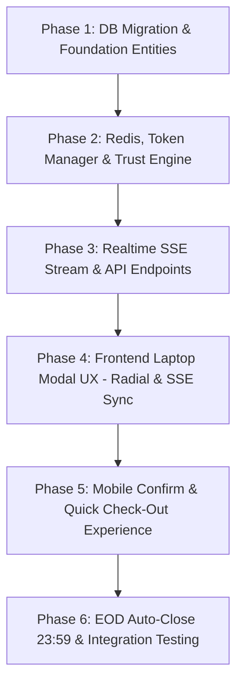

# Kế Hoạch Triển Khai Kỹ Thuật (Implementation Plan)
## Nâng Cấp Hệ Thống Chấm Công Chuyên Cần v2.0 (Dynamic QR, Device Binding, SSE Real-time & Adaptive Check-out)

> **Căn cứ tài liệu kiến trúc:** [ADR 0003](file:///c:/Users/Luong%20Anh%20Huy/InternHub-Workspace/InternHub/docs/adr/0003-dynamic-kiosk-qr-and-device-audit.md)  
> **Căn cứ tài liệu đặc tả:** [TM-25 Specification v2.0](file:///c:/Users/Luong%20Anh%20Huy/InternHub-Workspace/InternHub/docs/specs/TM-25-check-in-check-out-spec.md)  
> **Trạng thái:** DRAFT FOR REVIEW (CẤM CODE KHI CHƯA PHÊ DUYỆT)  
> **Ngày lập:** 2026-10-12  

---

## 1. Mục Tiêu & Giới Hạn Kiến Trúc (Architecture Boundaries)
1. **Bảo tồn 100%:** Luồng Personal Dynamic QR trên Dashboard của từng TTS được giữ nguyên vẹn.
2. **Loại bỏ lỗ hổng:** Khóa vĩnh viễn direct bypass API `POST /api/v1/attendances/check-in` và ẩn nút bypass PC trên UI Production.
3. **Multi-Factor Trust Engine:** Kết hợp Device Fingerprint + Dynamic Subnet IP (`organization_settings`) + Optional GPS (bù trừ sai số trong nhà).
4. **Trải nghiệm 12 điểm doanh nghiệp:** SSE Realtime Sync (Phone -> Laptop), Check-out nhanh 1-chạm di động, vòng đếm ngược Radial Progress SVG, và EOD Job 23:59.

---

## 2. Lộ Trình Triển Khai Phân Tầng (Vertical & Sequential Phases)

---

## 3. Chi Tiết Các Phase & Nhiệm Vụ Cụ Thể

### Phase 1: Cơ Sở Dữ Liệu & Entity Foundation (DB & Entities)
- **Task 1.1: Flyway Migration Schema (`V20261012_01__attendance_v2.sql`)**
  - Thêm 4 cột vào bảng `attendances`: `review_status VARCHAR(32) DEFAULT 'AUTO_APPROVED'`, `reviewed_by VARCHAR(64)`, `reviewed_at DATETIME`, `review_note TEXT`.
  - Tạo bảng mới `attendance_audit_logs` (lưu vết bất biến: `device_fingerprint`, `client_ip`, `trust_level`, `audit_flags`, `accuracy_meters`...).
  - Tạo bảng mới `intern_devices` (lưu vết thiết bị và vòng đời nâng hạng `PRIMARY_TRUSTED`).
  - Đánh index cho `review_status` và `device_fingerprint`.
- **Task 1.2: JPA Entity & Enums Mapping trong `intern-and-program-service`**
  - Cập nhật `Attendance.java`: Bổ sung fields review.
  - Tạo `AttendanceAuditLog.java` & `AttendanceAuditLogRepository.java`.
  - Tạo `InternDevice.java` & `InternDeviceRepository.java`.
  - Tạo các Enums: `AttendanceReviewStatus`, `TrustLevel`, `DeviceTrustStatus`.

---

### Phase 2: Core Backend - Trust Engine, Redis & Network Subnet
- **Task 2.1: Quản lý IP Subnet Động per-company**
  - Bổ sung helper đọc dải CIDR/IP văn phòng từ bảng `organization_settings` (hoặc caching Redis per-company).
  - Viết tiện ích `IpSubnetMatcher.java` kiểm tra `clientIp` có nằm trong dải IP văn phòng hợp lệ hay không.
- **Task 2.2: Nâng cấp `CheckInQrTokenManager` với Redis**
  - Di chuyển toàn bộ lưu trữ phiên QR từ `ConcurrentHashMap` sang Redis Broker.
  - Cấu hình TTL 60 giây + Grace skew period 15 giây.
  - Triển khai One-time Nonce: Đánh dấu tiêu thụ token chống Replay Attack.
- **Task 2.3: Phát triển `TrustLevelEvaluator` (Multi-factor Engine)**
  - Nhận đầu vào: Device Fingerprint, Client IP, GPS (lat, lng, accuracy), OfficeLocation, Primary Device status.
  - Triển khai đúng ma trận AND:
    - `HIGH`: Đúng máy + IP công ty + GPS $\le 50\text{m}$.
    - `MEDIUM`: Đúng máy + IP công ty (ko GPS) HOẶC Đúng máy + GPS $\le 50\text{m}$ (4G ngoài IP) HOẶC Máy lạ nhưng có mặt tại công ty (khớp IP hoặc GPS $\le 50\text{m}$) $\rightarrow$ Gán cờ `NEW_DEVICE`, cấp `AUTO_APPROVED`.
    - `LOW`: (Máy lạ) AND (Cả IP lẫn GPS đều ngoài công ty) $\rightarrow$ Gán cờ `SUSPICIOUS_FRAUD_RISK`, chuyển trạng thái `PENDING_REVIEW`.
  - Bù sai số phần cứng: `distance - accuracy <= allowedRadius`.

---

### Phase 3: API Gateway, Realtime SSE Stream & Controller Endpoints
- **Task 3.1: Xây dựng SSE Stream Endpoint (`GET /api/v1/attendances/check-in/stream`)**
  - Tạo `SseEmitterRegistry` quản lý các emitter kết nối theo `qrToken`.
  - Khi điện thoại submit confirm thành công: Backend tìm emitter tương ứng và bắn ngay event `CHECK_IN_SUCCESS`.
- **Task 3.2: Nâng cấp Endpoint Confirm & Quick Check-out**
  - Nâng cấp `POST /api/v1/attendances/check-in/confirm` nhận DTO mới (`deviceFingerprint`, `latitude`, `longitude`, `accuracyMeters`).
  - Viết endpoint mới `POST /api/v1/attendances/check-out/quick` cho phép Mobile 1-chạm nếu thỏa mãn High/Medium Trust.
  - Xóa bỏ triệt để method legacy `POST /api/v1/attendances/check-in` direct bypass.
- **Task 3.3: Định tuyến API Gateway**
  - Cấu hình hỗ trợ SSE streaming qua Spring Cloud Gateway (tắt buffer timeout, hỗ trợ `text/event-stream`).

---

### Phase 4: Frontend - Trải Nghiệm Modal Trên Laptop (Laptop UX)
- **Task 4.1: Nâng cấp `AttendanceActionModal.tsx` với Radial Progress & Silent Prefetch**
  - Thêm đồng hồ đếm ngược SVG Radial 60s đẹp mắt, đổi màu từ xanh $\rightarrow$ vàng $\rightarrow$ đỏ khi gần hết giờ.
  - Khi còn 5s cuối: Tự động âm thầm gọi API xin Token mới và cross-fade QR mượt mà.
  - Auto-pause sau 3 phút nếu người dùng bỏ đi.
- **Task 4.2: Tích hợp SSE Client Lắng Nghe Real-time**
  - Mở `EventSource` tới endpoint `/check-in/stream?qrToken=...`.
  - Ngay khi nhận `CHECK_IN_SUCCESS`: Modal nổ hiệu ứng xanh lá ăn mừng, tự tắt sau 3 giây và tự refresh card Dashboard sang trạng thái *"Đã vào ca"*.
- **Task 4.3: Bảo Mật Giao Diện Laptop**
  - Ẩn hoàn toàn nút "Mở link xác nhận" và "Sao chép link" trên Production build.
  - Thêm micro-guide hoạt họa hướng dẫn quét mã bằng Camera/Zalo/Google Lens.

---

### Phase 5: Frontend - Trải Nghiệm Mobile & Quick Check-Out
- **Task 5.1: Nâng cấp `InternAttendanceConfirmPage.tsx`**
  - Thu thập `DeviceFingerprint` qua thư viện FingerprintJS (hoặc Canvas băm chuẩn).
  - Pre-permission banner giải thích trước khi kích hoạt dialog GPS của trình duyệt.
  - Fallback Wi-Fi nếu người dùng từ chối GPS.
  - Hiển thị Thẻ Trạng Thái Minh Bạch: Thẻ vàng trấn an khi rơi vào `PENDING_REVIEW` (giải thích ngày công vẫn giữ nguyên, chờ HR đối soát).
- **Task 5.2: Tính năng "Tan Ca Nhanh 1-Chạm" Trên Mobile Web**
  - Thêm nút Quick Check-out trên giao diện di động của TTS khi hết giờ làm việc.
  - Gọi `POST /check-out/quick`. Nếu ở xa công ty, hiện hướng dẫn quét QR trên laptop.
- **Task 5.3: Badge Review Tối Thiểu Trên Lịch Sử Chấm Công**
  - Hiển thị badge nhỏ: `Chờ duyệt` (vàng) hoặc `Đã duyệt` (xanh) trên bảng chấm công của TTS.

---

### Phase 6: Nghiệp Vụ Vận Hành EOD & Kiểm Thử Toàn Diện
- **Task 6.1: Spring Scheduled Task 23:59 EOD Auto-Close**
  - Tạo `@Scheduled(cron = "0 59 23 * * ?")` quét các ca điểm danh thiếu `check_out_time`.
  - Cập nhật trạng thái thành `FORGOTTEN_CHECKOUT`.
- **Task 6.2: Unit Test Suite & Mock Verification**
  - Viết Unit Test cho `TrustLevelEvaluatorTest`: Kiểm tra đủ 5 nhánh tín hiệu trong ma trận.
  - Viết Integration Test cho luồng SSE E2E.
- **Task 6.3: E2E Smoke Test Trong Môi Trường Thật**
  - Kiểm thử quét mã bằng điện thoại thật qua mạng LAN/Wi-Fi văn phòng.
  - Kiểm thử phản hồi tức thì về màn hình Laptop qua SSE stream.
